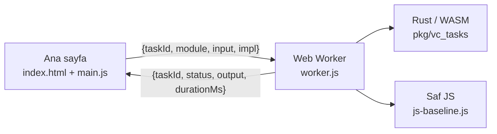

# wasm-worker-proto

Tarayıcıda **Web Worker içinde Rust'tan derlenmiş WebAssembly (WASM) görevleri** çalıştıran, belirlenimci (deterministic) bir prototip. Bu, *x402 ile stablecoin mikro ödemeli, tarayıcı tabanlı gönüllü hesaplama platformu* dönem projesinin worker çekirdeğidir: koordinatörden gelecek görevlerin (görev adı + girdi) çalıştırılacağı ve sonucunun karşılaştırılabilir biçimde döneceği sayfa.

> **English summary.** A browser page that runs deterministic, integer-only Rust/WASM tasks inside a module Web Worker, behind a stable message protocol (`{taskId, module, input}` → `{taskId, status, output, durationMs}`). Includes a pure-JavaScript baseline, fixed cross-checked test vectors, Node and headless-browser tests, and a WASM-vs-JS benchmark. Part of a term project on browser-based volunteer computing with adaptive result verification.

## İçindekiler

- [Özellikler](#özellikler)
- [Mimari](#mimari)
- [Hızlı başlangıç](#hızlı-başlangıç)
- [Görev arayüzü ve mesaj protokolü](#görev-arayüzü-ve-mesaj-protokolü)
- [Görevler](#görevler)
- [Belirlenimcilik ve test vektörleri](#belirlenimcilik-ve-test-vektörleri)
- [Testler](#testler)
- [Performans ölçümü](#performans-ölçümü)
- [Tarayıcı desteği](#tarayıcı-desteği)
- [Sorun giderme](#sorun-giderme)
- [Proje yapısı](#proje-yapısı)
- [Sınırlılıklar ve yol haritası](#sınırlılıklar-ve-yol-haritası)

## Özellikler

- **İki belirlenimci görev:** SHA-256 hash zinciri ve sarmalı (wrapping) aritmetikle tamsayı matris çarpımı. Kayan nokta (float) kullanılmaz.
- **Ortak görev arayüzü:** her görev `run(input_json: &str) -> String` imzasını taşır; çıktı kanonik JSON'dur (anahtarlar sıralı, boşluksuz), böylece sonuçlar bayt düzeyinde karşılaştırılabilir.
- **Web Worker izolasyonu:** hesaplama ana iş parçacığını bloke etmez. Sayfadaki kare sayacı ve döner simge bunu görünür kılar.
- **Hata dayanıklılığı:** geçersiz girdi, bilinmeyen modül, WASM yükleme hatası, panic ve zaman aşımı raporlanır. Panic sonrası worker otomatik yeniden başlatılır.
- **Üç bağımsız uygulama çapraz doğrulaması:** Rust/WASM, saf JavaScript ve Python (`hashlib`) aynı test vektörlerini üretir.
- **Dahili WASM–JS karşılaştırması** ve Node/Playwright testleri.

## Mimari



- `target: web` ile derlenir; worker, ES modülü olarak (`new Worker(url, {type: "module"})`) çalışır ve WASM'i ilk görevde tembel (lazy) yükler. Böylece yükleme hatası, worker'ı öldürmek yerine o görevin hatası olarak döner.
- `impl` alanı yalnızca karşılaştırma içindir (`"wasm"` varsayılan, `"js"` saf JavaScript sürümü).

## Hızlı başlangıç

**Gereksinimler:** Rust (rustup), `wasm32-unknown-unknown` hedefi, [`wasm-pack`](https://rustwasm.github.io/wasm-pack/), Node.js (testler için; Node 22 ile denendi) ve Python 3 (yerel sunucu için).

```bash
rustup target add wasm32-unknown-unknown
cargo install wasm-pack --locked

git clone https://github.com/H-ERDEM/wasm-worker-proto.git
cd wasm-worker-proto

npm run build      # wasm-pack build --release --target web --out-dir pkg
npm run serve      # python3 -m http.server 8080
```

Ardından tarayıcıda **<http://localhost:8080>** adresini açın. WASM `file://` ile çalışmaz, mutlaka bir HTTP sunucusu kullanın (`npx serve .` de olur).

Sayfada: görev seçin, JSON girdiyi düzenleyin, **Çalıştır**'a basın. **Test vektörlerini doğrula** düğmesi tüm sabit vektörleri WASM ve JS ile çalıştırıp beklenenle karşılaştırır. **WASM vs JS ölçümü** süre karşılaştırması yapar.

> `pkg/` klasörü derleme çıktısıdır ve depoya dahil değildir; önce `npm run build` çalıştırılmalıdır.

## Görev arayüzü ve mesaj protokolü

**Ana sayfa → worker**

| Alan | Tür | Açıklama |
|---|---|---|
| `taskId` | sayı | İstek–yanıt eşleştirme anahtarı |
| `module` | metin | `"sha_chain"`, `"matmul"` (ve test için `"debug_panic"`) |
| `input` | metin | Görevin JSON girdisi |
| `impl` | metin, isteğe bağlı | `"wasm"` (varsayılan) veya `"js"` |

**Worker → ana sayfa**

| Alan | Tür | Açıklama |
|---|---|---|
| `taskId` | sayı | İsteğin `taskId` değeri |
| `status` | `"ok"` \| `"error"` | Sonuç durumu |
| `output` | metin | `ok` ise kanonik çıktı JSON'u, `error` ise hata iletisi |
| `durationMs` | sayı | Yalnızca hesaplama süresi (WASM yükleme hariç) |
| `impl` | metin | Kullanılan uygulama |
| `loadMs` | sayı, isteğe bağlı | WASM yükleme süresi (yalnızca ilk WASM görevinde) |
| `fatal` | bool, isteğe bağlı | `WebAssembly.RuntimeError` (panic) ise `true`; sayfa worker'ı yeniden başlatır |

Rust tarafı `run_task(module, input_json)` olarak dışa aktarılır ve her görev modülü `run(&str) -> String` ile `try_run(&str) -> Result<String, String>` sunar.

## Görevler

### `sha_chain`

- **Girdi:** `{"seed": "<metin>", "iterations": 1..=100000000}`
- **Tanım:** `h0 = SHA-256(UTF-8(seed))`, `h_i = SHA-256(h_{i-1})`; `iterations = 1` ise çıktı `SHA-256(seed)`'dir.
- **Çıktı:** `{"hash":"<hex>","iterations":<n>}`

### `matmul`

- **Girdi:** `{"seed": <u32>, "n": 1..=512}`
- **Tanım:** A ve B (n×n, `u32`), `mulberry32` PRNG ile satır sırasıyla (önce A, sonra B) üretilir; `C = A·B mod 2^32`. Çıktı, C'nin satır sıralı, little-endian `u32` baytlarının SHA-256 özetidir.
- **Çıktı:** `{"hash":"<hex>","n":<n>,"seed":<seed>}`

## Belirlenimcilik ve test vektörleri

Görevler yalnızca tamsayı ve bayt işlemleri kullanır. WebAssembly'de kayan nokta işlemlerinin NaN bit deseni belirsiz olabildiği için ([spesifikasyon notu](https://www.webassembly.org/docs/nondeterminism/)) kayan nokta bilinçli olarak dışarıda bırakılmıştır.

Sabit vektörler `vectors.js` içindedir; beklenen değerler Rust'tan bağımsız olan `scripts/ref_vectors.py` (Python `hashlib`) ile üretilmiştir. Örnekler:

| Görev | Girdi | `hash` |
|---|---|---|
| `sha_chain` | `{"seed":"hello","iterations":1}` | `2cf24dba5fb0a30e26e83b2ac5b9e29e1b161e5c1fa7425e73043362938b9824` |
| `sha_chain` | `{"seed":"hello","iterations":1000}` | `f6eec10c841b542f37ffb4ca00f82c5b6b4b11b79636d20201078b667ac37159` |
| `matmul` | `{"seed":42,"n":64}` | `21bfb70784701c76d11da1401dec6eb95c570e074e7a831c5ac69a56514433cb` |

Sekiz vektörün tamamı Chrome 155 (macOS), Firefox 158 (macOS) ve Chrome 155 (Android) üzerinde WASM ve saf JS ile aynı çıktıyı üretmiştir.

## Testler

```bash
npm run test:rust      # cargo test
npm run test:vectors   # Node'da WASM ve JS çıktıları, vektörlere karşı
npm run test:e2e       # Playwright ile başsız Chromium: vektörler, UI donmaması, panic ve toparlanma, benchmark
npm test               # hepsi (build dahil)
```

- `test:e2e` bir Chromium gerektirir: `npx playwright install chromium` ya da `CHROMIUM_PATH=/yol/chrome npm run test:e2e`.
- Uçtan uca test, uzun bir görev sürerken ana iş parçacığının yanıt verdiğini (en uzun kare aralığı < 250 ms) ve panic sonrası worker'ın toparlandığını doğrular.

## Performans ölçümü

Sayfadaki **WASM vs JS ölçümü** her görevi WASM ve saf JS ile 5 kez çalıştırır (ilk koşu ısınma olarak atılır) ve medyanı raporlar. Ölçülen görevler: `sha_chain` (200.000 iterasyon) ve `matmul` (n=384).

Aynı SHA-256 zinciri üzerinde (200.000 iterasyon) JS/WASM süre oranı, test edilen cihazlarda:

| Ortam | JS/WASM |
|---|---|
| Chrome 155, macOS (Intel) | ≈ 4,7× |
| Firefox 158, macOS (Intel) | ≈ 6,0× |
| Chrome 155, Android | ≈ 7,5× |

**Yorumlarken dikkat:**

- Bu bir *iki uygulama arasındaki* karşılaştırmadır. JS tarafı elle yazılmış, özel optimizasyon yapılmamış bir SHA-256'dır; sonuçlar WASM'in genel hızını temsil etmez. Genel WASM–native karşılaştırması için bkz. Jangda vd., *Not So Fast* (USENIX ATC 2019).
- Oran iş yüküne ve boyuta bağlıdır. Matris çarpımında oran büyüklükle düşer: Node (V8) üzerinde yapılan bir denemede n=128'de ≈ 2,2×, n=384'te ≈ 1,3× ölçülmüştür.
- Tarayıcılar `performance.now()` çözünürlüğünü kasıtlı olarak yuvarlar (özellikle Firefox). **Birkaç milisaniyelik süreler güvenilir ölçülemez**, bu yüzden benchmark yeterince uzun işler kullanır. Kendi cihazınızda yeniden ölçün.
- Ölçümler tek makinede, tek oturumda yapılmıştır; istatistiksel bir değerlendirme değildir.

## Tarayıcı desteği

| Tarayıcı | Durum |
|---|---|
| Chrome 155 (macOS), Chrome 155 (Android) | Test edildi |
| Firefox 158 (macOS) | Test edildi |
| Safari / iOS | Test edilmedi |

Module worker desteği gerekir; güncel Chrome, Firefox ve Safari sürümleri destekler. Eski tarayıcılar için `wasm-pack build --target no-modules` ve klasik worker (`importScripts`) kullanılabilir, ancak bu depoda uygulanmamıştır.

## Sorun giderme

| Belirti | Neden ve çözüm |
|---|---|
| Sayfa açılıyor ama görevler çalışmıyor; konsolda CORS veya `file://` hatası | Sayfa `file://` ile açılmış. `npm run serve` ile `http://localhost:8080` kullanın. |
| `404` ile `pkg/vc_tasks.js` bulunamıyor | `npm run build` çalıştırılmamış. |
| "Incorrect response MIME type" ya da streaming compile uyarısı | Sunucu `.wasm` için `application/wasm` göndermiyor. Python `http.server` ve `npx serve` doğru gönderir. |
| `Failed to construct 'Worker'` / "Cannot use import statement outside a module" | Tarayıcı module worker desteklemiyor; tarayıcıyı güncelleyin. |
| Görev `unreachable` ile bitiyor | Rust panic (`panic = "abort"`). Konsolda panic iletisi görünür; sayfa worker'ı yeniden başlatır. `debug_panic` görevi bu yolu test eder. |
| `wasm-pack build` ağ hatası veriyor | `wasm-opt` (binaryen) indirmesi `Cargo.toml`'da kapalıdır. Yine de hata alıyorsanız ağ ve proxy ayarlarını kontrol edin. |
| LAN'daki telefondan açılmıyor | Telefon ve bilgisayar aynı ağda olmalı; `http://<bilgisayar-IP>:8080` kullanın (`https` değil), VPN'i ve güvenlik duvarını kontrol edin. |

## Proje yapısı

```
wasm-worker-proto/
├── Cargo.toml, Cargo.lock
├── package.json
├── src/
│   ├── lib.rs            # wasm dışa aktarımları: run_task, list_modules
│   ├── sha_chain.rs      # Görev 1
│   └── matmul.rs         # Görev 2
├── index.html, main.js   # arayüz, WorkerClient, vektör ve benchmark düğmeleri
├── worker.js             # module worker, mesaj protokolü
├── js-baseline.js        # saf JS sürümleri (karşılaştırma ve çapraz kontrol)
├── vectors.js            # sabit test vektörleri
├── scripts/ref_vectors.py  # bağımsız Python referansı
└── test/
    ├── node-vectors.mjs  # Node'da WASM ve JS vs vektörler
    └── e2e.mjs           # Playwright ile gerçek tarayıcı testi
```

## Sınırlılıklar ve yol haritası

- Prototip tek sayfa/tek worker içindir; koordinatör, WebSocket bağlantısı, DAG ve çoklu worker henüz yoktur.
- Modüller şimdilik tek WASM paketine gömülüdür. Hedef: koordinatörün `.wasm` modüllerini hash'leriyle birlikte sunması ve worker'ın bunları doğrulayıp yüklemesi.
- Çıktı kanonik JSON olduğundan koordinatör, replikasyon karşılaştırmasını dizgi eşitliğiyle yapabilir; uzun çıktılar için yalnızca özetin gönderilmesi planlanır.
- `fatal` bayrağı, panic ve zaman aşımı koordinatör tarafında "görev başarısız, başka worker'a ata" ve itibar güncellemesine bağlanacaktır.
- `durationMs` ve `loadMs` değerleri, simülatörün worker hız dağılımını kalibre etmek için kullanılacaktır.
- Güvenlik: görev girdileri worker'a açıktır (gizlilik/şifreli hesaplama kapsam dışıdır) ve ödeme yalnızca test ağında (Devnet) tasarlanmıştır.

## Lisans

Henüz bir lisans belirtilmemiştir (dönem projesi). Paylaşım ve yeniden kullanım koşulları için depo sahibine danışın.
