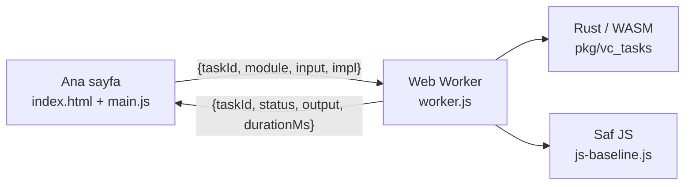
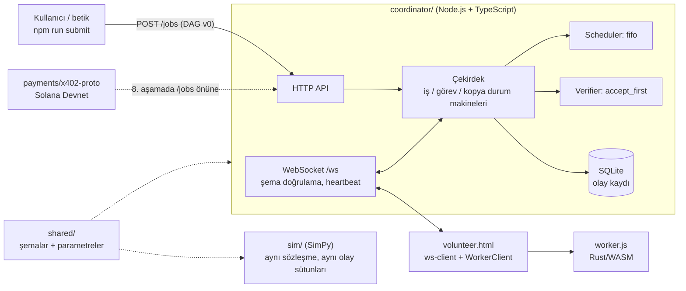

# wasm-worker-proto

Tarayıcıda **Web Worker içinde Rust'tan derlenmiş WebAssembly (WASM) görevleri** çalıştıran, belirlenimci (deterministic) bir prototip. Bu, *x402 ile stablecoin mikro ödemeli, tarayıcı tabanlı gönüllü hesaplama platformu* dönem projesinin deposudur. 5. haftada worker çekirdeği olarak başladı; 6–7. haftalarda **koordinatör**, **gönüllü sayfası**, **SimPy simülatörü** ve **x402 prototipi** eklendi. Proje aşama aşama büyür: [`docs/ROADMAP.md`](docs/ROADMAP.md).

> **English summary.** A browser page that runs deterministic, integer-only Rust/WASM tasks inside a module Web Worker, behind a stable message protocol (`{taskId, module, input}` → `{taskId, status, output, durationMs}`). Includes a pure-JavaScript baseline, fixed cross-checked test vectors, Node and headless-browser tests, and a WASM-vs-JS benchmark. Part of a term project on browser-based volunteer computing with adaptive result verification.

## İçindekiler

- [Özellikler](#özellikler)
- [Mimari](#mimari)
- [Hızlı başlangıç](#hızlı-başlangıç)
- [Platform (Hafta 6–7)](#platform-hafta-67)
- [Görev arayüzü ve mesaj protokolü](#görev-arayüzü-ve-mesaj-protokolü)
- [Görevler](#görevler)
- [Belirlenimcilik ve test vektörleri](#belirlenimcilik-ve-test-vektörleri)
- [Testler](#testler)
- [Performans ölçümü](#performans-ölçümü)
- [Tarayıcı desteği](#tarayıcı-desteği)
- [Sorun giderme](#sorun-giderme)
- [Proje yapısı](#proje-yapısı)
- [Sınırlılıklar ve yol haritası](#sınırlılıklar-ve-yol-haritası)

## Özellikler

- **İki belirlenimci görev:** SHA-256 hash zinciri ve sarmalı (wrapping) aritmetikle tamsayı matris çarpımı. Kayan nokta (float) kullanılmaz.
- **Ortak görev arayüzü:** her görev `run(input_json: &str) -> String` imzasını taşır; çıktı kanonik JSON'dur (anahtarlar sıralı, boşluksuz), böylece sonuçlar bayt düzeyinde karşılaştırılabilir.
- **Web Worker izolasyonu:** hesaplama ana iş parçacığını bloke etmez. Sayfadaki kare sayacı ve döner simge bunu görünür kılar.
- **Hata dayanıklılığı:** geçersiz girdi, bilinmeyen modül, WASM yükleme hatası, panic ve zaman aşımı raporlanır. Panic sonrası worker otomatik yeniden başlatılır.
- **Üç bağımsız uygulama çapraz doğrulaması:** Rust/WASM, saf JavaScript ve Python (`hashlib`) aynı test vektörlerini üretir.
- **Dahili WASM–JS karşılaştırması** ve Node/Playwright testleri.

## Mimari



- `target: web` ile derlenir; worker, ES modülü olarak (`new Worker(url, {type: "module"})`) çalışır ve WASM'i ilk görevde tembel (lazy) yükler. Böylece yükleme hatası, worker'ı öldürmek yerine o görevin hatası olarak döner.
- `impl` alanı yalnızca karşılaştırma içindir (`"wasm"` varsayılan, `"js"` saf JavaScript sürümü).

## Hızlı başlangıç

**Gereksinimler:** Rust (rustup), `wasm32-unknown-unknown` hedefi, [`wasm-pack`](https://rustwasm.github.io/wasm-pack/), Node.js (testler için; Node 22 ile denendi) ve Python 3 (yerel sunucu için).

```bash
rustup target add wasm32-unknown-unknown
cargo install wasm-pack --locked

git clone https://github.com/H-ERDEM/wasm-worker-proto.git
cd wasm-worker-proto

npm run build      # wasm-pack build --release --target web --out-dir pkg
npm run serve      # python3 -m http.server 8080
```

Ardından tarayıcıda **<http://localhost:8080>** adresini açın. WASM `file://` ile çalışmaz, mutlaka bir HTTP sunucusu kullanın (`npx serve .` de olur).

Sayfada: görev seçin, JSON girdiyi düzenleyin, **Çalıştır**'a basın. **Test vektörlerini doğrula** düğmesi tüm sabit vektörleri WASM ve JS ile çalıştırıp beklenenle karşılaştırır. **WASM vs JS ölçümü** süre karşılaştırması yapar.

> `pkg/` klasörü derleme çıktısıdır ve depoya dahil değildir; önce `npm run build` çalıştırılmalıdır.

## Platform (Hafta 6–7)



### Çalıştırma

**Gereksinim:** Node.js 22.18+, Python 3.11+ (simülatör için), Rust + `wasm-pack` (WASM derlemesi için).

```bash
npm install
pip install -r sim/requirements.txt
npm run build                 # pkg/ (WASM)

npm run coordinator           # http://127.0.0.1:8787  → / gönüllü sayfasını açar
npm run submit -- shared/examples/three-task-dag.json --wait
```

Tarayıcıda `http://127.0.0.1:8787` adresini açın, **Katılıyorum, başlat** düğmesine basın ve iş gönderin. Aynı ağdaki bir telefon için koordinatörü `HOST=0.0.0.0 npm run coordinator` ile başlatıp `http://<bilgisayar-IP>:8787` adresini açın. Tarayıcı olmadan denemek için `node coordinator/test/run-fake-worker.ts` komutu Node'da bir sahte worker bağlar.

**Telefonla uçtan uca deneme (23 Kasım 2026).** Android 10 / Chrome 158 telefon, aynı Wi-Fi'daki MacBook Air'de `HOST=0.0.0.0` ile çalışan koordinatöre `http://<IP>:8787` üzerinden tek worker olarak bağlandı (WASM, `moduleHash` denetimi açık). `single-task.json` ve 7 görevli `image-pipeline.json` (iki `image_blur`, bir `matmul`, üç `sha_chain`, bir birleşme) COMPLETED oldu; yedi çıktının yedisi de bağımsız hesaplamayla eşleşti. Telefon düz HTTP sayfasında olduğundan `crypto.subtle` yoktur; worker paket özetini saf JS SHA-256 ile hesaplar.

### HTTP API

| Yöntem | Yol | Açıklama |
|---|---|---|
| `POST` | `/quote` | DAG v0 için fiyat teklifi (üst sınır); iş oluşturmaz, ödeme istemez |
| `GET` | `/panel`, `/examples`, `/events`, `/demo/info` | Demo paneli ve beslediği uç noktalar (örnek DAG'ler, olay kaydı) |
| `POST` | `/demo/buy` | Panel alıcısı: x402 ile öder ve iş gönderir; yalnızca aynı makineden |
| `POST` | `/jobs` | DAG v0 gönderir → `201 {jobId}`; geçersiz DAG ya da bilinmeyen strateji → `400`; ödeme açıksa ödemesiz istek `402`. İsteğe bağlı `?scheduler=fifo\|fastest\|reputation&verifier=fixed2\|fixed3\|adaptive\|accept_first` (varsayılan `shared/config`) |
| `GET` | `/jobs/:id` | İş durumu, stratejiler, görev durumları, kabul edilen çıktılar, sınama işi sayısı |
| `GET` | `/workers` | Bağlı worker'lar: hız, α, β, itibar R, güvenilir mi, `flagged` (sınamada en az bir kez yakalanmış; yalnızca izleme, kara liste yok) |
| `GET` | `/modules` | WASM paket özeti ve modül listesi |
| `GET` | `/health` | Sağlık kontrolü |
| `GET` | `/`, `/*.html`, `/*.js`, `/pkg/*` | Gönüllü sayfası ve WASM; kaynak kod ve dizin gezintisi kapalı |

DAG v0 biçimi `shared/schemas/dag.v0.schema.json` dosyasında; örnekler `shared/examples/` altında. Bir görevin girdisi, bağımlı olduğu görevin kabul edilmiş çıktısına `{"$ref": "t1.output.hash"}` ile başvurabilir.

### WebSocket protokolü (`/ws`)

Görev mesajı, aşağıdaki "Görev arayüzü ve mesaj protokolü" bölümündeki Web Worker protokolünün bir zarf içine konmuş hâlidir.

| Yön | Mesaj |
|---|---|
| W → K | `hello {consent: true, workerId?, userAgent?, deviceClass?, impls?}` |
| K → W | `welcome {workerId, heartbeatMs, modules}` |
| K → W | `assign {replicaId, module, input, deadlineMs, moduleHash?}`; sınama işi de aynı biçimdedir |
| W → K | `result {replicaId, status, output, durationMs, impl?, loadMs?, fatal?}` |
| W → K | `status {available}`: CPU sınırı ya da şarj koşulu nedeniyle ara verme |
| K ↔ W | `ping` / `pong {t}` |
| W → K | `bye {reason?}` |

Şemaya uymayan her mesaj bağlantıyı `1008` koduyla kapatır ve kayda geçer. `missedHeartbeats × heartbeatMs` süre ses gelmezse kopya `LOST` olur, süre sınırı aşılırsa `TIMED_OUT` olur; iki durumda da yerine yeni bir kopya açılır.

### Doğrulama, itibar ve ödeme (9. hafta)

Koordinatör simülatörle aynı stratejileri uygular (`coordinator/src/strategies.ts`, `reputation.ts`); iki taraf `shared/test/strategy-scenarios.json` ve `shared/test/reputation-vectors.json` ortak senaryolarını geçer.

- **İtibar:** Beta modeli; replikasyonla doğrulanan her kopya ve her sınama işi `rep_events` tablosuna yazılır, α ve β `workers` tablosunda saklanır.
- **Sınama işi:** Doğrulayıcı `adaptive` ise her atamada `spotCheckRate` olasılıkla worker'a gerçek görev yerine aynı modülden, aynı boyutta, rastgele tohumlu bir görev gider. Beklenen çıktıyı koordinatör Node'da aynı WASM ile (derlenmemişse saf JS ile) hesaplar (`oracle.ts`). Sınama işi `replicas` tablosunda `is_spotcheck = 1`, `task_id = spot/…` olarak kaydedilir; `tasks` tablosuna girmez.
- **Geriye dönük iptal:** Sınamada yakalanan worker'ın bitmemiş işlerdeki tek kopyalı kabulleri ve onlara bağlı alt görevler yeniden kuyruğa alınır (`log` tablosunda `retroactive_cancel`).
- **Ödeme:** İş bitince (COMPLETED ya da FAILED) kabul edilen görevlerin eşleşen kopyaları ve geçilen sınama işleri `paid = 1` olur. Zincir üstü transfer 10. haftada.

### Ödemeli koordinatör: x402 ile iş satın alma (9. hafta)

`PAYMENTS=1` ile `POST /jobs` bir x402 ödemesinin arkasına alınır (`coordinator/src/api/payments.ts`). Alıcı işi gönderirken **üst sınırı** öder (`exact`, Devnet USDC); iş bitince gerçekleşen maliyet hesaplanır ve fark `jobs.refund_due`'ya yazılır (zincir üstü iade 10. haftada).

- Üst sınır = p × N × maxReplicas / (1 − q) (uyarlanabilir), p × N × maxReplicas (sınama işsiz stratejiler); p = `unitPrice` (0,001 USDC), N görev sayısı, maxReplicas = 10, q = 0,10. Örnek: 7 görevli `image-pipeline.json`, `adaptive` → 0,077778 USDC.
- DAG ve stratejiler ödemeden **önce** doğrulanır (geçersiz istek 400, ödeme istenmez). Ödeme zincirde **kesinleştikten sonra** iş kuyruğa girer; kesinleşmezse iş oluşturulmaz.
- Ödeme imzası tutara bağlıdır: küçük bir iş için imzalanan ödemeyle büyük bir iş gönderilemez. Aynı ödemenin tekrarı reddedilir.
- Emanet defteri `jobs` tablosunda: `quote_cap`, `payment_tx`, `payer`, `paid_at`, `realized_cost`, `refund_due` (atomik USDC; `GET /jobs/:id` → `payment`).

Devnet'te çalıştırma (anahtarlar `payments/x402-proto/.env`; bkz. o klasörün README'si):

```bash
PAYMENTS=1 npm run coordinator                       # PLATFORM_ADDRESS .env'den okunur
npm run submit -- shared/examples/image-pipeline.json --verifier adaptive --quote      # yalnızca teklif
npm run submit -- shared/examples/image-pipeline.json --verifier adaptive --pay --max-usdc 0.1 --wait
```

`--pay` alıcı anahtarını (`BUYER_PRIVATE_KEY`) kullanır; `--replay` ödemeden sonra aynı ödeme başlığını bir kez daha gönderip reddedildiğini gösterir; istemci politikası yalnızca Devnet, yalnızca Devnet USDC ve en fazla `--max-usdc` (varsayılan 1) öder.

### Worker ödemeleri ve iade (10. hafta)

Ödenmiş bir iş **kesinleşince** (bitti ve ona yansıtılan sınama işlerinin hepsi sonuçlandı) koordinatör bir ödeme planı çıkarır ve `payouts` tablosuna yazar (`coordinator/src/payouts.ts`):

- her worker'a, kabul anında eşleşen kopyaları ve geçtiği sınama işleri kadar birim ücret (0,001 USDC);
- alıcıya üst sınır − gerçekleşen maliyet (iade). Kalemlerin toplamı ödenen üst sınıra eşittir.

Worker gönüllü sayfasındaki "Ödeme adresi" alanına (ya da `?wallet=`) bir Solana Devnet adresi girerse ödemesi oraya yapılır; adres yoksa kalem `no_wallet` olarak kalır. Ödemesiz işlerde plan çıkarılmaz.

`PAYOUTS=1` ile plan Devnet'e gönderilir: platform cüzdanından **tek işlemde** toplu USDC transferi (alıcının token hesabı yoksa açılır; `coordinator/src/solana-chain.ts`). İade işleminin imzası `jobs.refund_tx`'e, tüm ödemeler `GET /jobs/:id` → `payment.payouts`'a ve panelin emanet defterine yansır.

Çift ödemeye karşı: (iş, tür, alıcı) tekil; işlem imzası yayından **önce** kaydedilir ve yeniden başlatmada aynı imza sorgulanır; yalnızca zincire hiç girmediği kesinleşen (blok karması süresi dolmuş) ya da zincirde hata veren işlem yeniden imzalanır (en fazla 3 deneme).

```bash
HOST=0.0.0.0 PAYMENTS=1 PAYOUTS=1 npm run coordinator   # PLATFORM_PRIVATE_KEY .env'de
```

Platform adresinde işlem ücreti ve yeni token hesabı kirası için biraz **Devnet SOL** gerekir (https://faucet.solana.com). RPC varsayılanı `https://api.devnet.solana.com` (`RPC_URL` ile değişir).

### MCP sunucusu: platform dış ajanlara açık (10. hafta)

`coordinator/src/mcp/server.ts`, HTTP API'nin üstünde ince bir MCP adaptörüdür; koordinatöre yeni mantık eklemez.

| Araç | Ne yapar |
|---|---|
| `list_modules` | WASM modülleri, özetleri, örnek DAG'ler ve DAG biçimi |
| `get_quote` | DAG + strateji için üst sınır (USDC); iş oluşturmaz |
| `submit_workflow` | İşi gönderir; **ücretli** (x402) |
| `get_status` | Görev sayıları, süre, defter ve worker ödemeleri |
| `get_result` | İş bitince çıktılar ve doğrulama bilgisi; **MCP Tasks** (`taskSupport: optional`; görev isteği olmadan çağrılırsa bekler) |

Ödeme x402 v2'nin MCP taşımasıyla yapılır: ödemesiz `submit_workflow` çağrısı `isError: true` ve `structuredContent` = PaymentRequired döner; istemci aynı çağrıyı `params._meta["x402/payment"]` = PaymentPayload ile tekrarlar; başarıda kesinleşme bilgisi `_meta["x402/payment-response"]`'tadır. Adaptör ödeme yükünü `PAYMENT-SIGNATURE` başlığı olarak `POST /jobs`'a iletir; DAG doğrulaması, üst sınır + iade, tekrar koruması HTTP yoluyla aynıdır.

```bash
PAYMENTS=1 npm run coordinator                        # ayrı terminalde
npm run -s mcp                                        # stdio MCP sunucusu (COORDINATOR_URL, varsayılan :8787)
npm run mcp-agent -- shared/examples/image-pipeline.json --verifier adaptive --max-usdc 0.1   # uçtan uca örnek ajan (Devnet)
```

Claude masaüstü uygulaması (`claude_desktop_config.json`), yollar kendi bilgisayarınıza göre:

```json
{ "mcpServers": { "gonullu-hesaplama": {
    "command": "node",
    "args": ["--disable-warning=ExperimentalWarning", "/Users/<kullanıcı>/wasm-worker-proto/coordinator/src/mcp/stdio.ts"],
    "env": { "COORDINATOR_URL": "http://127.0.0.1:8787" } } } }
```

Claude masaüstü x402 ödemesini kendisi yapmaz: `get_quote`, `get_status`, `get_result` ve ödemesiz koordinatörde `submit_workflow` kullanılabilir; ödemeli akış `mcp-agent` (ve 11. haftadaki ajan) ile gösterilir.

### Gönüllü sayfası URL parametreleri

| Parametre | Açıklama |
|---|---|
| `coordinator=ws://…/ws` | Varsayılan: sayfanın sunulduğu adres |
| `cpu=low\|medium\|high` | Görevler arası 5 sn / 1 sn / 0 ara |
| `impl=js` | WASM yerine saf JS (karşılaştırma ve WASM'siz test için) |
| `autostart=1` | Onay ekranını atlar; **yalnızca araştırmacının kendi cihazlarında** deney için |
| `wallet=<adres>` | Ödeme adresi (Solana Devnet); onay ekranındaki alanla aynı |
| `fault=random\|collude&s=0.2` | Deney modu: `s` olasılıkla kasıtlı yanlış sonuç (biçim gerçek çıktıyla aynı) |

**On-off saldırgan (ara demo).** Worker kimliği tarayıcının `localStorage`'ında, itibarı koordinatörün veritabanında tutulur. Dürüst çalışıp tek kopya moduna geçmiş bir sekme aynı adreste `fault=random&s=1` ile yeniden açılırsa aynı kimlik ve itibarla hile yapmaya başlar: sonuçları tek kopyayla kabul edilir, ilk sınama işinde yakalanır ve bitmemiş işlerdeki tek kopyalı sonuçları geriye dönük iptal edilip yeniden hesaplanır (`test/volunteer-e2e.mjs`, "on-off saldırgan").

### Simülatör ve ortak analiz

```bash
cd sim
python -m vcsim.run --seed 1                                     # 20 DAG × 50 görev, 50 worker
python -m vcsim.run --seed 1 --set faults.f=0.2 --set workers.session_mean_s=60
python -m vcsim.analyze ../experiments/data/sim/default-s1 ../coordinator/coordinator.db
```

`vcsim.analyze`, simülatör çıktısı ile koordinatörün SQLite kaydını **aynı metrik koduyla** okur: makespan, iş başına maliyet, görev ve iş düzeyinde hatalı sonuç oranı, kayıp ve zaman aşımı sayıları. Koordinatör kaydındaki doğru sonuç Python referansıyla hesaplanır.

### Demo paneli (ara demo)

Terminal yerine tek ekranda canlı demo: koordinatör çalışırken **http://127.0.0.1:8787/panel** adresini açın.

- **Alıcı:** örnek DAG (`shared/examples/`, ara demo için `demo-40.json`, 40 görev) ve doğrulama stratejisi seçilir; "Teklif al" üst sınırı formülüyle gösterir, "Öde ve gönder" x402 ödemesini yapar ve adımları sırayla gösterir: 402 → imza → zincirde kesinleşme (Solana gezgini bağlantısıyla).
- **İş:** görev grafiği canlı; her görevin durumu ve kaç eşleşen kopyayla (ya da tek kopyayla) kabul edildiği. Altında kabul, tek kopya, eşleşen kopya ve sınama sayaçları; iş bitince emanet defteri (ödenen, gerçekleşen, iade edilecek).
- **Tarayıcılar:** bağlı her tarayıcı (Chrome · Mac, Chrome · Android …), o anki görevi ya da sınama işi, itibar çubuğu (τ çizgisiyle), "tek kopya" ve "yakalandı" rozetleri.
- **Olaylar:** koordinatörün kaydından (`GET /events`): bağlanma, ödeme, sınama, uyuşmazlık, tek kopya moduna geçiş, geriye dönük iptal, iş sonu.

Ödeme `PAYMENTS=1` ile açılır. Alıcı anahtarı (`BUYER_PRIVATE_KEY`) yalnızca koordinatörün çalıştığı makinedeki `.env`'de kalır; panel ödemeyi `POST /demo/buy` üzerinden ister ve bu uç nokta yalnızca aynı makineden gelen isteği kabul eder (`coordinator/src/api/demo-buyer.ts`). Telefonun bağlanabilmesi için `HOST=0.0.0.0` verilirse panelin üstünde gönüllü sayfasının yerel ağ adresi görünür.

```bash
HOST=0.0.0.0 PAYMENTS=1 npm run coordinator     # sonra tarayıcıda /panel
```

### Görsel simülasyon (ara demo)

`docs/demo/simulasyon.html` simülatörün bir koşusunu tarayıcıda adım adım oynatır; sunucu gerektirmez (dosyayı çift tıklayıp açmak yeter). Aynı tohumla iki doğrulama stratejisi yan yana oynar: sabit 2'li ve uyarlanabilir. Gösterilenler: 16 tarayıcının o anki görevi, itibarı R ve tek kopya modu; 10 DAG'in görev durumları; sınamada yakalanma, tek kopya moduna geçme ve iş tamamlanma olayları; maliyet, yanlış kabul edilen görev ve sınama sayaçları. "Gerçeği göster" hatalı tarayıcıları ve kabul edilmiş yanlış sonuçları işaretler (koordinatör bunları bilmez).

İki senaryo vardır: colluding ve rastgele hata, ikisinde de f = %20, s = 1. Veri dosyası `docs/demo/replay-data.js` şununla yeniden üretilir:

```bash
cd sim && python -m vcsim.replay              # tohum 3, fixed2 ve adaptive
python -m vcsim.replay --seed 5 --set faults.f=0.3
```

Oynatıcı (`docs/demo/replay-player.js`) olayları sırayla işler. Sayfanın son sayaçlarının o koşunun `summary.json` değerleriyle aynı çıktığı `sim/tests/test_replay.py`'de denetlenir. Sayfa tek bir koşuyu gösterir; stratejilerin istatistiksel karşılaştırması 30 tohumluk deneylerle yapılır (`docs/figures/hafta8/`).

### x402 prototipi

Bkz. [`payments/x402-proto/README.md`](payments/x402-proto/README.md): Solana Devnet üzerinde `402 → ödeme → 200` döngüsü, istemci harcama politikası ve Devnet'te elle çalıştırma adımları.

## Görev arayüzü ve mesaj protokolü

**Ana sayfa → worker**

| Alan | Tür | Açıklama |
|---|---|---|
| `taskId` | sayı | İstek–yanıt eşleştirme anahtarı |
| `module` | metin | `"sha_chain"`, `"matmul"`, `"image_blur"` (ve test için `"debug_panic"`) |
| `input` | metin | Görevin JSON girdisi |
| `impl` | metin, isteğe bağlı | `"wasm"` (varsayılan) veya `"js"` |

**Worker → ana sayfa**

| Alan | Tür | Açıklama |
|---|---|---|
| `taskId` | sayı | İsteğin `taskId` değeri |
| `status` | `"ok"` \| `"error"` | Sonuç durumu |
| `output` | metin | `ok` ise kanonik çıktı JSON'u, `error` ise hata iletisi |
| `durationMs` | sayı | Yalnızca hesaplama süresi (WASM yükleme hariç) |
| `impl` | metin | Kullanılan uygulama |
| `loadMs` | sayı, isteğe bağlı | WASM yükleme süresi (yalnızca ilk WASM görevinde) |
| `fatal` | bool, isteğe bağlı | `WebAssembly.RuntimeError` (panic) ise `true`; sayfa worker'ı yeniden başlatır |

Rust tarafı `run_task(module, input_json)` olarak dışa aktarılır ve her görev modülü `run(&str) -> String` ile `try_run(&str) -> Result<String, String>` sunar.

## Görevler

### `sha_chain`

- **Girdi:** `{"seed": "<metin>", "iterations": 1..=100000000}`
- **Tanım:** `h0 = SHA-256(UTF-8(seed))`, `h_i = SHA-256(h_{i-1})`; `iterations = 1` ise çıktı `SHA-256(seed)`'dir.
- **Çıktı:** `{"hash":"<hex>","iterations":<n>}`

### `matmul`

- **Girdi:** `{"seed": <u32>, "n": 1..=512}`
- **Tanım:** A ve B (n×n, `u32`), `mulberry32` PRNG ile satır sırasıyla (önce A, sonra B) üretilir; `C = A·B mod 2^32`. Çıktı, C'nin satır sıralı, little-endian `u32` baytlarının SHA-256 özetidir.
- **Çıktı:** `{"hash":"<hex>","n":<n>,"seed":<seed>}`

### `image_blur` (8. hafta)

- **Girdi:** `{"seed": <u32>, "w": 1..=1024, "h": 1..=1024, "passes": 1..=16}`
- **Tanım:** w×h gri tonlu `u8` görüntü `mulberry32` ile satır sırasıyla üretilir (her piksel bir sonraki çekilişin en üst baytı). 3×3 kutu bulanıklaştırma `passes` kez uygulanır: her çıktı pikseli 3×3 komşuluğun toplamının 9'a tamsayı bölümüdür; kenarlarda koordinatlar sınıra kıstırılır (en yakın piksel). Kayan nokta yoktur.
- **Çıktı:** `{"h":<h>,"hash":"<hex>","passes":<p>,"seed":<seed>,"w":<w>}`; özet, son görüntünün satır sıralı baytlarının SHA-256'sıdır.
- **Maliyet:** `w·h·passes` (`shared/config` `costFunctions`).

## Belirlenimcilik ve test vektörleri

Görevler yalnızca tamsayı ve bayt işlemleri kullanır. WebAssembly'de kayan nokta işlemlerinin NaN bit deseni belirsiz olabildiği için ([spesifikasyon notu](https://www.webassembly.org/docs/nondeterminism/)) kayan nokta bilinçli olarak dışarıda bırakılmıştır.

Sabit vektörler `vectors.js` içindedir; beklenen değerler Rust'tan bağımsız olan `scripts/ref_vectors.py` (Python `hashlib`) ile üretilmiştir. Örnekler:

| Görev | Girdi | `hash` |
|---|---|---|
| `sha_chain` | `{"seed":"hello","iterations":1}` | `2cf24dba5fb0a30e26e83b2ac5b9e29e1b161e5c1fa7425e73043362938b9824` |
| `sha_chain` | `{"seed":"hello","iterations":1000}` | `f6eec10c841b542f37ffb4ca00f82c5b6b4b11b79636d20201078b667ac37159` |
| `matmul` | `{"seed":42,"n":64}` | `21bfb70784701c76d11da1401dec6eb95c570e074e7a831c5ac69a56514433cb` |
| `image_blur` | `{"seed":42,"w":64,"h":48,"passes":3}` | `3894adbe0c4011c6f5b7e8e3c248b1275401d8082f8cb5be5483e3bc5b488863` |

İlk sekiz vektör (`sha_chain`, `matmul`) Chrome 155 (macOS), Firefox 158 (macOS) ve Chrome 155 (Android) üzerinde WASM ve saf JS ile aynı çıktıyı üretmiştir (5. hafta). 8. haftada 13 vektörün tamamı (`image_blur` dahil) Chrome 157 (macOS), Firefox 160 (macOS) ve Chrome 158 (Android 10) üzerinde WASM ve saf JS ile yeniden denetlendi ve eşleşti (23 Kasım 2026). `image_blur` vektörleri ayrıca Rust (yerel derleme, `cargo test`), `scripts/ref_vectors.py` ve simülatörün NumPy referansında aynıdır.

## Testler

```bash
npm run test:rust      # cargo test
npm run test:vectors   # Node'da WASM ve JS çıktıları, vektörlere karşı
npm run test:e2e       # Playwright ile başsız Chromium: vektörler, UI donmaması, panic ve toparlanma, benchmark
npm run test:quick     # ağ ve WASM derlemesi gerektirmez: sözleşmeler, koordinatör, x402, simülatör
npm run test:volunteer # gönüllü sayfası ↔ koordinatör, gerçek Chromium (pkg/ yoksa saf JS ile)
npm test               # hepsi (build dahil)
```

| Paket | Test | Kapsam |
|---|---|---|
| `shared/` | 3 | Şemalar, örnekler, parametreler |
| `coordinator/` | 18 | DAG doğrulama; tek görev, DAG, kopan/sessizleşen worker, zaman aşımı, panic, geçersiz mesaj, müsaitlik, statik sunum |
| `test/volunteer-e2e.mjs` | 8 | Onay, tek görev, iki tarayıcıyla DAG, sekme kapanması, yeniden bağlanma, CPU sınırı, deney modu, panic |
| `sim/` | 19 | Belirlenimcilik, makespan alt sınırı, f·s sağlaması, colluding, CRN, bağımlılık sırası, tespit gecikmesi, sütun uyumu, koordinatör kaydının analizi |
| `payments/x402-proto` | 4 | 402 yanıtı ve `PAYMENT-REQUIRED` içeriği, geçersiz ödeme, istemci politikası |

CI (`.github/workflows/ci.yml`) her push ve PR'da iki iş çalıştırır: hızlı testler, ve WASM derlemesiyle Rust + tarayıcı testleri.

- `test:e2e` bir Chromium gerektirir: `npx playwright install chromium` ya da `CHROMIUM_PATH=/yol/chrome npm run test:e2e`.
- Uçtan uca test, uzun bir görev sürerken ana iş parçacığının yanıt verdiğini (en uzun kare aralığı < 250 ms) ve panic sonrası worker'ın toparlandığını doğrular.

## Performans ölçümü

Sayfadaki **WASM vs JS ölçümü** her görevi WASM ve saf JS ile 5 kez çalıştırır (ilk koşu ısınma olarak atılır) ve medyanı raporlar. Ölçülen görevler: `sha_chain` (200.000 iterasyon) ve `matmul` (n=384).

Aynı SHA-256 zinciri üzerinde (200.000 iterasyon) JS/WASM süre oranı, test edilen cihazlarda:

| Ortam | JS/WASM |
|---|---|
| Chrome 155, macOS (Intel) | ≈ 4,7× |
| Firefox 158, macOS (Intel) | ≈ 6,0× |
| Chrome 155, Android | ≈ 7,5× |

**Yorumlarken dikkat:**

- Bu bir *iki uygulama arasındaki* karşılaştırmadır. JS tarafı elle yazılmış, özel optimizasyon yapılmamış bir SHA-256'dır; sonuçlar WASM'in genel hızını temsil etmez. Genel WASM–native karşılaştırması için bkz. Jangda vd., *Not So Fast* (USENIX ATC 2019).
- Oran iş yüküne ve boyuta bağlıdır. Matris çarpımında oran büyüklükle düşer: Node (V8) üzerinde yapılan bir denemede n=128'de ≈ 2,2×, n=384'te ≈ 1,3× ölçülmüştür.
- Tarayıcılar `performance.now()` çözünürlüğünü kasıtlı olarak yuvarlar (özellikle Firefox). **Birkaç milisaniyelik süreler güvenilir ölçülemez**, bu yüzden benchmark yeterince uzun işler kullanır. Kendi cihazınızda yeniden ölçün.
- Ölçümler tek makinede, tek oturumda yapılmıştır; istatistiksel bir değerlendirme değildir.

## Tarayıcı desteği

| Tarayıcı | Durum |
|---|---|
| Chrome 155–157 (macOS), Chrome 155–158 (Android 10) | Test edildi |
| Firefox 158–160 (macOS) | Test edildi |
| Safari / iOS | Test edilmedi |

Module worker desteği gerekir; güncel Chrome, Firefox ve Safari sürümleri destekler. Eski tarayıcılar için `wasm-pack build --target no-modules` ve klasik worker (`importScripts`) kullanılabilir, ancak bu depoda uygulanmamıştır.

## Sorun giderme

| Belirti | Neden ve çözüm |
|---|---|
| Sayfa açılıyor ama görevler çalışmıyor; konsolda CORS veya `file://` hatası | Sayfa `file://` ile açılmış. `npm run serve` ile `http://localhost:8080` kullanın. |
| `404` ile `pkg/vc_tasks.js` bulunamıyor | `npm run build` çalıştırılmamış. |
| "Incorrect response MIME type" ya da streaming compile uyarısı | Sunucu `.wasm` için `application/wasm` göndermiyor. Python `http.server` ve `npx serve` doğru gönderir. |
| `Failed to construct 'Worker'` / "Cannot use import statement outside a module" | Tarayıcı module worker desteklemiyor; tarayıcıyı güncelleyin. |
| Görev `unreachable` ile bitiyor | Rust panic (`panic = "abort"`). Konsolda panic iletisi görünür; sayfa worker'ı yeniden başlatır. `debug_panic` görevi bu yolu test eder. |
| `wasm-pack build` ağ hatası veriyor | `wasm-opt` (binaryen) indirmesi `Cargo.toml`'da kapalıdır. Yine de hata alıyorsanız ağ ve proxy ayarlarını kontrol edin. |
| LAN'daki telefondan açılmıyor | Telefon ve bilgisayar aynı ağda olmalı; `http://<bilgisayar-IP>:8080` kullanın (`https` değil), VPN'i ve güvenlik duvarını kontrol edin. |

## Proje yapısı

```
wasm-worker-proto/
├── Cargo.toml, src/            # Rust görevleri: lib.rs, sha_chain.rs, matmul.rs, image_blur.rs
├── index.html, main.js         # WASM prototip sayfası (vektör ve benchmark düğmeleri)
├── volunteer.html, volunteer.js  # gönüllü sayfası (koordinatöre bağlanır)
├── worker-client.js            # WorkerClient: iki sayfanın ortak worker yöneticisi
├── worker.js, js-baseline.js   # module worker ve saf JS sürümleri
├── vectors.js, scripts/ref_vectors.py
├── shared/                     # ortak sözleşme: schemas/, config/, examples/, test/
├── coordinator/                # Node.js + TypeScript koordinatör
│   ├── src/  coordinator.ts, strategies.ts, queue/dag.ts, ws/hub.ts, api/, db/, cli/
│   └── test/ dag.test.ts, e2e.test.ts, fake-worker.ts
├── sim/                        # SimPy simülatörü (vcsim) ve ortak analiz
├── payments/x402-proto/        # x402 Devnet prototipi
├── test/                       # node-vectors.mjs, e2e.mjs, volunteer-e2e.mjs
├── docs/                       # yol haritası, haftalık raporlar
└── .github/workflows/ci.yml
```

## Sınırlılıklar ve yol haritası

- ~~Koordinatör, WebSocket bağlantısı, DAG ve çoklu worker~~ → 7. haftada eklendi.
- ~~Doğrulama yalnızca `accept_first`~~ → 8–9. haftalarda replikasyon, itibar, sınama işi ve geriye dönük iptal eklendi.
- Modüller şimdilik tek WASM paketine gömülü. Hedef: koordinatörün `.wasm` modüllerini özetleriyle sunması, worker'ın yüklemeden önce doğrulaması (DAG v0'daki `moduleHash` alanı bunun için ayrıldı).
- Simülatördeki `base_rate` ve oturum süresi değerleri yer tutucudur; pilot tarayıcı ölçümleriyle (`durationMs`, `loadMs`) kalibre edilecek.
- x402 prototipi ağ gerektirmeyen testlerle doğrulandı; Devnet'te gerçek ödeme elle yapılacak.
- Güvenlik: görev girdileri worker'a açıktır (gizlilik/şifreli hesaplama kapsam dışıdır) ve ödeme yalnızca test ağında (Devnet) tasarlanmıştır.

## Lisans

MIT. Ayrıntılar için [`LICENSE`](LICENSE) dosyasına bakın. Kod, simülatör ve deney verisi bu depoda açık olarak yayımlanır.
