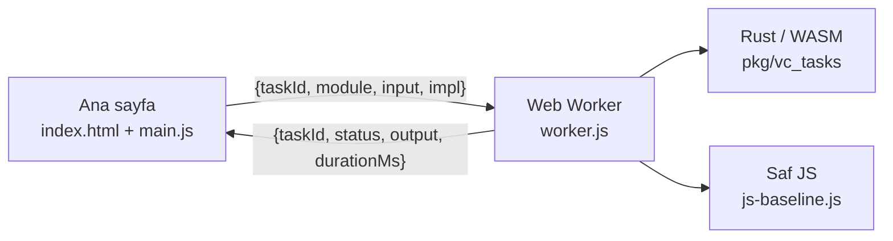
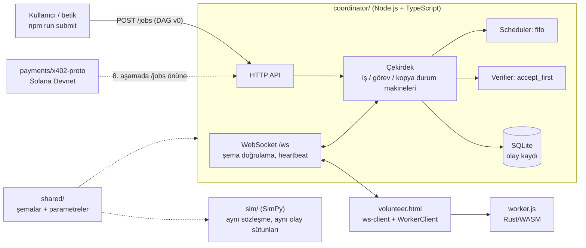

# wasm-worker-proto

Tarayıcıda **Web Worker içinde Rust'tan derlenmiş WebAssembly (WASM) görevleri** çalıştıran, belirlenimci (deterministic) bir prototip. Bu, *x402 ile stablecoin mikro ödemeli, tarayıcı tabanlı gönüllü hesaplama platformu* dönem projesinin deposudur. 5. haftada worker çekirdeği olarak başladı; 6–7. haftalarda **koordinatör**, **gönüllü sayfası**, **SimPy simülatörü** ve **x402 prototipi** eklendi. Proje aşama aşama büyür: [`docs/ROADMAP.md`](docs/ROADMAP.md).

> **English summary.** A browser page that runs deterministic, integer-only Rust/WASM tasks inside a module Web Worker, behind a stable message protocol (`{taskId, module, input}` → `{taskId, status, output, durationMs}`). Includes a pure-JavaScript baseline, fixed cross-checked test vectors, Node and headless-browser tests, and a WASM-vs-JS benchmark. Part of a term project on browser-based volunteer computing with adaptive result verification.

## İçindekiler

- [Özellikler](#özellikler)
- [Mimari](#mimari)
- [Hızlı başlangıç](#hızlı-başlangıç)
- [Platform (Hafta 6–7)](#platform-hafta-67)
- [Görev arayüzü ve mesaj protokolü](#görev-arayüzü-ve-mesaj-protokolü)
- [Görevler](#görevler)
- [Belirlenimcilik ve test vektörleri](#belirlenimcilik-ve-test-vektörleri)
- [Testler](#testler)
- [Performans ölçümü](#performans-ölçümü)
- [Tarayıcı desteği](#tarayıcı-desteği)
- [Sorun giderme](#sorun-giderme)
- [Proje yapısı](#proje-yapısı)
- [Sınırlılıklar ve yol haritası](#sınırlılıklar-ve-yol-haritası)

## Özellikler

- **İki belirlenimci görev:** SHA-256 hash zinciri ve sarmalı (wrapping) aritmetikle tamsayı matris çarpımı. Kayan nokta (float) kullanılmaz.
- **Ortak görev arayüzü:** her görev `run(input_json: &str) -> String` imzasını taşır; çıktı kanonik JSON'dur (anahtarlar sıralı, boşluksuz), böylece sonuçlar bayt düzeyinde karşılaştırılabilir.
- **Web Worker izolasyonu:** hesaplama ana iş parçacığını bloke etmez. Sayfadaki kare sayacı ve döner simge bunu görünür kılar.
- **Hata dayanıklılığı:** geçersiz girdi, bilinmeyen modül, WASM yükleme hatası, panic ve zaman aşımı raporlanır. Panic sonrası worker otomatik yeniden başlatılır.
- **Üç bağımsız uygulama çapraz doğrulaması:** Rust/WASM, saf JavaScript ve Python (`hashlib`) aynı test vektörlerini üretir.
- **Dahili WASM–JS karşılaştırması** ve Node/Playwright testleri.

## Mimari



- `target: web` ile derlenir; worker, ES modülü olarak (`new Worker(url, {type: "module"})`) çalışır ve WASM'i ilk görevde tembel (lazy) yükler. Böylece yükleme hatası, worker'ı öldürmek yerine o görevin hatası olarak döner.
- `impl` alanı yalnızca karşılaştırma içindir (`"wasm"` varsayılan, `"js"` saf JavaScript sürümü).

## Hızlı başlangıç

**Gereksinimler:** Rust (rustup), `wasm32-unknown-unknown` hedefi, [`wasm-pack`](https://rustwasm.github.io/wasm-pack/), Node.js (testler için; Node 22 ile denendi) ve Python 3 (yerel sunucu için).

```bash
rustup target add wasm32-unknown-unknown
cargo install wasm-pack --locked

git clone https://github.com/H-ERDEM/wasm-worker-proto.git
cd wasm-worker-proto

npm run build      # wasm-pack build --release --target web --out-dir pkg
npm run serve      # python3 -m http.server 8080
```

Ardından tarayıcıda **<http://localhost:8080>** adresini açın. WASM `file://` ile çalışmaz, mutlaka bir HTTP sunucusu kullanın (`npx serve .` de olur).

Sayfada: görev seçin, JSON girdiyi düzenleyin, **Çalıştır**'a basın. **Test vektörlerini doğrula** düğmesi tüm sabit vektörleri WASM ve JS ile çalıştırıp beklenenle karşılaştırır. **WASM vs JS ölçümü** süre karşılaştırması yapar.

> `pkg/` klasörü derleme çıktısıdır ve depoya dahil değildir; önce `npm run build` çalıştırılmalıdır.

## Platform (Hafta 6–7)



### Çalıştırma

**Gereksinim:** Node.js 22.18+, Python 3.11+ (simülatör için), Rust + `wasm-pack` (WASM derlemesi için).

```bash
npm install
pip install -r sim/requirements.txt
npm run build                 # pkg/ (WASM)

npm run coordinator           # http://127.0.0.1:8787  → / gönüllü sayfasını açar
npm run submit -- shared/examples/three-task-dag.json --wait
```

Tarayıcıda `http://127.0.0.1:8787` adresini açın, **Katılıyorum, başlat** düğmesine basın ve iş gönderin. Aynı ağdaki bir telefon için koordinatörü `HOST=0.0.0.0 npm run coordinator` ile başlatıp `http://<bilgisayar-IP>:8787` adresini açın. Tarayıcı olmadan denemek için `node coordinator/test/run-fake-worker.ts` komutu Node'da bir sahte worker bağlar.

### HTTP API

| Yöntem | Yol | Açıklama |
|---|---|---|
| `POST` | `/jobs` | DAG v0 gönderir → `201 {jobId}`; geçersiz DAG → `400` |
| `GET` | `/jobs/:id` | İş durumu, görev durumları, kabul edilen çıktılar |
| `GET` | `/workers` | Bağlı worker'lar |
| `GET` | `/health` | Sağlık kontrolü |
| `GET` | `/`, `/*.html`, `/*.js`, `/pkg/*` | Gönüllü sayfası ve WASM; kaynak kod ve dizin gezintisi kapalı |

DAG v0 biçimi `shared/schemas/dag.v0.schema.json` dosyasında; örnekler `shared/examples/` altında. Bir görevin girdisi, bağımlı olduğu görevin kabul edilmiş çıktısına `{"$ref": "t1.output.hash"}` ile başvurabilir.

### WebSocket protokolü (`/ws`)

Görev mesajı, aşağıdaki "Görev arayüzü ve mesaj protokolü" bölümündeki Web Worker protokolünün bir zarf içine konmuş hâlidir.

| Yön | Mesaj |
|---|---|
| W → K | `hello {consent: true, workerId?, userAgent?, deviceClass?, impls?}` |
| K → W | `welcome {workerId, heartbeatMs, modules}` |
| K → W | `assign {replicaId, module, input, deadlineMs}` |
| W → K | `result {replicaId, status, output, durationMs, impl?, loadMs?, fatal?}` |
| W → K | `status {available}`: CPU sınırı ya da şarj koşulu nedeniyle ara verme |
| K ↔ W | `ping` / `pong {t}` |
| W → K | `bye {reason?}` |

Şemaya uymayan her mesaj bağlantıyı `1008` koduyla kapatır ve kayda geçer. `missedHeartbeats × heartbeatMs` süre ses gelmezse kopya `LOST` olur, süre sınırı aşılırsa `TIMED_OUT` olur; iki durumda da yerine yeni bir kopya açılır.

### Gönüllü sayfası URL parametreleri

| Parametre | Açıklama |
|---|---|
| `coordinator=ws://…/ws` | Varsayılan: sayfanın sunulduğu adres |
| `cpu=low\|medium\|high` | Görevler arası 5 sn / 1 sn / 0 ara |
| `impl=js` | WASM yerine saf JS (karşılaştırma ve WASM'siz test için) |
| `autostart=1` | Onay ekranını atlar; **yalnızca araştırmacının kendi cihazlarında** deney için |
| `fault=random\|collude&s=0.2` | Deney modu: `s` olasılıkla kasıtlı yanlış sonuç (biçim gerçek çıktıyla aynı) |

### Simülatör ve ortak analiz

```bash
cd sim
python -m vcsim.run --seed 1                                     # 20 DAG × 50 görev, 50 worker
python -m vcsim.run --seed 1 --set faults.f=0.2 --set workers.session_mean_s=60
python -m vcsim.analyze ../experiments/data/sim/default-s1 ../coordinator/coordinator.db
```

`vcsim.analyze`, simülatör çıktısı ile koordinatörün SQLite kaydını **aynı metrik koduyla** okur: makespan, iş başına maliyet, görev ve iş düzeyinde hatalı sonuç oranı, kayıp ve zaman aşımı sayıları. Koordinatör kaydındaki doğru sonuç Python referansıyla hesaplanır.

### x402 prototipi

Bkz. [`payments/x402-proto/README.md`](payments/x402-proto/README.md): Solana Devnet üzerinde `402 → ödeme → 200` döngüsü, istemci harcama politikası ve Devnet'te elle çalıştırma adımları.

## Görev arayüzü ve mesaj protokolü

**Ana sayfa → worker**

| Alan | Tür | Açıklama |
|---|---|---|
| `taskId` | sayı | İstek–yanıt eşleştirme anahtarı |
| `module` | metin | `"sha_chain"`, `"matmul"` (ve test için `"debug_panic"`) |
| `input` | metin | Görevin JSON girdisi |
| `impl` | metin, isteğe bağlı | `"wasm"` (varsayılan) veya `"js"` |

**Worker → ana sayfa**

| Alan | Tür | Açıklama |
|---|---|---|
| `taskId` | sayı | İsteğin `taskId` değeri |
| `status` | `"ok"` \| `"error"` | Sonuç durumu |
| `output` | metin | `ok` ise kanonik çıktı JSON'u, `error` ise hata iletisi |
| `durationMs` | sayı | Yalnızca hesaplama süresi (WASM yükleme hariç) |
| `impl` | metin | Kullanılan uygulama |
| `loadMs` | sayı, isteğe bağlı | WASM yükleme süresi (yalnızca ilk WASM görevinde) |
| `fatal` | bool, isteğe bağlı | `WebAssembly.RuntimeError` (panic) ise `true`; sayfa worker'ı yeniden başlatır |

Rust tarafı `run_task(module, input_json)` olarak dışa aktarılır ve her görev modülü `run(&str) -> String` ile `try_run(&str) -> Result<String, String>` sunar.

## Görevler

### `sha_chain`

- **Girdi:** `{"seed": "<metin>", "iterations": 1..=100000000}`
- **Tanım:** `h0 = SHA-256(UTF-8(seed))`, `h_i = SHA-256(h_{i-1})`; `iterations = 1` ise çıktı `SHA-256(seed)`'dir.
- **Çıktı:** `{"hash":"<hex>","iterations":<n>}`

### `matmul`

- **Girdi:** `{"seed": <u32>, "n": 1..=512}`
- **Tanım:** A ve B (n×n, `u32`), `mulberry32` PRNG ile satır sırasıyla (önce A, sonra B) üretilir; `C = A·B mod 2^32`. Çıktı, C'nin satır sıralı, little-endian `u32` baytlarının SHA-256 özetidir.
- **Çıktı:** `{"hash":"<hex>","n":<n>,"seed":<seed>}`

## Belirlenimcilik ve test vektörleri

Görevler yalnızca tamsayı ve bayt işlemleri kullanır. WebAssembly'de kayan nokta işlemlerinin NaN bit deseni belirsiz olabildiği için ([spesifikasyon notu](https://www.webassembly.org/docs/nondeterminism/)) kayan nokta bilinçli olarak dışarıda bırakılmıştır.

Sabit vektörler `vectors.js` içindedir; beklenen değerler Rust'tan bağımsız olan `scripts/ref_vectors.py` (Python `hashlib`) ile üretilmiştir. Örnekler:

| Görev | Girdi | `hash` |
|---|---|---|
| `sha_chain` | `{"seed":"hello","iterations":1}` | `2cf24dba5fb0a30e26e83b2ac5b9e29e1b161e5c1fa7425e73043362938b9824` |
| `sha_chain` | `{"seed":"hello","iterations":1000}` | `f6eec10c841b542f37ffb4ca00f82c5b6b4b11b79636d20201078b667ac37159` |
| `matmul` | `{"seed":42,"n":64}` | `21bfb70784701c76d11da1401dec6eb95c570e074e7a831c5ac69a56514433cb` |

Sekiz vektörün tamamı Chrome 155 (macOS), Firefox 158 (macOS) ve Chrome 155 (Android) üzerinde WASM ve saf JS ile aynı çıktıyı üretmiştir.

## Testler

```bash
npm run test:rust      # cargo test
npm run test:vectors   # Node'da WASM ve JS çıktıları, vektörlere karşı
npm run test:e2e       # Playwright ile başsız Chromium: vektörler, UI donmaması, panic ve toparlanma, benchmark
npm run test:quick     # ağ ve WASM derlemesi gerektirmez: sözleşmeler, koordinatör, x402, simülatör
npm run test:volunteer # gönüllü sayfası ↔ koordinatör, gerçek Chromium (pkg/ yoksa saf JS ile)
npm test               # hepsi (build dahil)
```

| Paket | Test | Kapsam |
|---|---|---|
| `shared/` | 3 | Şemalar, örnekler, parametreler |
| `coordinator/` | 18 | DAG doğrulama; tek görev, DAG, kopan/sessizleşen worker, zaman aşımı, panic, geçersiz mesaj, müsaitlik, statik sunum |
| `test/volunteer-e2e.mjs` | 8 | Onay, tek görev, iki tarayıcıyla DAG, sekme kapanması, yeniden bağlanma, CPU sınırı, deney modu, panic |
| `sim/` | 19 | Belirlenimcilik, makespan alt sınırı, f·s sağlaması, colluding, CRN, bağımlılık sırası, tespit gecikmesi, sütun uyumu, koordinatör kaydının analizi |
| `payments/x402-proto` | 4 | 402 yanıtı ve `PAYMENT-REQUIRED` içeriği, geçersiz ödeme, istemci politikası |

CI (`.github/workflows/ci.yml`) her push ve PR'da iki iş çalıştırır: hızlı testler, ve WASM derlemesiyle Rust + tarayıcı testleri.

- `test:e2e` bir Chromium gerektirir: `npx playwright install chromium` ya da `CHROMIUM_PATH=/yol/chrome npm run test:e2e`.
- Uçtan uca test, uzun bir görev sürerken ana iş parçacığının yanıt verdiğini (en uzun kare aralığı < 250 ms) ve panic sonrası worker'ın toparlandığını doğrular.

## Performans ölçümü

Sayfadaki **WASM vs JS ölçümü** her görevi WASM ve saf JS ile 5 kez çalıştırır (ilk koşu ısınma olarak atılır) ve medyanı raporlar. Ölçülen görevler: `sha_chain` (200.000 iterasyon) ve `matmul` (n=384).

Aynı SHA-256 zinciri üzerinde (200.000 iterasyon) JS/WASM süre oranı, test edilen cihazlarda:

| Ortam | JS/WASM |
|---|---|
| Chrome 155, macOS (Intel) | ≈ 4,7× |
| Firefox 158, macOS (Intel) | ≈ 6,0× |
| Chrome 155, Android | ≈ 7,5× |

**Yorumlarken dikkat:**

- Bu bir *iki uygulama arasındaki* karşılaştırmadır. JS tarafı elle yazılmış, özel optimizasyon yapılmamış bir SHA-256'dır; sonuçlar WASM'in genel hızını temsil etmez. Genel WASM–native karşılaştırması için bkz. Jangda vd., *Not So Fast* (USENIX ATC 2019).
- Oran iş yüküne ve boyuta bağlıdır. Matris çarpımında oran büyüklükle düşer: Node (V8) üzerinde yapılan bir denemede n=128'de ≈ 2,2×, n=384'te ≈ 1,3× ölçülmüştür.
- Tarayıcılar `performance.now()` çözünürlüğünü kasıtlı olarak yuvarlar (özellikle Firefox). **Birkaç milisaniyelik süreler güvenilir ölçülemez**, bu yüzden benchmark yeterince uzun işler kullanır. Kendi cihazınızda yeniden ölçün.
- Ölçümler tek makinede, tek oturumda yapılmıştır; istatistiksel bir değerlendirme değildir.

## Tarayıcı desteği

| Tarayıcı | Durum |
|---|---|
| Chrome 155 (macOS), Chrome 155 (Android) | Test edildi |
| Firefox 158 (macOS) | Test edildi |
| Safari / iOS | Test edilmedi |

Module worker desteği gerekir; güncel Chrome, Firefox ve Safari sürümleri destekler. Eski tarayıcılar için `wasm-pack build --target no-modules` ve klasik worker (`importScripts`) kullanılabilir, ancak bu depoda uygulanmamıştır.

## Sorun giderme

| Belirti | Neden ve çözüm |
|---|---|
| Sayfa açılıyor ama görevler çalışmıyor; konsolda CORS veya `file://` hatası | Sayfa `file://` ile açılmış. `npm run serve` ile `http://localhost:8080` kullanın. |
| `404` ile `pkg/vc_tasks.js` bulunamıyor | `npm run build` çalıştırılmamış. |
| "Incorrect response MIME type" ya da streaming compile uyarısı | Sunucu `.wasm` için `application/wasm` göndermiyor. Python `http.server` ve `npx serve` doğru gönderir. |
| `Failed to construct 'Worker'` / "Cannot use import statement outside a module" | Tarayıcı module worker desteklemiyor; tarayıcıyı güncelleyin. |
| Görev `unreachable` ile bitiyor | Rust panic (`panic = "abort"`). Konsolda panic iletisi görünür; sayfa worker'ı yeniden başlatır. `debug_panic` görevi bu yolu test eder. |
| `wasm-pack build` ağ hatası veriyor | `wasm-opt` (binaryen) indirmesi `Cargo.toml`'da kapalıdır. Yine de hata alıyorsanız ağ ve proxy ayarlarını kontrol edin. |
| LAN'daki telefondan açılmıyor | Telefon ve bilgisayar aynı ağda olmalı; `http://<bilgisayar-IP>:8080` kullanın (`https` değil), VPN'i ve güvenlik duvarını kontrol edin. |

## Proje yapısı

```
wasm-worker-proto/
├── Cargo.toml, src/            # Rust görevleri: lib.rs, sha_chain.rs, matmul.rs
├── index.html, main.js         # WASM prototip sayfası (vektör ve benchmark düğmeleri)
├── volunteer.html, volunteer.js  # gönüllü sayfası (koordinatöre bağlanır)
├── worker-client.js            # WorkerClient: iki sayfanın ortak worker yöneticisi
├── worker.js, js-baseline.js   # module worker ve saf JS sürümleri
├── vectors.js, scripts/ref_vectors.py
├── shared/                     # ortak sözleşme: schemas/, config/, examples/, test/
├── coordinator/                # Node.js + TypeScript koordinatör
│   ├── src/  coordinator.ts, strategies.ts, queue/dag.ts, ws/hub.ts, api/, db/, cli/
│   └── test/ dag.test.ts, e2e.test.ts, fake-worker.ts
├── sim/                        # SimPy simülatörü (vcsim) ve ortak analiz
├── payments/x402-proto/        # x402 Devnet prototipi
├── test/                       # node-vectors.mjs, e2e.mjs, volunteer-e2e.mjs
├── docs/                       # yol haritası, haftalık raporlar
└── .github/workflows/ci.yml
```

## Sınırlılıklar ve yol haritası

- ~~Koordinatör, WebSocket bağlantısı, DAG ve çoklu worker~~ → 7. haftada eklendi.
- Doğrulama şimdilik yalnızca `accept_first` (güvensiz karşılaştırma tabanı); replikasyon, itibar ve sınama işi 8–9. haftalarda eklenecek. Deney modundaki test, bu doğrulayıcının yanlış sonucu kabul ettiğini gösteriyor.
- Modüller şimdilik tek WASM paketine gömülü. Hedef: koordinatörün `.wasm` modüllerini özetleriyle sunması, worker'ın yüklemeden önce doğrulaması (DAG v0'daki `moduleHash` alanı bunun için ayrıldı).
- Simülatördeki `base_rate` ve oturum süresi değerleri yer tutucudur; pilot tarayıcı ölçümleriyle (`durationMs`, `loadMs`) kalibre edilecek.
- x402 prototipi ağ gerektirmeyen testlerle doğrulandı; Devnet'te gerçek ödeme elle yapılacak.
- Güvenlik: görev girdileri worker'a açıktır (gizlilik/şifreli hesaplama kapsam dışıdır) ve ödeme yalnızca test ağında (Devnet) tasarlanmıştır.

## Lisans

MIT. Ayrıntılar için [`LICENSE`](LICENSE) dosyasına bakın. Kod, simülatör ve deney verisi bu depoda açık olarak yayımlanır.
