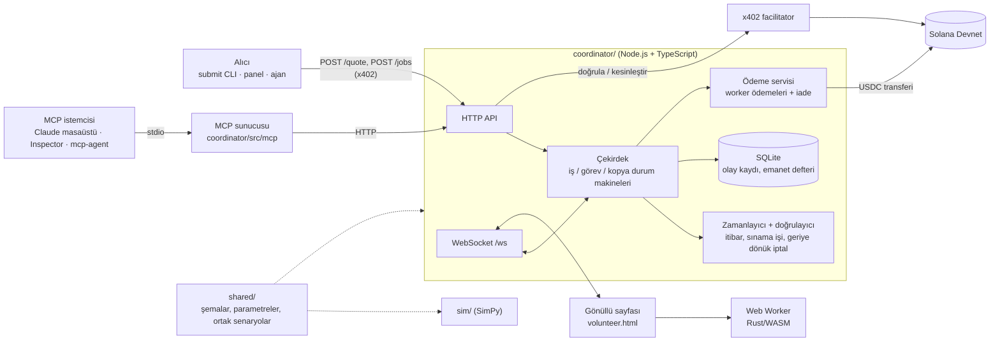
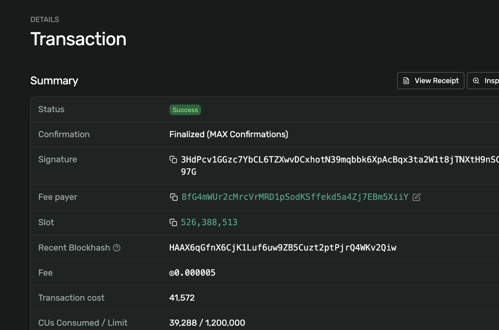
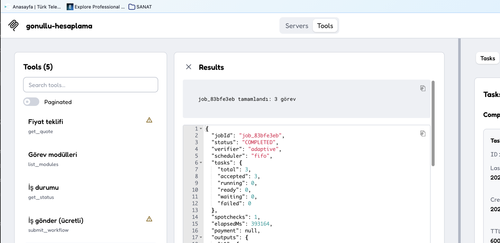

<div align="center">

# wasm-worker-proto

**x402 ile stablecoin mikro ödemeli, tarayıcı tabanlı gönüllü hesaplama platformu**

WebAssembly iş akışlarının (DAG) zamanlanması · itibar tabanlı uyarlanabilir replikasyonla doğrulama · MCP arayüzü ve yapay zekâ ajanı

[](https://github.com/H-ERDEM/wasm-worker-proto/actions/workflows/ci.yml)
[](LICENSE)


</div>

---

## Genel bakış

Gönüllüler bir web sayfasını açıp onay vererek bilgisayarlarının ya da telefonlarının işlem gücünü paylaşır; **kurulum gerekmez**. İşler, Rust'tan derlenmiş WebAssembly görevlerinden oluşan iş akışlarıdır (DAG). Bir **koordinatör** görevleri tarayıcılara dağıtır, sonuçları **itibar tabanlı uyarlanabilir replikasyon** ve **sınama işleriyle** doğrular. Alıcı işi **x402** ile Solana Devnet USDC ödeyerek satın alır; iş bitince doğrulanmış her sonuç için worker'a ödeme yapılır, kalan tutar alıcıya iade edilir. Platform, **MCP** sunucusu üzerinden yapay zekâ ajanlarına da açıktır. Farklı zamanlama ve doğrulama stratejileri bir **SimPy simülatöründe** ve gerçek tarayıcılarda karşılaştırılır.

> **English summary.** A browser-based volunteer computing platform. Volunteers open a web page; a coordinator schedules DAGs of deterministic Rust/WASM tasks onto their browsers' Web Workers, verifies results with reputation-based adaptive replication and spot checks, and pays volunteers in Devnet USDC. Buyers (people or AI agents) purchase jobs over x402; the platform is also exposed as an MCP server. A SimPy simulator and real-browser experiments compare scheduling and verification strategies.

### Proje durumu

| Bileşen | Durum |
|---|---|
| Rust/WASM görevleri, Web Worker, test vektörleri | ✅ Tamamlandı |
| Koordinatör (HTTP API, WebSocket, DAG kuyruğu, SQLite) | ✅ Tamamlandı |
| Gönüllü sayfası (masaüstü ve Android) | ✅ Tamamlandı |
| Zamanlama ve doğrulama stratejileri, itibar, sınama işi, geriye dönük iptal | ✅ Tamamlandı |
| x402 ile iş satın alma, worker ödemeleri ve iade (Solana Devnet) | ✅ Tamamlandı |
| MCP sunucusu (Claude masaüstü ve MCP Inspector ile denendi) | ✅ Tamamlandı |
| SimPy simülatörü ve ilk karşılaştırma grafikleri | ✅ Tamamlandı |
| Doğal dilden DAG üreten yapay zekâ ajanı | 🚧 Geliştiriliyor |
| Gerçek tarayıcı deney matrisi, analiz ve final raporu | 🚧 Planlandı |

Ayrıntılı ilerleme ve karar kaydı: [`docs/ROADMAP.md`](docs/ROADMAP.md).

## İçindekiler

- [Genel bakış](#genel-bakış)
- [Özellikler](#özellikler)
- [Mimari](#mimari)
- [Hızlı başlangıç](#hızlı-başlangıç)
- [Koordinatör](#koordinatör)
- [Gönüllü sayfası](#gönüllü-sayfası)
- [Doğrulama ve itibar](#doğrulama-ve-itibar)
- [Ödemeler](#ödemeler)
- [MCP sunucusu](#mcp-sunucusu)
- [Demo araçları](#demo-araçları)
- [Simülatör](#simülatör)
- [WASM görev çekirdeği](#wasm-görev-çekirdeği)
- [Testler](#testler)
- [Sorun giderme](#sorun-giderme)
- [Proje yapısı](#proje-yapısı)
- [Sınırlılıklar](#sınırlılıklar)
- [Lisans](#lisans)
- [Proje hakkında](#proje-hakkında)

## Özellikler

- **Kurulumsuz katılım:** gönüllü sayfası onay, CPU sınırı, "yalnızca şarjdayken" koşulu ve yeniden bağlanma ile gelir; görevler izole Web Worker'da çalışır.
- **DAG iş akışları:** görevler bağımlılık sırasıyla çalışır; bir görevin girdisi üst görevin çıktısına `$ref` ile bağlanır.
- **Belirlenimci görevler:** `sha_chain`, `matmul`, `image_blur`; yalnızca tamsayı işlemleri, kanonik JSON çıktı. Rust/WASM, saf JS ve Python aynı test vektörlerini üretir.
- **Stratejiler:** zamanlayıcılar `fifo`, `fastest`, `reputation`; doğrulayıcılar `accept_first`, `fixed2`, `fixed3`, `adaptive`. Koordinatör ve simülatör aynı ortak senaryoları geçer.
- **İtibar ve sınama:** Beta itibar modeli; güvenilir worker'ın sonucu tek kopyayla kabul edilir, sınama işinde yakalanan worker'ın bitmemiş işlerdeki tek kopyalı sonuçları geriye dönük iptal edilir.
- **Ödeme döngüsü:** x402 ile iş satın alma (üst sınır ödenir), emanet defteri, worker ödemeleri ve alıcıya iade tek Solana işleminde; çift ödeme koruması.
- **MCP:** altı araç; ödeme x402 v2 MCP taşımasıyla; Claude masaüstü ve MCP Inspector ile denendi.
- **Demo araçları:** canlı demo paneli ve simülasyonu tarayıcıda oynatan görsel sayfa.

## Mimari



Koordinatör tek süreçtir; MCP sunucusu koordinatöre yalnızca HTTP ile bağlanan ince bir adaptördür. Ortak sözleşme (`shared/`) koordinatör ve simülatörün aynı DAG biçimini, parametreleri ve strateji anlamlarını kullanmasını sağlar.

## Hızlı başlangıç

**Gereksinimler:** Node.js 22.18+, Python 3.11+ (simülatör), Rust + `wasm32-unknown-unknown` hedefi + [`wasm-pack`](https://rustwasm.github.io/wasm-pack/) (WASM derlemesi).

```bash
git clone https://github.com/H-ERDEM/wasm-worker-proto.git
cd wasm-worker-proto
npm install
pip install -r sim/requirements.txt
npm run build                 # pkg/ (WASM); derlenmezse sayfa saf JS ile çalışır

npm run coordinator           # http://127.0.0.1:8787
```

1. Tarayıcıda **http://127.0.0.1:8787** adresini açıp **Katılıyorum, başlat**'a basın. `adaptive` ve `fixed2` doğrulama iki farklı tarayıcının sonucunu karşılaştırdığı için ikinci bir tarayıcıda (ör. Firefox + Chrome) da açın; aynı tarayıcının iki sekmesi aynı worker sayılır.
2. İkinci terminalde bir iş gönderin:
   ```bash
   npm run submit -- shared/examples/three-task-dag.json --verifier adaptive --wait
   ```
3. Canlı izlemek için **http://127.0.0.1:8787/panel** adresini açın.

Aynı ağdaki bir telefonla katılmak için koordinatörü `HOST=0.0.0.0 npm run coordinator` ile başlatıp telefonda `http://<bilgisayar-IP>:8787` adresini açın. Tarayıcı olmadan denemek için `node coordinator/test/run-fake-worker.ts` bir sahte worker bağlar.

## Koordinatör

Varsayılan stratejiler `shared/config`'tedir; iş başına `?scheduler=` ve `?verifier=` ile değişir. Ortam değişkenleri: `HOST`, `PORT`, `PAYMENTS=1` (x402), `PAYOUTS=1` (worker ödemeleri), `RPC_URL`.

### HTTP API

| Yöntem | Yol | Açıklama |
|---|---|---|
| `POST` | `/quote` | DAG için fiyat teklifi (üst sınır); iş oluşturmaz, ödeme istemez |
| `POST` | `/jobs` | DAG gönderir → `201 {jobId}`; geçersiz DAG ya da bilinmeyen strateji → `400`; ödeme açıksa ödemesiz istek → `402`. İsteğe bağlı `?scheduler=fifo\|fastest\|reputation&verifier=fixed2\|fixed3\|adaptive\|accept_first`; `&source=panel\|cli\|mcp` işi kimin gönderdiğini kaydeder (yoksa `api`; panelde rozet olarak görünür) |
| `GET` | `/jobs/:id` | Durum, stratejiler, görevler, kabul edilen çıktılar, sınama sayısı, emanet defteri ve worker ödemeleri |
| `GET` | `/workers` | Bağlı worker'lar: hız, α, β, itibar R, güvenilir mi, `flagged` (sınamada yakalanmış; yalnızca izleme) |
| `GET` | `/modules` | WASM paket özeti (`moduleHash`) ve modül listesi |
| `GET` | `/panel`, `/examples`, `/events`, `/demo/info` | Demo paneli ve beslediği uç noktalar |
| `POST` | `/demo/buy` | Panel alıcısı: x402 ile öder ve iş gönderir; yalnızca aynı makineden |
| `GET` | `/health` | Sağlık kontrolü |
| `GET` | `/`, `/*.html`, `/*.js`, `/pkg/*` | Gönüllü sayfası ve WASM; kaynak kod ve dizin gezintisi kapalı |

**DAG v0** biçimi `shared/schemas/dag.v0.schema.json`'da, örnekler `shared/examples/` altında (`single-task`, `three-task-dag`, `image-pipeline`, `matrix-chain`, `demo-40`). Bir görevin girdisi bağımlı olduğu görevin kabul edilmiş çıktısına `{"$ref": "t1.output.hash"}` ile başvurur. Her görev WASM paketinin özetine (`moduleHash`) bağlanır; DAG'de verilmişse eşleşmelidir, verilmemişse koordinatör doldurur.

### WebSocket protokolü (`/ws`)

| Yön | Mesaj |
|---|---|
| W → K | `hello {consent: true, workerId?, userAgent?, deviceClass?, impls?, wallet?}` |
| K → W | `welcome {workerId, heartbeatMs, modules}` |
| K → W | `assign {replicaId, module, input, deadlineMs, moduleHash?}`; sınama işi de aynı biçimdedir |
| W → K | `result {replicaId, status, output, durationMs, impl?, loadMs?, fatal?}` |
| W → K | `status {available}`: CPU sınırı ya da şarj koşulu nedeniyle ara verme |
| K ↔ W | `ping` / `pong {t}` |
| W → K | `bye {reason?}` |

Şemaya (`shared/schemas/messages.v0.schema.json`) uymayan mesaj bağlantıyı `1008` ile kapatır. `missedHeartbeats × heartbeatMs` süre ses gelmezse kopya `LOST`, süre sınırı aşılırsa `TIMED_OUT` olur; ikisinde de yerine yeni kopya açılır.

## Gönüllü sayfası

`volunteer.html` onay ekranıyla açılır: görevlerin ne olduğu ve neyin kaydedildiği yazılıdır; CPU kullanımı, "mobilde yalnızca şarjdayken" ve isteğe bağlı Solana Devnet ödeme adresi seçilir. Worker kimliği ve ödeme adresi tarayıcının `localStorage`'ında, itibar koordinatörün veritabanında tutulur.

| URL parametresi | Açıklama |
|---|---|
| `coordinator=ws://…/ws` | Varsayılan: sayfanın sunulduğu adres |
| `cpu=low\|medium\|high` | Görevler arası 5 sn / 1 sn / 0 ara |
| `impl=js` | WASM yerine saf JS |
| `wallet=<adres>` | Ödeme adresi (onay ekranındaki alanla aynı) |
| `autostart=1` | Onay ekranını atlar; **yalnızca araştırmacının kendi cihazlarında** deney için |
| `fault=random\|collude&s=0.2` | Deney modu: `s` olasılıkla kasıtlı yanlış sonuç (biçim gerçek çıktıyla aynı) |

**On-off saldırgan.** Dürüst çalışıp güvenilir olmuş bir sekme aynı adreste `fault=random&s=1` ile yeniden açılırsa aynı kimlik ve itibarla hile yapmaya başlar: sonuçları tek kopyayla kabul edilir, ilk sınama işinde yakalanır ve bitmemiş işlerdeki tek kopyalı sonuçları geriye dönük iptal edilip yeniden hesaplanır.

**Denenen cihazlar.** Chrome 155–157 ve Firefox 158–160 (macOS), Chrome 155–158 (Android 10). Telefonla uçtan uca deneme (23 Kasım 2026): Android 10 / Chrome 158, aynı Wi-Fi'daki koordinatöre bağlanıp `single-task` ve 7 görevli `image-pipeline` işlerini tamamladı; yedi çıktı bağımsız hesaplamayla eşleşti. Safari/iOS denenmedi.

## Doğrulama ve itibar

Koordinatör (`coordinator/src/strategies.ts`, `reputation.ts`) ve simülatör aynı stratejileri uygular; iki taraf `shared/test/strategy-scenarios.json` ve `shared/test/reputation-vectors.json` ortak senaryolarını geçer. Parametreler `shared/config`'tedir (Kapsam v3).

- **İtibar:** Beta modeli, R = (α+1)/(α+β+2), unutma katsayısı λ. Replikasyonla doğrulanan her kopya ve her sınama işi `rep_events` tablosuna yazılır. R eşiği (τ) ve yeterli gözlemi aşan worker güvenilir sayılır.
- **Uyarlanabilir doğrulama (`adaptive`):** güvenilir worker'ın sonucu tek kopyayla kabul edilir; diğerleri eşleşen kopya gerektirir (en fazla `maxReplicas` = 10 kopya).
- **Sınama işi:** her atamada q = 0,10 olasılıkla worker'a gerçek görev yerine aynı modülden, aynı boyutta, rastgele tohumlu bir görev gider; beklenen çıktıyı koordinatör Node'da aynı WASM ile (derlenmemişse saf JS ile) hesaplar (`oracle.ts`). Sınama işi gerçek görevden ayırt edilemez.
- **Geriye dönük iptal:** sınamada yakalanan worker'ın bitmemiş işlerdeki tek kopyalı kabulleri ve onlara bağlı alt görevler yeniden kuyruğa alınır (`log` → `retroactive_cancel`). Bitmiş işlerdeki sonuçlar geri alınamaz, ayrıca sayılır (`late_detection`).

## Ödemeler

Ayrıntılı Devnet kurulumu (anahtarlar, faucet, imzalar): [`payments/x402-proto/README.md`](payments/x402-proto/README.md). Anahtarlar yalnızca `payments/x402-proto/.env`'de durur; depoya girmez.

### İş satın alma (x402)

`PAYMENTS=1` ile `POST /jobs` x402 ödemesinin arkasına alınır (`coordinator/src/api/payments.ts`). Alıcı işi gönderirken **üst sınırı** öder (`exact` şeması, Devnet USDC); iş bitince gerçekleşen maliyet hesaplanır, fark iade edilir.

- Üst sınır = p × N × maxReplicas / (1 − q) (sınama işli stratejiler) ya da p × N × maxReplicas; p = 0,001 USDC, N görev sayısı. Örnek: 7 görevli `image-pipeline`, `adaptive` → 0,077778 USDC.
- Sıra: DAG ve stratejiler doğrulanır (geçersizse 400, ödeme istenmez) → 402 → ödeme zincirde **kesinleşir** → iş kuyruğa girer. Ödeme imzası tutara bağlıdır; aynı ödemenin tekrarı reddedilir.
- Emanet defteri `jobs` tablosunda: `quote_cap`, `payment_tx`, `payer`, `paid_at`, `realized_cost`, `refund_due`, `refund_tx`.

```bash
PAYMENTS=1 npm run coordinator
npm run submit -- shared/examples/image-pipeline.json --verifier adaptive --quote                     # yalnızca teklif
npm run submit -- shared/examples/image-pipeline.json --verifier adaptive --pay --max-usdc 0.1 --wait
```

İstemci politikası yalnızca Devnet'te, yalnızca Devnet USDC ile ve en fazla `--max-usdc` öder. `--replay` aynı ödeme başlığını yeniden gönderip reddedildiğini gösterir. Devnet kayıtları: `job_336a3fe8` (ödemeli iş) ve `job_f8600908` (tekrarın reddi), 23 Kasım 2026.

### Worker ödemeleri ve iade

Ödenmiş bir iş **kesinleşince** (bitti ve ona yansıtılan sınama işleri sonuçlandı) koordinatör bir ödeme planı çıkarır (`coordinator/src/payouts.ts`, `payouts` tablosu): her worker'a doğrulanmış kopyaları ve geçtiği sınama işleri kadar birim ücret, alıcıya üst sınır − gerçekleşen maliyet. Kalemlerin toplamı ödenen üst sınıra eşittir. Ödeme adresi vermemiş worker'ın kalemi `no_wallet` kalır.

`PAYOUTS=1` ile plan platform cüzdanından **tek Solana işleminde** toplu USDC transferiyle gönderilir; alıcının token hesabı yoksa açılır (`coordinator/src/solana-chain.ts`). Çift ödemeye karşı (iş, tür, alıcı) tekildir, işlem imzası yayından önce kaydedilir ve yalnızca zincire hiç girmediği kesinleşen ya da zincirde hata veren işlem yeniden imzalanır (en fazla 3 deneme).

```bash
HOST=0.0.0.0 PAYMENTS=1 PAYOUTS=1 npm run coordinator   # PLATFORM_PRIVATE_KEY .env'de; platform adresinde biraz Devnet SOL gerekir
```

**Devnet kaydı (26 Kasım 2026).** `job_84adbcea` (CLI) ve `job_22616c0d` (MCP üzerinden `mcp-agent`): her iş için iki worker ödemesi ve alıcı iadesi tek işlemde zincirde kesinleşti (`3HdPcv1G…`, `3qLUkWhz…`). İkinci işte iki tarayıcı da güvenilir olduğundan bazı görevler tek kopyayla kabul edildi; gerçekleşen maliyet 0,016'dan 0,011 USDC'ye düştü. Ayrıntılar ve gezgin bağlantıları: [`payments/x402-proto/README.md`](payments/x402-proto/README.md).



## MCP sunucusu

`coordinator/src/mcp/server.ts`, HTTP API'nin üstünde ince bir MCP adaptörüdür; koordinatöre yeni mantık eklemez. stdio ile ayrı süreç olarak çalışır.

| Araç | Ne yapar |
|---|---|
| `list_modules` | WASM modülleri, özetleri, örnek DAG adları ve DAG biçimi |
| `get_example` | Hazır bir örnek DAG'ın tamamı (ad ya da jobId ile); doğrudan `get_quote`/`submit_workflow`'a verilir |
| `get_quote` | DAG + strateji için üst sınır (USDC); iş oluşturmaz |
| `submit_workflow` | İşi gönderir; **ücretli** (x402) |
| `get_status` | Görev sayıları, süre, defter ve worker ödemeleri; hemen döner |
| `get_result` | İş bitince çıktılar ve doğrulama bilgisi; **MCP Tasks** destekli, görev isteği olmadan çağrılırsa iş bitene kadar bekler |

**Ödeme:** x402 v2'nin MCP taşıması. Ödemesiz `submit_workflow` çağrısı `isError: true` ve `structuredContent` = PaymentRequired döner; istemci aynı çağrıyı `params._meta["x402/payment"]` ile tekrarlar; kesinleşme bilgisi `_meta["x402/payment-response"]`'tadır. Adaptör ödemeyi `PAYMENT-SIGNATURE` başlığıyla `POST /jobs`'a iletir; doğrulama, üst sınır + iade ve tekrar koruması HTTP yoluyla aynıdır.

```bash
npm run -s mcp            # stdio MCP sunucusu (COORDINATOR_URL, varsayılan http://127.0.0.1:8787)
npm run mcp-agent -- shared/examples/image-pipeline.json --verifier adaptive --max-usdc 0.1   # ödemeli uçtan uca örnek ajan (Devnet)
```

### Harici istemciler

**Claude masaüstü.** Yapılandırmayı bu bilgisayarın yollarıyla yazdırın; Claude → Ayarlar → Geliştirici → "Yapılandırmayı düzenle" ile açılan `claude_desktop_config.json`'a ekleyin (dosyadaki diğer ayarlara dokunmadan, en üste `"mcpServers"` girdisi olarak) ve uygulamayı Cmd+Q ile kapatıp açın:

```bash
npm run -s mcp-config     # node'un tam yolunu kullanır; Claude masaüstü terminalin PATH'ini (nvm, Homebrew) görmez
```

```json
{ "mcpServers": { "gonullu-hesaplama": {
    "command": "/…/bin/node",
    "args": ["--disable-warning=ExperimentalWarning", "/Users/<kullanıcı>/wasm-worker-proto/coordinator/src/mcp/stdio.ts"],
    "env": { "COORDINATOR_URL": "http://127.0.0.1:8787" } } } }
```

Claude masaüstü x402 ödemesini kendisi yapmaz; ödemesiz koordinatörle bütün araçlar kullanılabilir, ödemeli akış `mcp-agent` ile gösterilir.

**Araç çağrısı kaydı.** Sunucu her araç çağrısını tek satır olarak stderr'e yazar, ör. `araç get_status {job_3c8982cb} → job_3c8982cb: COMPLETED, 7/7 görev kabul edildi (12 ms)`. Claude masaüstünde bu satırlar `~/Library/Logs/Claude/mcp-server-gonullu-hesaplama.log` dosyasına düşer (Claude'un kendi kaydı yalnızca bağlantıyı ve araç listesini tutuyor); Inspector'da terminalde görünür.

**MCP Inspector** (MCP'nin resmî test aracı; araçları tarayıcıda elle çağırır):

```bash
npm run mcp-inspector     # http://127.0.0.1:6274 açılır → Connect → Tools
```

"Edit as JSON" kutusuna aracın tüm girdisi yazılır, ör. `get_quote` için `{"dag": {…}, "verifier": "adaptive"}`, `get_result` için `{"jobId": "job_…"}`.

**Denemeler (25 Kasım 2026, ödemesiz koordinatör, iki gönüllü tarayıcı: Firefox + Chrome).**
- *MCP Inspector v2.13.0:* beş araç listelendi; `get_quote` → `submit_workflow` → `get_result` ile `job_83bfe3eb` (three-task-dag, adaptive) tamamlandı: 3/3 görev kabul, 1 sınama işi.
- *Claude masaüstü:* doğal dil isteğiyle ("modülleri listele, teklif al, işi gönder, sonucu getir") Claude araçları kendisi sırayla çağırdı; `job_1f2cfc32` (3 görev, adaptive) 3,4 sn'de tamamlandı, her görev 2 eşleşen kopyayla doğrulandı, teklif üst sınırı 0,033334 USDC.



## Demo araçları

### Demo paneli

Koordinatör çalışırken **http://127.0.0.1:8787/panel**: terminal yerine tek ekranda canlı demo.

- **Alıcı:** örnek DAG (ara demo için `demo-40.json`, 40 görev) ve doğrulama stratejisi seçilir; "Teklif al" üst sınırı formülüyle gösterir, "Öde ve gönder" x402 adımlarını sırayla gösterir: 402 → imza → zincirde kesinleşme (Solana gezgini bağlantısıyla).
- **İş:** panel, kim gönderirse göndersin en son gönderilen işi izler; başlıktaki rozet kaynağını gösterir (Panel, Terminal, MCP ajanı). Görev grafiği canlı; her görevin durumu ve kaç eşleşen kopyayla (ya da tek kopyayla) kabul edildiği; iş bitince emanet defteri ve worker ödemeleri. İş panelden gönderilmediyse Alıcı sütunu bunu ve işin ödeme işlemini gösterir.
- **Tarayıcılar:** bağlı her tarayıcı, o anki görevi ya da sınama işi, itibar çubuğu (τ çizgisiyle), "tek kopya" ve "yakalandı" rozetleri.
- **Olaylar:** bağlanma, ödeme, sınama, uyuşmazlık, tek kopya moduna geçiş, geriye dönük iptal, iş sonu.

Alıcı anahtarı (`BUYER_PRIVATE_KEY`) yalnızca koordinatörün makinesindeki `.env`'de kalır; panel ödemeyi `POST /demo/buy` ile ister ve bu uç nokta yalnızca aynı makineden gelen isteği kabul eder. `HOST=0.0.0.0` verilirse panelin üstünde gönüllü sayfasının yerel ağ adresi görünür.

```bash
HOST=0.0.0.0 PAYMENTS=1 npm run coordinator     # sonra tarayıcıda /panel
```

### Görsel simülasyon

`docs/demo/simulasyon.html` simülatörün bir koşusunu tarayıcıda adım adım oynatır; sunucu gerektirmez (dosyayı çift tıklayıp açmak yeter). Aynı tohumla sabit 2'li ve uyarlanabilir doğrulama yan yana oynar: 16 tarayıcının görevi, itibarı ve tek kopya modu; 10 DAG'in görev durumları; yakalanma ve tamamlanma olayları; maliyet ve yanlış kabul sayaçları. "Gerçeği göster" hatalı tarayıcıları ve kabul edilmiş yanlış sonuçları işaretler. İki senaryo: colluding ve rastgele hata (f = %20, s = 1).

```bash
cd sim && python -m vcsim.replay              # docs/demo/replay-data.js'i yeniden üretir (tohum 3)
```

Sayfa tek bir koşuyu gösterir; stratejilerin istatistiksel karşılaştırması 30 tohumluk deneylerle yapılır (`docs/figures/hafta8/`).

## Simülatör

`sim/vcsim`, koordinatörle aynı sözleşme ve strateji anlamlarıyla çalışan bir SimPy simülatörüdür: worker oturumları ve kopmalar, hız dağılımı, hata modelleri (rastgele, colluding), itibar, sınama işi, maliyet.

```bash
cd sim
python -m vcsim.run --seed 1                                      # 20 DAG × 50 görev, 50 worker
python -m vcsim.run --seed 1 --set faults.f=0.2 --set workers.session_mean_s=60
python -m vcsim.analyze ../experiments/data/sim/default-s1 ../coordinator/coordinator.db
```

`vcsim.analyze` simülatör çıktısını ve koordinatörün SQLite kaydını **aynı metrik koduyla** okur: makespan, iş başına maliyet, görev ve iş düzeyinde hatalı sonuç oranı, kayıp ve zaman aşımı sayıları.

## WASM görev çekirdeği

Projenin başlangıç noktası: Web Worker içinde Rust/WASM görevleri çalıştıran, belirlenimci bir prototip. `index.html` bu çekirdeği tek başına dener (görev çalıştırma, test vektörlerini doğrulama, WASM–JS ölçümü):

```bash
npm run build && npm run serve     # http://localhost:8080 (WASM file:// ile çalışmaz)
```

### Görev arayüzü

Her görev `run(input_json: &str) -> String` imzasını taşır; çıktı kanonik JSON'dur (anahtarlar sıralı, boşluksuz), böylece sonuçlar bayt düzeyinde karşılaştırılabilir. Rust tarafı `run_task(module, input_json)` olarak dışa aktarılır. Worker ES modülü olarak çalışır ve WASM'ı ilk görevde tembel yükler; yükleme hatası, panic ve zaman aşımı görevin hatası olarak döner, panic sonrası worker yeniden başlatılır.

| Sayfa → worker | Worker → sayfa |
|---|---|
| `taskId`, `module`, `input` (JSON metni), `impl?` (`wasm` \| `js`) | `taskId`, `status` (`ok` \| `error`), `output`, `durationMs`, `impl`, `loadMs?` (ilk WASM görevi), `fatal?` (panic) |

### Görevler

| Görev | Girdi | Tanım | Çıktı |
|---|---|---|---|
| `sha_chain` | `{"seed": "<metin>", "iterations": 1..=100000000}` | `h0 = SHA-256(seed)`, `h_i = SHA-256(h_{i-1})` | `{"hash","iterations"}` |
| `matmul` | `{"seed": <u32>, "n": 1..=512}` | A, B (n×n `u32`) `mulberry32` ile; `C = A·B mod 2^32`; C'nin little-endian baytlarının SHA-256'sı | `{"hash","n","seed"}` |
| `image_blur` | `{"seed": <u32>, "w","h": 1..=1024, "passes": 1..=16}` | `mulberry32` ile gri tonlu `u8` görüntü; 3×3 kutu bulanıklaştırma (toplam / 9, kenarda kıstırma) `passes` kez; son görüntünün SHA-256'sı | `{"h","hash","passes","seed","w"}` |

`debug_panic` yalnızca test içindir. Görev maliyetleri `shared/config` → `costFunctions`.

### Belirlenimcilik ve test vektörleri

Görevler yalnızca tamsayı ve bayt işlemleri kullanır; WebAssembly'de kayan nokta NaN bit deseni belirsiz olabildiği için ([spesifikasyon notu](https://www.webassembly.org/docs/nondeterminism/)) kayan nokta bilinçli olarak dışarıda bırakıldı. Sabit vektörler `vectors.js`'te; beklenen değerler Rust'tan bağımsız `scripts/ref_vectors.py` (Python `hashlib`) ile üretildi. 13 vektörün tamamı Chrome 157 (macOS), Firefox 160 (macOS) ve Chrome 158 (Android 10) üzerinde WASM ve saf JS ile eşleşti (23 Kasım 2026).

| Görev | Girdi | `hash` |
|---|---|---|
| `sha_chain` | `{"seed":"hello","iterations":1}` | `2cf24dba5fb0a30e26e83b2ac5b9e29e1b161e5c1fa7425e73043362938b9824` |
| `sha_chain` | `{"seed":"hello","iterations":1000}` | `f6eec10c841b542f37ffb4ca00f82c5b6b4b11b79636d20201078b667ac37159` |
| `matmul` | `{"seed":42,"n":64}` | `21bfb70784701c76d11da1401dec6eb95c570e074e7a831c5ac69a56514433cb` |
| `image_blur` | `{"seed":42,"w":64,"h":48,"passes":3}` | `3894adbe0c4011c6f5b7e8e3c248b1275401d8082f8cb5be5483e3bc5b488863` |

### Performans (WASM–JS)

Prototip sayfasındaki ölçüm her görevi WASM ve saf JS ile 5 kez çalıştırır (ilki ısınma) ve medyanı raporlar. SHA-256 zincirinde (200.000 iterasyon) JS/WASM süre oranı: Chrome 155 macOS ≈ 4,7×, Firefox 158 macOS ≈ 6,0×, Chrome 155 Android ≈ 7,5×. Bu, iki uygulama arasındaki bir karşılaştırmadır (JS tarafı optimize edilmemiş bir SHA-256); oran iş yüküne bağlıdır (matmul'da n büyüdükçe düşer) ve tarayıcıların `performance.now()` yuvarlaması nedeniyle kısa süreler güvenilir ölçülemez. Genel WASM–native karşılaştırması için Jangda vd., *Not So Fast* (USENIX ATC 2019).

## Testler

```bash
npm run test:quick     # ağ ve WASM derlemesi gerektirmez: sözleşmeler, koordinatör, ödeme, simülatör
npm run test:volunteer # gönüllü sayfası ↔ koordinatör, gerçek Chromium (pkg/ yoksa saf JS ile)
npm run test:rust      # cargo test
npm run test:vectors   # Node'da WASM ve JS çıktıları, vektörlere karşı
npm run test:e2e       # başsız Chromium: vektörler, UI donmaması, panic ve toparlanma
npm test               # hepsi (build dahil)
```

| Paket | Test | Kapsam |
|---|---|---|
| `shared/` | 6 | Şemalar, örnekler, parametreler, mesaj sözleşmesi |
| `coordinator/` | 108 | DAG, kopan/sessizleşen worker, zaman aşımı; stratejiler ve ortak senaryolar; itibar, sınama, geriye dönük iptal; x402 ödeme ve tekrar; worker ödemeleri, çift ödeme, başarısız transfer; MCP araçları ve uçtan uca senaryo |
| `test/volunteer-e2e.mjs` | 14 | Gerçek tarayıcılar: onay, DAG, kopma ve yeniden bağlanma, CPU sınırı, deney modu (fixed2, colluding, adaptive sınama, on-off saldırgan), ödeme adresi |
| `sim/` | 159 | Belirlenimcilik, stratejiler, itibar vektörleri, colluding, CRN, sütun uyumu, ortak analiz, görsel simülasyon verisi |
| `payments/x402-proto` | 4 | 402 yanıtı, geçersiz ödeme, istemci politikası |

CI (`.github/workflows/ci.yml`) her push ve PR'da iki iş çalıştırır: hızlı testler, ve WASM derlemesiyle Rust + tarayıcı testleri. Chromium yolu `CHROMIUM_PATH` ile verilebilir (`npx playwright install chromium`).

## Sorun giderme

| Belirti | Neden ve çözüm |
|---|---|
| İş RUNNING'de kalıyor | `adaptive`/`fixed2` ikinci kopyayı **başka** bir tarayıcıdan bekler. İkinci bir tarayıcıda gönüllü sayfasını açın (aynı tarayıcının sekmeleri tek worker sayılır). |
| Claude masaüstünde MCP sunucusu başlamıyor | Yapılandırmada `"command": "node"` yazıyorsa nvm/Homebrew Node'u bulunamaz; `npm run -s mcp-config` çıktısındaki tam yolu kullanın. Uygulamayı Cmd+Q ile kapatıp açın. |
| Inspector'da "Execute Tool" pasif ya da "iş bulunamadı: {…}" | "Edit as JSON" açıkken aracın tüm girdisi yazılır (`{"dag": …}`); kapalıyken `jobId` kutusuna yalnızca `job_…` yazılır. |
| Inspector "Request timed out after 1m00s" | `get_result` iş bitene kadar bekler; önce `get_status` ile durumu görün ya da ⚙️ → Request timeout'u uzatın. |
| Ödemeli koordinatör `.env`'i bulamıyor | Anahtarlar `payments/x402-proto/.env`'de olmalı; ayrıntı o klasörün README'sinde. |
| `404` ile `pkg/vc_tasks.js` bulunamıyor | `npm run build` çalıştırılmamış (gönüllü sayfası bu durumda saf JS kullanır). |
| Prototip sayfası `file://` ile açılmış, görevler çalışmıyor | `npm run serve` ile `http://localhost:8080` kullanın. |
| Görev `unreachable` ile bitiyor | Rust panic; sayfa worker'ı yeniden başlatır. `debug_panic` bu yolu test eder. |
| Telefondan bağlanılamıyor | Koordinatör `HOST=0.0.0.0` ile başlatılmalı; aynı ağ, `http://` (https değil), VPN ve güvenlik duvarı. |

## Proje yapısı

```
wasm-worker-proto/
├── Cargo.toml, src/              # Rust görevleri: sha_chain, matmul, image_blur
├── volunteer.html, volunteer.js  # gönüllü sayfası
├── panel.html                    # demo paneli (/panel)
├── worker-client.js, worker.js, js-baseline.js   # ortak worker yöneticisi, module worker, saf JS
├── index.html, main.js, vectors.js               # WASM prototip sayfası ve test vektörleri
├── shared/                       # ortak sözleşme: schemas/, config/, examples/, test/
├── coordinator/
│   ├── src/  coordinator.ts, strategies.ts, reputation.ts, oracle.ts, payouts.ts, solana-chain.ts,
│   │         api/ (http, payments, demo-buyer), mcp/ (server, stdio, scenario), cli/, queue/, ws/, db/
│   └── test/
├── sim/                          # SimPy simülatörü (vcsim), analiz, görsel simülasyon verisi
├── payments/x402-proto/          # x402 Devnet prototipi ve ayarları (.env)
├── test/                         # tarayıcı testleri (volunteer-e2e, e2e, node-vectors)
├── docs/                         # ROADMAP, raporlar, figures/, demo/ (görsel simülasyon), img/
├── scripts/ref_vectors.py
└── .github/workflows/ci.yml
```

## Sınırlılıklar

- Ödemeler yalnızca **Solana Devnet**'te (test USDC); birim ücret sabit 0,001 USDC.
- Görev girdileri worker'a açıktır; gizlilik ve şifreli hesaplama kapsam dışıdır.
- Modüller tek WASM paketinde; görevler paketin özetine (`moduleHash`) bağlanır, ayrı `.wasm` modülleri yoktur.
- Sınama işi yakalaması olasılıksaldır: iş bitmeden yakalanmayan tek kopyalı yanlış sonuç geri alınamaz (`late_detection` olarak sayılır).
- Simülatördeki hız ve oturum dağılımları gerçek tarayıcı ölçümleriyle kalibre edilecek.
- Safari/iOS denenmedi.
- Sıradaki işler (yapay zekâ ajanı, Playwright deney koşucuları, deney matrisi): [`docs/ROADMAP.md`](docs/ROADMAP.md).

## Lisans

[MIT](LICENSE) © 2026 Hayrunnisa Büşra Erdem. Kod, simülatör ve deney verisi bu depoda açık olarak yayımlanır.

## Proje hakkında

> [!NOTE]
> **Bu depo, devam eden bir dönem projesidir.** Çalışma aktif olarak geliştirilmektedir; arayüzler, parametreler ve sonuçlar dönem boyunca değişebilir. Bu sürüm bir araştırma prototipidir ve üretim ortamında kullanım için tasarlanmamıştır: ödemeler yalnızca Solana Devnet'te test USDC ile yapılır.

| | |
|---|---|
| **Proje** | x402 ile stablecoin mikro ödemeli, tarayıcı tabanlı gönüllü hesaplama platformu |
| **Geliştiren** | Hayrunnisa Büşra Erdem |
| **Tür** | Dönem projesi (2026, güz dönemi) |
| **Durum** | 🚧 Devam ediyor: yapay zekâ ajanı, gerçek tarayıcı deneyleri ve final raporu sırada |

Geri bildirim ve öneriler için bir [issue](https://github.com/H-ERDEM/wasm-worker-proto/issues) açabilirsiniz.
