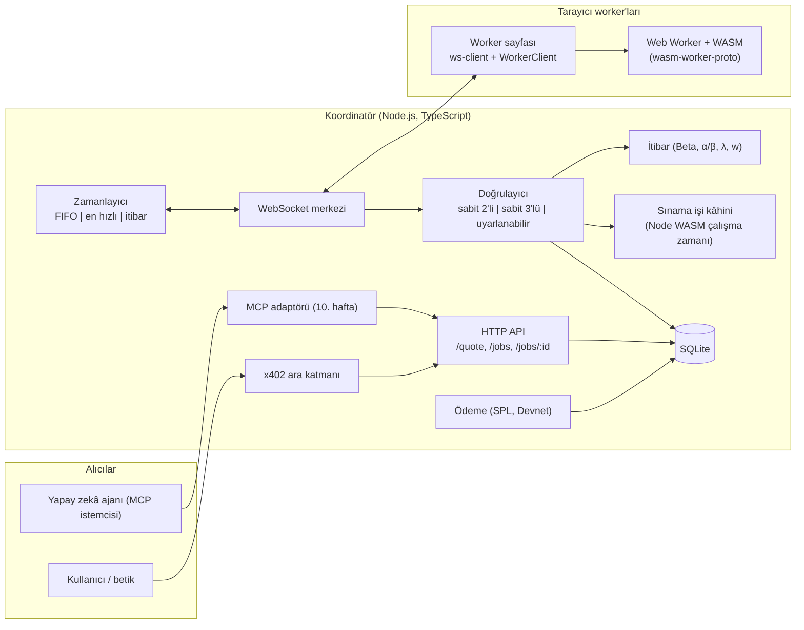
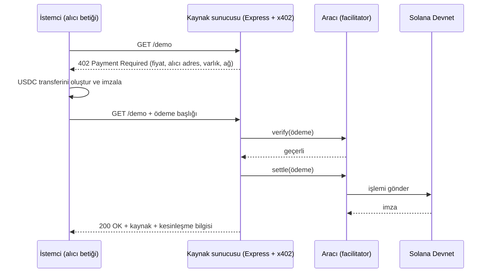

# 6–7. Haftalar: İlerleme Raporu ve Uygulama Planı

**Proje:** x402 ile stablecoin mikro ödemeli, tarayıcı tabanlı gönüllü hesaplama platformu: WebAssembly iş akışlarının (DAG) zamanlanması, itibar tabanlı uyarlanabilir replikasyonla doğrulama, yapay zekâ ajanı ve MCP arayüzü
**Öğrenci:** Hayrunnisa Büşra ERDEM (02230201006)
**Kapsanan dönem:** 6. hafta (Literatür taraması II, mimari, x402 prototipi) ve 7. hafta (simülatör iskeleti ve koordinatör çekirdeği, paralel)
**Dayanılan belgeler:** Haftalık Proje Planı, Kapsam Dokümanı, Literatür Notları I, `wasm-worker-proto` README

> Durum sütunları **Planlandı** olarak işaretlidir. Her haftanın sonunda *Tamamlandı / Kısmen / Ertelendi* olarak güncellenirse bu belge ilerleme kaydı olarak da kullanılabilir.

> **Güncelleme (5 Kasım 2026).** Bu belge 6. hafta başlamadan önce yazılmış bir plandır ve tarihsel kayıt olarak olduğu gibi bırakılmıştır. Planda "açık nokta" ya da "danışmandan beklenen karar" diye geçen maddelerin hepsine 6. haftada proje ekibi karar verdi; güncel ve bağlayıcı metin **Kapsam Dokümanı v2 (Hafta 6)**'dır. Özet olarak: alıcı ödemesi A seçeneği (üst sınır + iade, `exact` şeması); ajan ve MCP **Should**; `maxReplicas = 5` ve toplam deneme sınırı 15; lisans MIT; ara demo 9. hafta. Kararların tam listesi Kapsam v2 §8'de, karar kaydı `docs/ROADMAP.md` içindedir. §4 bu belgenin sonunda güncellenmiştir.

---

## 0. 5. Hafta Sonundaki Durum

### 0.1 Mevcut çıktılar

| Çıktı | Durum | 6–7. haftalarla ilişkisi |
|---|---|---|
| `wasm-worker-proto` | Module Web Worker içinde Rust → WASM görevleri (`sha_chain`, `matmul`); sabit protokol `{taskId, module, input, impl}` → `{taskId, status, output, durationMs, impl, loadMs?, fatal?}`; JS ve Python `hashlib` ile çapraz doğrulanmış 8 test vektörü; Chrome 155 (macOS, Android) ve Firefox 158'de (macOS) bit düzeyinde aynı çıktı; Node ve Playwright testleri. | Platformun **görev paketi** ve **worker sayfası** olur. `test:vectors` WASM'in Node'da çalıştığını zaten gösteriyor; koordinatörün sınama işi cevabını hesaplaması için gereken yol budur. |
| Kapsam dokümanı | RQ1–RQ3, 3 zamanlama × 3 doğrulama stratejisi, Beta itibar modeli, sınama işi ve geriye dönük iptal kuralları, deney matrisi (63 konfigürasyon × 30 tohum + 270 ablasyon koşusu + 60 gerçek tarayıcı koşusu), MoSCoW. | Simülatörün ve koordinatörün sunması gereken arayüzleri belirler. |
| Literatür Notları I | BOINC, sabotaja dayanıklılık, colluding, tarayıcı tabanlı hesaplama, WASM, ödeme/itibar başlıklarında 18 kaynak; ilk karşılaştırma tablosu ve boşluk tespiti. | 6. hafta bunu baştan yazmaz, genişletir; açık kalan okuma maddeleri devralınır. |

### 0.2 Mevcut belgelerde tespit edilen sorunlar (6. haftada düzeltilecek)

Belgeler birlikte okunurken fark edildi. Küçük sorunlar, ancak bir kısmı bırakılırsa kodda hataya ya da jüri sorusuna dönüşebilir.

1. **Gösterim çakışması.** `f` hem *hatalı worker oranını* hem itibar modelindeki *hatalı sonuç sayacını*; `s` hem *yanlış sonuç verme olasılığını* hem *doğru sonuç sayacını* gösteriyor. Bu yüzden `R = (s + 1)/(s + f + 2)` formülü "f = %20, s = 1" ifadesinin yanında belirsiz kalıyor.
   **Öneri:** hata modelinde `f`, `s` kalsın (Sarmenta [4] ile uyumlu); itibar sayaçları `α` (doğrulanmış doğru) ve `β` (doğrulanmış hatalı) olarak yeniden adlandırılsın: `R = (α + 1)/(α + β + 2)`, eşik `α ≥ α_min`. Kodda da aynı adlar kullanılsın (`alpha`, `beta`).
2. **Demo haftası uyuşmazlığı.** Kilometre taşları paragrafı ara demoyu 8. haftada, haftalık tablo 9. haftada gösteriyor. Biri seçilmeli (paralel çalışma düşünülünce tablodaki 9. hafta daha gerçekçi).
3. **Worker ödeme modeli** planda 6. haftanın kararı olarak geçiyor, ancak kapsam dokümanında zaten kararlaştırılmış (sabit birim fiyat; kabul edilen sonuçla eşleşen her kopya ve geçilen her sınama işi ödenir; ödeme iş bitince toplu yapılır). 6. haftada yalnızca maliyet modeli olarak biçimselleştirilmesi yeterli (§1.4.5).
4. **Tanımsız beraberlik kuralı.** Sabit 2'li strateji uyuşmazlıkta üçüncü kopyaya geçiyor, sabit 3'lü "en az iki eşleşen" istiyor; ancak üç sonucun da farklı olduğu durum (rastgele hata modelinde f = %30'da mümkün) tanımlı değil. Bir üst kopya sınırı (ör. `max_replicas = 5`, BOINC'teki `max_error_instances` [2] karşılığı) tanımlanmalı; sınıra ulaşan görev başarısız sayılıp yeniden verilmeli ve bu olaylar ayrı bir metrik olarak sayılmalı.
5. **Kapsam dokümanından devralınan açık noktalar:** (2) ajan/MCP'nin önceliği (Could), proje başlığındaki ve 10–11. haftalardaki merkezi yeriyle çelişiyor; (3) iş maliyeti ancak iş bitince belli olurken alıcının x402 ile ne kadar ödeyeceği. *İkisine de 6. haftada karar verildi: ajan ve MCP Should, alıcı ödemesi üst sınır + iade (§4).*

---

## 1. 6. Hafta — Literatür II, Mimari, x402 Prototipi

### 1.1 Hedefler ve çıktılar

| # | Çıktı | Kabul ölçütü | Durum |
|---|---|---|---|
| Ç6.1 | **Literatür Notları II** (Notları I ile aynı yapı: künye, problem ve yöntem, projeme katkı, sınırlılık ve farkım) | x402 ve ajan ödemeleri, MCP, DAG zamanlama, itibar sistemleri ve §1.2.5'teki devralınan maddeleri kapsar | Planlandı |
| Ç6.2 | Benzer sistemler ve doğrulama yöntemleri için **genişletilmiş karşılaştırma tablosu** | Her hücre bir kaynağa dayanır; "belirtilmemiş" Notları I'deki anlamıyla kullanılır | Planlandı |
| Ç6.3 | Danışmana **literatür sunumu** | 10–12 slayt; boşluk tespiti ve iki açık karar içerir | Planlandı |
| Ç6.4 | **Mimari dokümanı** | Bileşenler, protokoller, DAG JSON şeması, veri modeli, maliyet modeli, alıcı ödemesi önerisi | Planlandı |
| Ç6.5 | **Repo kurulumu** | Monorepo derlenir ve mevcut `wasm-worker-proto` testleri CI'da çalışır | Planlandı |
| Ç6.6 | **x402 prototipi** | Solana Devnet'te test USDC ile tek bir 402 → ödeme → 200 döngüsü; işlem imzası kaydedilir ve Devnet gezgininde görülür | Planlandı |
| Ç6.7 | Düzeltilmiş kapsam dokümanı | §0.2'deki sorunlar giderilmiş | Planlandı |

### 1.2 Literatür taraması II

Her başlığın bir yönlendirici sorusu var; amaç özet değil, karar üretmek.

#### 1.2.1 x402 ve ajan ödemeleri
- **Okunacak:** x402 protokol dokümanının [18] tamamı (ödeme gereksinimleri nesnesi, ödeme şemaları, aracının (facilitator) `verify`/`settle` rolleri, Solana desteği) ve Solana için en az bir SDK örneği (kaynak sunucusu ve istemci).
- **Cevaplanacak sorular:**
  - Fiyatı ancak yürütmeden sonra belli olan bir iş için hangi ödeme şeması uygun? (Notları I: akış, istek anında sabit fiyat varsayıyor.)
  - **Solana Devnet**'te ödemeyi kesinleştiren bir aracı var mı, yoksa prototip doğrulama/kesinleştirme adımını kendisi mi yapmalı?
  - İstemci kesinleşmenin kanıtı olarak ne alıyor, koordinatör ne saklamalı (işlem imzası, ödeyen adres, tutar, token mint adresi)?
- **Beslediği yer:** Ç6.6, alıcı ödemesi kararı (§1.4.5), 9. haftadaki emanet takibi.
- **Not:** x402 SDK paket adları, ağ tanımlayıcıları ve aracı desteği hızlı değişiyor; künyede doküman erişim tarihi [18]'de olduğu gibi yazılmalı.

#### 1.2.2 Model Context Protocol (MCP)
- **Okunacak:** MCP spesifikasyonu (tools, resources, transport katmanları) ve resmî TypeScript SDK dokümanı.
- **Sorular:** `get_quote`, `submit_workflow`, `get_status`, `get_result` araç (tool) olarak nasıl modellenmeli (girdi şemaları, uzun süren işler, yoklama mı bildirim mi)? Bir MCP araç çağrısı x402 ödemesini nasıl taşır ya da tetikler?
- **Beslediği yer:** mimari dokümanı, aynı HTTP API'nin üstünde bir MCP adaptörü için yer ayırır; böylece 10. hafta çekirdeğe yeni mantık eklemez.

#### 1.2.3 DAG zamanlama
- **Okunacak:** Topcuoglu, Hariri, Wu (2002), HEFT [L2-1]; Kwok ve Ahmad (1999), statik DAG zamanlama taraması [L2-2]; [2]'nin 9. bölümünde atıf verilen DAG/yığın tamamlama çalışmaları (Heien vd.; Lee vd.), [2]'nin kaynakçasından izlenerek.
- **Sorular:** Statik liste zamanlayıcıları (HEFT) burada neden doğrudan uygulanamaz? (Beklenen cevap: görev maliyetleri bilinse de worker hızları bilinmez ve worker'lar ayrılır, bu yüzden atama çevrimiçi/pull tabanlı olmalı.) Hazır görevleri sıralamak için HEFT'in upward rank gibi bir öncelik ölçütü kullanılmaya değer mi?
- **Kaydedilecek karar:** deney matrisi FIFO / en hızlı öncelikli / itibar ağırlıklı stratejilerini *worker seçimi* kuralı olarak tutar. Hazır görev sıralaması tüm konfigürasyonlarda FIFO kalır, böylece RQ3 yalnızca worker seçimini karşılaştırır. Upward rank sıralaması gelecek çalışma olarak not edilir, matrise eklenmez.

#### 1.2.4 İtibar sistemleri
- **Okunacak:** Jøsang, Ismail, Boyd (2007), güven ve itibar sistemleri taraması [L2-3]; Kamvar, Schlosser, Garcia-Molina (2003), EigenTrust [L2-4]; Notları I'de [7] üzerinden bulunan Silaghi vd. (2008).
- **Sorular:** Tek ve güvenilir bir koordinatör varken merkezi Beta modeli [16], EigenTrust gibi geçişli bir modele göre gerekçelendirilebilir mi? (Beklenen: evet; koordinatör her doğrulanmış olayı doğrudan gözlediği için geçişli güvene ihtiyaç yok.) On-off saldırıları unutma katsayısı λ ile nasıl etkileşir? Bu, kapsam §4'te belirtilen sınırlılığı destekler.

#### 1.2.5 Literatür Notları I'den devralınan maddeler

| Madde | Yapılacak |
|---|---|
| Fabisiak ve Danilecki (2017), tarayıcı tabanlı gönüllü hesaplama taraması | Okunacak; JSDC, CrowdProcess ve BOINC'in web yaklaşımları buradan tabloya eklenecek |
| BOINC uyarlanabilir replikasyon parametreleri | Ad ve varsayılan eşikler BOINC dokümantasyonundan teyit edilecek; [2] bunları vermiyor |
| Silaghi vd. (IPDPS 2008) | Okunup colluding bölümüne eklenecek |
| Golle ve Mironov (CT-RSA 2001) | Cevabı bilinen sınama işinin kriptografik öncülü olarak okunacak |
| iExec PoCo [17] | Hakemli bir kaynak bulunacak; o zamana kadar "yalnızca blog" uyarısı kalacak |
| Golem, Truebit, Gridcoin | Boşluk analizine eklenecek; Truebit için Teutsch ve Reitwießner [L2-5] |
| [13], [14], [15] | Tam metin okunup Notları I'deki alanlar teyit edilecek |
| Canon vd. (IPDPS 2010) karakterizasyon çalışması | İsteğe bağlı; yalnızca RQ2 sonuçları gerektirirse okunacak |

### 1.3 Genişletilmiş karşılaştırma tabloları (Ç6.2)

Notları I'de sistem düzeyinde tek bir tablo var. 6. haftada bu tablo ikiye ayrılıyor, çünkü algoritmik çalışmalar ([4]–[7]) birer sistem değil ve "platform / kurulum" sütunlarına uymuyor.

**Tablo A — Sistemler** (mevcut satırlar Notları I'den, yeni satırlar 6. haftada doldurulacak)

| Sistem | Platform | Doğrulama | Teşvik / ödeme | DAG | Kurulum | Colluding |
|---|---|---|---|---|---|---|
| BOINC [1, 2] | Native istemci | Replikasyon, validator, uyarlanabilir replikasyon | Credit (parasal değil) | Yok | İstemci | Belirtilmemiş |
| QMachine [8] | Tarayıcı (JS) | Yok (güvenilir gönüllü varsayımı) | Belirtilmemiş | Kısmi | Yok | Yok |
| Pando [9] | Tarayıcı (JS, WebRTC) | Yok (crash-stop) | Yok | Akış hattı | Yok | Yok |
| VFuse [10] | Tarayıcı (WASM) | Katılan düğümler değerlendirir | NFT ödülü | Var | Yok | Belirtilmemiş |
| Wasimoff [11] | Tarayıcı (WASM) | Belirtilmemiş | Belirtilmemiş | Yok | Yok | Belirtilmemiş |
| iExec PoCo [17] | Belirtilmemiş | Sarmenta oylaması + itibar + teminat | Kullanıcı ödemesi + kaybedenlerin teminatı | Belirtilmemiş | Belirtilmemiş | Kısmen (teminat) |
| Golem | *doldurulacak* | *doldurulacak* | *doldurulacak* | *doldurulacak* | *doldurulacak* | *doldurulacak* |
| Truebit [L2-5] | *doldurulacak* | *doldurulacak* | *doldurulacak* | *doldurulacak* | *doldurulacak* | *doldurulacak* |
| Gridcoin | *doldurulacak* | *doldurulacak* | *doldurulacak* | *doldurulacak* | *doldurulacak* | *doldurulacak* |
| **Önerilen sistem** | Tarayıcı (Web Worker + WASM) | İtibar tabanlı uyarlanabilir replikasyon + cevabı bilinen sınama işi + geriye dönük iptal | x402 ile iş satın alma; yalnızca doğrulanmış kopyalara SPL test USDC | Var | Yok | Ölçülüyor (RQ2) |

**Tablo B — Doğrulama yöntemleri**

| Yöntem | Beklenen ek yük | Colluding | Cevabı bilinen iş gerekir mi | Garanti türü | Kaynak |
|---|---|---|---|---|---|
| m-first oylama | m/(1−f) | Zayıf | Hayır | Hata m ile üstel düşer | [4] |
| Spot-checking + geriye izleme | ≈ 1/(1−q) | Kısmi | Evet | Hata sınırı ∝ 1/(q·n) | [4] |
| Credibility eşiği | Uyarlanabilir | Zayıf (bağımsızlık varsayar) | Evet | ≥ 1 − ε ile kabul | [4] |
| Quiz | Paket başına | İyi | Evet | Analiz + simülasyon | [5] |
| İtibara göre boyutlanan gruplar (LOC) | Uyarlanabilir | Ele alınmıyor | Hayır | Hedef LOC | [6] |
| CAA sertifikalandırma | ≥ 2 | İyi | Hayır | p − √v > 1 − ε | [7] |
| BOINC uyarlanabilir replikasyon | → 1 | Belirtilmemiş | Hayır | "Düşük sınır", türetilmemiş | [2] |
| **Önerilen** | Ölçülüyor (RQ1) | Ölçülüyor (RQ2) | Evet (q = 0,10) | Deneysel | — |

### 1.4 Mimari dokümanı (Ç6.4)

#### 1.4.1 Bileşen görünümü



Dokümana yazılacak tasarım kuralları:
- **Tek çekirdek, birden çok giriş kapısı.** Tek giriş noktası HTTP API'dir; x402 onu korur, MCP onu sarar. Zamanlayıcı ve doğrulayıcı bir işin nasıl ödendiğini bilmez.
- **Stratejiler eklentidir.** İki arayüzün arkasında çalışırlar: `Scheduler.pick(hazırKopya, boştakiWorkerlar)` ve `Verifier.onResult(görev, kopyalar) → {kabul | dahaFazla(k) | başarısız}`. Simülatörde bire bir aynı arayüzler bulunur (§2.2.4). RQ3'ü (simülatör ile gerçek karşılaştırması) anlamlı kılan budur.
- **İtibar yalnızca doğrulanmış olaylarda güncellenir** (replikasyon sonucu ya da sınama işi); kapsam dokümanındaki kararla aynı.

#### 1.4.2 Teknoloji kararları

| Konu | Seçim | Gerekçe |
|---|---|---|
| Koordinatör çalışma ortamı | Node.js 22 + TypeScript | README testlerinde zaten kullanılıyor; sınama işi kâhini için aynı WASM çalışma zamanı |
| WebSocket | `ws` | Yalın, yaygın, yüzlerce worker için yeterli |
| Veritabanı | `better-sqlite3` ile SQLite | Eşzamanlı API tek süreçli koordinatöre uygun; deney koşusu başına tek dosya kolay arşivlenir |
| Mesaj doğrulama | Ortak JSON Schema + TS doğrulayıcı | Aynı şemalar Python simülatöründe de kullanılır |
| Simülatör | Python 3.11+, SimPy, NumPy, pandas, pytest | Planlandığı gibi |
| Tarayıcı deneyleri | Playwright | `test:e2e`'de zaten kullanılıyor |

#### 1.4.3 DAG JSON formatı (v0)

`wasm-worker-proto`'daki görevler sabit bir JSON girdi alıyor. DAG'de ise alt görevin girdisi üst görevlerin kabul edilmiş çıktılarına bağlıdır; bu yüzden formatın bir referans mekanizmasına ihtiyacı var. Önerilen v0:

```json
{
  "version": 0,
  "jobId": "isteğe-bağlı-istemci-kimliği",
  "tasks": [
    {
      "id": "t1",
      "module": "sha_chain",
      "moduleHash": "sha256:<.wasm dosyasının özeti>",
      "input": { "seed": "hello", "iterations": 200000 },
      "cost": 200000,
      "deps": []
    },
    {
      "id": "t2",
      "module": "sha_chain",
      "input": { "seed": { "$ref": "t1.output.hash" }, "iterations": 100000 },
      "cost": 100000,
      "deps": ["t1"]
    },
    {
      "id": "t3",
      "module": "matmul",
      "input": { "seed": 42, "n": 128 },
      "cost": 2097152,
      "deps": []
    }
  ]
}
```

Kurallar:
- `deps` bir DAG oluşturmalıdır (gönderimde topolojik sıralamayla doğrulanır); her `$ref` yalnızca `deps` içinde listelenen bir görevi gösterebilir.
- `$ref` **ancak üst görev kabul edildikten sonra** çözülür (spekülatif yürütme yok, kapsam §5).
- `cost`, en hızlı öncelikli stratejide hızları normalize etmek için kullanılan işlem sayısıdır: `sha_chain` için `iterations`, `matmul` için `n³`. Verilmezse koordinatör modül başına bir maliyet fonksiyonuyla hesaplar.
- `moduleHash`, README yol haritasındaki "koordinatör `.wasm` modüllerini özetleriyle sunar, worker yüklemeden önce doğrular" maddesini karşılar. 7. haftada isteğe bağlı, 8. haftadan itibaren zorunlu.
- Çıktılar README'deki gibi kanonik JSON kalır; kopya karşılaştırması dizgi eşitliğiyle yapılır.

Aynı dosya formatını **simülatörün iş yükü yükleyicisi de kullanır**; böylece gerçek tarayıcı deneyinde kullanılan bir DAG simülasyonda değiştirilmeden yeniden oynatılabilir.

#### 1.4.4 Veri modeli (SQLite, ilk sürüm)

| Tablo | Ana sütunlar |
|---|---|
| `workers` | `id`, `user_agent`, `device_class`, `first_seen`, `last_seen`, `alpha`, `beta`, `speed_ema`, `wallet` |
| `jobs` | `id`, `dag_json`, `strategy_sched`, `strategy_verif`, `status`, `submitted_at`, `completed_at`, `quote_cap`, `payment_tx`, `refund_tx` |
| `tasks` | `id`, `job_id`, `module`, `input_resolved`, `cost`, `state`, `accepted_output`, `accepted_at` |
| `replicas` | `id`, `task_id`, `worker_id`, `is_spotcheck`, `expected_output`, `state`, `assigned_at`, `deadline_at`, `returned_at`, `output`, `duration_ms`, `load_ms`, `fatal`, `paid` |
| `rep_events` | `worker_id`, `replica_id`, `kind` (match, mismatch, spot_pass, spot_fail), `alpha_after`, `beta_after`, `t` |
| `payouts` | `job_id`, `worker_id`, `amount`, `tx_signature`, `t` |

Merkezi olay tablosu `replicas`'tır (kopyalar). Simülatör **aynı sütunları** Parquet/CSV olarak yazar; böylece tek bir analiz betiği her iki tarafın metriklerini hesaplar (§2.4).

#### 1.4.5 Maliyet modeli ve alıcı ödemesi önerisi

Worker tarafı (karar verilmiş durumda): **ödenen birim** başına birim fiyat `p`. Ödenen birim, kabul edilen sonuçla eşleşen bir kopya ya da geçilen bir sınama işidir. İş maliyeti:

`C_iş = p × (eşleşen kopyalar + işe yansıtılan geçilmiş sınama işleri)`

Alıcı tarafı. x402 akışı istek anında bir fiyat bekliyor, ancak `C_iş` ancak iş bitince belli oluyor. Değerlendirilen iki seçenek (**karar: A seçeneği**):

| Seçenek | Mekanizma | Artıları | Eksileri |
|---|---|---|---|
| **A. Üst sınır + iade** (önerilen) | `/quote` bir üst sınır döndürür; alıcı bu tutarı x402 ile öder; iş bitince koordinatör `üst sınır − C_iş` farkını SPL transferiyle iade eder | Alıcı ölçülen maliyeti öder; 9. haftadaki "bütçe ve emanet takibi" ile örtüşür; 11. haftadaki ajan kesin bir bütçeyle akıl yürütebilir | İş başına fazladan bir zincir üstü transfer; test edilmesi gereken iade mantığı |
| B. Strateji başına sabit fiyat | Fiyat = seçilen stratejinin beklenen maliyeti; sapmayı platform üstlenir | En basit x402 entegrasyonu | Alıcı fiyatı RQ1 maliyetini yansıtmaz; yüksek f altında platform zarar edebilir |

A seçeneği için üst sınır formülü (`N` görev, görev başına en fazla `max_replicas` kopya, sınama oranı `q`; sınama işleri gerçek kopyaların `q/(1−q)` katıdır):

Uyarlanabilir strateji için `üst sınır = p × N × max_replicas / (1 − q)`; sabit stratejiler için `p × N × max_replicas`.

`max_replicas = 3` ve `q = 0,10` için bu yaklaşık `3,33·p·N` eder. §0.2'deki 4. sorun `max_replicas = 5` ile çözülürse üst sınır da buna göre büyür; bu, sınırı küçük tutmak için bir gerekçedir.

### 1.5 Repo kurulumu (Ç6.5)

Önerilen monorepo. `wasm-worker-proto` geçmişiyle birlikte (`git subtree add` ya da `git filter-repo` ile) `tasks/` ve `worker-web/` altına alınır; böylece mevcut commit'ler ve test vektörleri izlenebilir kalır.

```
vc-platform/
├── tasks/                 # Rust paketi (wasm-worker-proto/src): sha_chain, matmul, sonra görüntü filtresi
│   └── vectors/           # vectors.js + scripts/ref_vectors.py, tüm paketlerce ortak
├── worker-web/            # index.html, main.js, worker.js, js-baseline.js (+ 7. haftada ws-client.js)
├── coordinator/           # TypeScript: api/, ws/, scheduler/, verifier/, reputation/, oracle/, db/
├── shared/
│   ├── schemas/           # dag.v0.json, messages.v0.json (JSON Schema)
│   └── config/            # strateji parametreleri (τ, α_min, q, λ, w, T_timeout); simülatör VE koordinatör kullanır
├── payments/
│   └── x402-proto/        # 6. hafta prototipi: sunucu + istemci + Devnet betikleri
├── sim/                   # Python paketi (7. hafta)
├── experiments/           # Playwright koşucuları, konfigürasyonlar, ham veri (git dışı), analiz defterleri
└── docs/                  # architecture.md, literatur-notlari-*.md, haftalık raporlar
```

Kurulum adımları:
1. Kökte workspaces içeren bir `package.json` (`worker-web`, `coordinator`, `payments/x402-proto`); README'deki betikler (`build`, `test:rust`, `test:vectors`, `test:e2e`) kökten çalışmaya devam etmeli.
2. Görev paketi iki hedef için derlenir: `--target web` (worker sayfası, şu anki gibi) ve sınama işi kâhini için Node'da yüklenebilen bir hedef. README'deki `test:vectors` WASM'i zaten Node'da çalıştırıyor; mümkünse ikinci bir derleme eklemek yerine o yükleme kodu yeniden kullanılmalı.
3. CI (GitHub Actions): Rust testleri, vektör testleri, Playwright Chromium uçtan uca testleri, Python testleri (7. haftadan itibaren).
4. Bir lisans eklenmeli. **Karar: MIT** (Kapsam v2 §8); `LICENSE` dosyası ve README'ye not eklenecek.
5. Devnet anahtarları için `.env.example`; gerçek anahtar çiftleri asla commit edilmez.

### 1.6 Solana Devnet'te x402 prototipi (Ç6.6)

**Amaç:** alıcı tarafındaki ödeme yolunu, koordinatörden bağımsız olarak uçtan uca kanıtlamak.



Adımlar:
1. İki Devnet anahtar çifti oluştur (alıcı, platform); işlem ücretleri için Devnet SOL airdrop al.
2. Bir faucet'ten Devnet test USDC al ve ilişkili token hesaplarını oluştur. Devnet USDC mint adresini sağlayıcının dokümanından teyit edip `shared/config`'e yaz.
3. x402 dokümanından Solana Devnet'i destekleyen bir aracı olup olmadığını kontrol et. Yoksa `payments/x402-proto` içinde basit, yerel bir doğrulama/kesinleştirme adımı yaz ve bunu mimari dokümanında sapma olarak not et.
4. `server.ts` (sabit fiyatlı tek korumalı rota, ör. 0,01 test USDC) ve `client.ts` (402'yi işler, imzalar, yeniden dener) yaz.
5. İşlem imzasını, tutarı ve ödeyeni kaydet; Devnet gezgininde doğrula.
6. Hata yollarını test et: yetersiz bakiye, yanlış ağ, tekrar kullanılan ödeme başlığı. Her birinde kaynak verilmemelidir.
7. **Ek hedef (10. hafta için yararlı):** platform cüzdanından bir "worker" cüzdanına SPL transferi yapan bir betik. Bu worker ödeme yoludur ve x402'den ayrıdır.

**Kabul ölçütü:** Devnet'te doğrulanabilir imzası olan bir başarılı ödemeli istek ve doğru biçimde 402 ya da hata döndüren üç hata durumu. Danışman sunumuna 1–2 dakikalık bir ekran kaydı eklenir.

### 1.7 Literatür sunumu taslağı (Ç6.3)

1. Problem ve motivasyon (kapsam §1)
2. Araştırma soruları RQ1–RQ3
3. Gönüllü hesaplama ve BOINC [1–3]
4. Sabotaja dayanıklılık: oylama, spot-checking, credibility [4]
5. Colluding: Quiz [5], itibara göre boyutlanan gruplar [6], CAA [7]
6. Tarayıcı tabanlı sistemler [8–11] ve WASM belirlenimciliği [12–15]
7. Ödeme ve itibar: Beta [16], iExec PoCo [17], x402 [18]
8. Karşılaştırma tabloları A ve B
9. Literatürdeki boşluk ve [17] sonrası daraltılmış yenilik iddiası
10. Mimariye genel bakış ve x402 prototipi demosu
11. **Alınan kararlar:** alıcı ödemesi (üst sınır + iade); ajan/MCP önceliği (Should); `maxReplicas = 5`; lisans ve teslim biçimi; ara demo 9. hafta

Sunum 14 slayt olarak hazırlandı. Planın 7. maddesine Golem gWASM, Truebit, Gridcoin ve MODICUM eklendi; 9. madde bu kaynaklara göre daha da daraltıldı.

### 1.8 6. hafta tamamlanma ölçütleri

- [x] Literatür Notları II yazıldı ve Notları I ile tek belgede birleştirildi ([19]–[32])
- [x] Tablo A ve B tamamlandı; kaynaksız hücre yok
- [x] Sunum hazırlandı; kararlar Kapsam Dokümanı v2 §8'e ve `docs/ROADMAP.md` karar kaydına işlendi
- [x] DAG şeması v0, mesaj şeması v0, veri modeli ve maliyet modelini içeren mimari dokümanı hazır
- [x] Monorepo derleniyor; mevcut 8 vektör CI'da geçiyor
- [ ] Devnet'te x402 ödemesi gösterildi; imza kaydedildi *(kod ve ağsız testler hazır; gerçek ödeme elle yapılacak)*
- [x] Kapsam dokümanı v2 olarak güncellendi (gösterim, maxReplicas, öncelik, alıcı ödemesi, kaynakça)

---

## 2. 7. Hafta — Simülatör İskeleti ve Koordinatör Çekirdeği (paralel)

### 2.1 Hedefler ve çıktılar

Plan, takvime sığmak için iki kolu paralel yürütür. Haftanın çıktısı bir **simülatör iskeleti** ve **gerçek koordinatör üzerinden ödemesiz, uçtan uca çalışan tek bir görevdir**.

| # | Çıktı | Kol | Durum |
|---|---|---|---|
| Ç7.1 | SimPy simülatör iskeleti: worker modeli, DAG üretici, eklenti strateji arayüzlü koordinatör modeli, olay kaydı, metrikler | A | Planlandı |
| Ç7.2 | Koordinatör çekirdeği: worker kaydı, WebSocket merkezi, görev kuyruğu, DAG bağımlılık çözümü, kopma tespiti, zaman aşımında yeniden atama | B | Planlandı |
| Ç7.3 | Koordinatöre bağlı tarayıcı worker sayfası (onay düğmesi, CPU sınırı) | B | Planlandı |
| Ç7.4 | Uçtan uca test: 2+ tarayıcı worker'ında tek görev ve 3 görevli bir DAG, bağlantısı kopan bir worker dahil | B | Planlandı |
| Ç7.5 | Ortak olay şeması ve hem simülatör hem koordinatör kayıtlarını okuyan ilk analiz betiği | A + B | Planlandı |

**Kapsam sınırı:** 7. hafta yalnızca *yer tutucu* stratejileri uygular (FIFO zamanlama, "ilk başarılı sonucu kabul et" doğrulaması). Gerçek stratejiler 8. haftanın işidir; 7. hafta yalnızca onları eklenebilir hâle getirir.

### 2.2 A kolu — Simülatör (Python + SimPy)

#### 2.2.1 Paket yapısı

```
sim/
├── pyproject.toml
├── vcsim/
│   ├── config.py        # shared/config + deney YAML dosyasını yükler
│   ├── rng.py           # adlandırılmış, bağımsız rastgele sayı akışları
│   ├── workload.py      # DAG üretici + ortak DAG JSON yükleyicisi
│   ├── worker.py        # Worker süreci: katılım, oturum, hız, hata davranışı
│   ├── coordinator.py   # hazır kuyruk, dağıtım, zaman aşımı, tespit gecikmesi
│   ├── strategies/
│   │   ├── base.py      # Scheduler / Verifier arayüzleri (koordinatörle aynı)
│   │   ├── fifo.py      # 7. hafta
│   │   └── accept_first.py   # 7. hafta yer tutucu doğrulayıcı
│   ├── reputation.py    # Beta modeli (α, β, λ, w); koordinatörle aynı anlam
│   ├── events.py        # kopya olay kayıtları (SQLite `replicas` ile aynı sütunlar)
│   └── run.py           # CLI: bir konfigürasyon × bir tohum → events.parquet + summary.json
└── tests/
```

#### 2.2.2 Worker modeli

| Parametre | Başlangıç modeli | Kalibrasyon kaynağı |
|---|---|---|
| Hız katsayısı | Worker'lar arasında log-normal (heterojen) | Gerçek cihazlarda uzun ölçüm görevlerinin `durationMs` değerleri (README, kısa görevlerin tarayıcıların zamanlayıcı yuvarlaması yüzünden, özellikle Firefox'ta, güvenilir ölçülemediğini belirtiyor) |
| Görev süresi | `cost / (base_rate[modül] × hız) + ağ_ek_yükü` | Modül başına `base_rate` aynı ölçümlerden; WASM ilk yükleme maliyeti `loadMs`'ten |
| Katılım | Poisson süreci | Pilot tarayıcı koşuları |
| Oturum süresi (worker ayrılması) | Üstel yer tutucu; pilot veri desteklerse Weibull/log-normal | Pilot tarayıcı koşuları (kapsam §5: pilottan kalibre edilir) |
| Hatalı worker | Worker başına Bernoulli(f); görev başına s olasılıkla yanlış sonuç | Deney konfigürasyonu |
| Colluding | Tek grup; grup "yanlış" kararı verdiğinde her üye o görev için aynı yanlış değeri döndürür | Deney konfigürasyonu (kapsam §5) |

Rastgele modelde yanlış sonuçlar benzersiz belirteçlerdir (asla birbirine eşit değildir); colluding modelde görev başına ortak bir belirteçtir. Bu, gerçek koordinatördeki dizgi karşılaştırmasının eşleşme anlamını birebir yeniden üretir.

#### 2.2.3 DAG üretici

- Biçimler: zincir, çatallan-birleş (fork-join), katmanlı rastgele (genişlik × derinlik); her biri yaklaşık 50 görev (kapsam §6).
- Modül karışımı ve `cost` yapılandırılmış dağılımlardan çekilir (`sha_chain` iterasyonları, `matmul` n).
- Çıktı **ortak DAG JSON v0** formatında diske yazılır; böylece aynı iş yükü gerçek tarayıcı koşusunda yeniden oynatılabilir.
- Varsayılan iş yükü: 20 DAG × ~50 görev, 50 simüle worker (kapsam §6); gerçek tarayıcı iş yükü: 5 DAG × ~50 görev.

#### 2.2.4 Koordinatör modeli ve strateji arayüzleri

Simüle koordinatör, gerçek koordinatörle aynı durum makinesini uygular (§2.3.3):

- Bir görev, tüm üst görevleri kabul edildiğinde HAZIR olur; `$ref` girdileri o anda çözülür.
- `Scheduler.pick()` boşta bir worker seçer; `Verifier.onResult()` kabul / daha fazla kopya / başarısız kararını verir.
- Süresi içinde dönmeyen kopya yeniden atanır. Görev ortasında ayrılan bir worker, **gerçek koordinatördeki tespit gecikmesiyle aynı gecikmeden** (heartbeat aralığı × kaçırılan sinyal sayısı) sonra fark edilir. Bunu modellemek RQ3 için önemlidir; aksi hâlde simülatör worker ayrılması altında makespan'i sistematik olarak düşük tahmin eder.

#### 2.2.5 Rastgelelik ve tekrarlanabilirlik

Eşleştirilmiş Wilcoxon testleri (kapsam §6), stratejiler arasında ortak rastgele sayılar gerektirir. Worker popülasyonu, katılımlar, oturumlar, hata kararları ve iş yükü için `numpy.random.SeedSequence(seed).spawn(k)` ile **ayrı, adlandırılmış akışlar** oluşturulur. Böylece strateji değişikliği yalnızca o stratejinin kullandığı akışları etkiler; aynı tohum için worker popülasyonu ve iş yükü tüm stratejilerde aynı kalır.

#### 2.2.6 Metrikler (simülasyon içinde değil, olay kaydından hesaplanır)

| Metrik | Tanım (kapsam §6) |
|---|---|
| Makespan | İş yükü başlangıcı → son işin tamamlanması; iş başına makespan da saklanır |
| İş başına maliyet | `p × (eşleşen kopyalar + geçilen sınama işleri)` |
| Görev düzeyinde hatalı sonuç oranı | Kabul edilip yanlış olan / tüm kabul edilenler (geriye dönük iptalden sonra) |
| İş düzeyinde hatalı iş oranı | En az bir yanlış görev içeren iş / tamamlanan işler |
| Ek (tanı amaçlı) | Görev başına kopya, kaybolan kopyalar, yeniden atamalar, `max_replicas` başarısızlıkları |

#### 2.2.7 Testler ve kontroller

- **Belirlenimcilik:** aynı konfigürasyon + tohum → bayt düzeyinde aynı `summary.json`.
- **Alt sınır:** f = 0 ve worker ayrılması yokken makespan, DAG'in en hızlı worker'daki kritik yol süresinden küçük olamaz.
- **Hata enjeksiyonu:** f = 0'da hatalı sonuç oranı tam 0; yer tutucu doğrulayıcı ve f > 0'da hatalı sonuç oranı ≈ f·s (ilk sonucu kabul etmenin güvensiz olduğunun sağlaması).
- **İtibar dengesi** (`reputation.py` bu hafta yazılırsa): λ = 0,99 ve w = 5 için hata olasılığı p olan bir worker α ≈ 100(1−p), β ≈ 500p değerlerine yakınsar. p = %1'de bu R ≈ 0,943 < τ = 0,95; p = %0,8'de R ≈ 0,952 verir. Bu, kapsam dokümanındaki "tek kopya modunda kalmak için hata olasılığının yaklaşık %1'in altında olması gerekir" ifadesini doğrular ve λ güncellemesinin yanlış uygulanmasını yakalar.
- **Çalışma süresi bütçesi:** yaklaşık 2.160 simülatör koşusu planlı (1.890 + 270, artı duyarlılık koşuları). Tam matrisin `multiprocessing` ile birkaç saatte bitmesi için koşu başına ≤ 5 sn hedeflenir.

### 2.3 B kolu — Koordinatör çekirdeği ve worker sayfası

#### 2.3.1 Koordinatör modülleri (7. hafta alt kümesi)

```
coordinator/src/
├── index.ts            # HTTP + WS sunucusunun başlatılması
├── api/jobs.ts         # POST /jobs (DAG v0), GET /jobs/:id — henüz ödemesiz
├── ws/hub.ts           # bağlantılar, heartbeat, mesaj doğrulama
├── ws/protocol.ts      # shared/schemas/messages.v0.json'dan üretilen mesaj türleri
├── queue/dag.ts        # doğrulama, topolojik sıra, $ref çözümü, hazır olma
├── queue/dispatcher.ts # HAZIR kopyaları Scheduler üzerinden boştaki worker'lara atar
├── scheduler/fifo.ts
├── verifier/acceptFirst.ts
├── db/schema.sql, db/repo.ts
└── cli/submit.ts       # npm run submit -- yol/dag.json
```

#### 2.3.2 WebSocket protokolü v0

Worker tarafındaki görev mesajı README protokolüdür ve bir zarfın içine konur. Worker sayfası Web Worker için yerel sayısal `taskId` değerini korur ve onu koordinatörün `replicaId` değerine eşler.

| Yön | Tür | Alanlar |
|---|---|---|
| W → K | `hello` | `workerId?` (varsa `localStorage`'da saklanır), `userAgent`, `deviceClass`, `impls: ["wasm"]`, `consent: true` |
| K → W | `welcome` | `workerId`, `heartbeatMs`, `modules: [{name, hash, url}]` |
| K → W | `assign` | `replicaId`, `module`, `input`, `deadlineMs` |
| W → K | `result` | `replicaId`, `status`, `output`, `durationMs`, `loadMs?`, `fatal?` (README alanları, değişmeden) |
| iki yönlü | `ping` / `pong` | `t` |
| W → K | `bye` | `reason` (sekme kapanıyor, CPU sınırı, pil) |

Tüm mesajlar ortak JSON Schema ile doğrulanır; geçersiz bir mesaj bağlantıyı kapatır ve kayda geçer.

#### 2.3.3 Durum makineleri

**Görev:** `WAITING` (üst görevler kabul edilmedi) → `READY` → `RUNNING` (en az bir canlı kopya) → `ACCEPTED` | `FAILED` (`max_replicas`'a ulaşıldı)

**Kopya:** `QUEUED` → `ASSIGNED` → `RETURNED_OK` | `RETURNED_ERROR` | `TIMED_OUT` | `LOST`

- `LOST`: WebSocket kapandı ya da art arda 2 heartbeat kaçırıldı → kopya hemen yeniden kuyruğa alınır.
- `TIMED_OUT`: `deadline_at`'e kadar sonuç gelmedi → yeniden kuyruğa alınır; geç gelen sonuç kaydedilir ama dikkate alınmaz.
- `fatal: true` ile `RETURNED_ERROR` (README: Rust panic → `WebAssembly.RuntimeError`) → başka bir worker'da yeniden kuyruğa alınır; 9. haftada itibara başarısızlık olarak yansır.
- 7. hafta `shared/config`'ten sabit bir `T_timeout` kullanır. 8. haftadan itibaren süre sınırı `cost / speed_ema` ile ölçeklenebilir.

#### 2.3.4 Worker sayfasındaki değişiklikler (`worker-web/`)

1. `ws-client.js`: bağlan, `hello`, heartbeat, artan beklemeyle yeniden bağlanma, `assign` → `WorkerClient.run()` → `result`.
2. `worker.js` değişmeden kullanılır; README protokolü koordinatörün ihtiyaç duyduğu her şeyi (`durationMs`, `loadMs`, `fatal`) zaten döndürüyor.
3. `fatal` sonrası Web Worker'ı README sayfasında olduğu gibi yeniden başlat.
4. **Etik ve güvenlik** (kapsam §8): bağlanmadan önce açık "katılıyorum" düğmesi; CPU kullanım sınırı (ör. görevler arası bekleme / dakikada en fazla görev, yapılandırılabilir); mobilde yalnızca şarjdayken (destekleniyorsa Battery Status API ile) ya da açık kullanıcı izniyle çalışma.
5. Küçük bir durum paneli: bağlı / boşta / çalışıyor, tamamlanan görevler, son süre.
6. Hatalı davranışı ileride f/s deneyleri için enjekte edecek bir **deney modu bayrağı** (URL parametresi, varsayılan olarak kapalı). 7. haftada iskelet olarak eklenir, böylece 11. haftadaki Playwright koşucuları sayfa değişikliği gerektirmez.

#### 2.3.5 Uçtan uca testler (Playwright, `test:e2e`'yi genişletir)

| Test | Beklenen sonuç |
|---|---|
| 1 worker, 1 `sha_chain` görevi (`{"seed":"hello","iterations":1000}`) | Kabul edilen çıktı README vektörü `f6eec10c…7ac37159` ile aynı; `replicas` tablosunda `duration_ms` içeren satır |
| 2 worker, bir `$ref` içeren 3 görevli DAG | Alt görev ancak üst görev kabul edilince başlar; çözülmüş girdi saklanır |
| Görev ortasında worker sekmesi kapatılır | Kopya `LOST`, yeniden atanır, iş yine tamamlanır |
| Worker sessizleşir (heartbeat engellenir) | 2 × `heartbeatMs` içinde tespit edilir; yeniden atanır |
| `debug_panic` görevi | `fatal` sonuç, worker yeniden başlar, görev yeniden atanır |
| İstemciden geçersiz mesaj | Bağlantı kapanır, hata kaydedilir, koordinatör çalışmaya devam eder |

### 2.4 İki kol arasındaki entegrasyon noktaları

| Ortak öğe | Kullanan | Neden önemli |
|---|---|---|
| `shared/schemas/dag.v0.json` | Koordinatör API'si, simülatör yükleyicisi, DAG üretici | Simülasyonda ve gerçek koşularda aynı iş yükü (RQ3) |
| `shared/config/*.yaml` | Koordinatör ve simülatör stratejileri | Aynı τ, α_min, q, λ, w, `T_timeout`, `heartbeatMs`, `max_replicas` |
| Kopya olay sütunları | SQLite `replicas` tablosu, simülatörün `events.parquet` dosyası | Tek analiz betiği her iki tarafın tüm metriklerini hesaplar; `|simülatör − gerçek| / gerçek` makespan sapması aynı kod yolundan gelir |
| Strateji arayüzleri | `coordinator/scheduler`, `coordinator/verifier`, `sim/vcsim/strategies` | 8. haftadaki stratejiler her tarafta aynı sözleşmeye göre bir kez yazılır ve aynı senaryolarla test edilir |

### 2.5 7. hafta tamamlanma ölçütleri

- [ ] `python -m vcsim.run --config default --seed 1` komutu `events.parquet` ve `summary.json` üretiyor; aynı tohumla yeniden çalıştırma aynı sonucu veriyor
- [ ] Simülatör; worker heterojenliği, worker ayrılması, rastgele ve colluding hatalar, DAG bağımlılıkları ve zaman aşımlarını FIFO + ilk sonucu kabul ile kapsıyor
- [ ] Simülatör birim testleri CI'da (belirlenimcilik, alt sınır, hata sağlaması)
- [ ] Koordinatör `POST /jobs` ile DAG v0 kabul ediyor, WebSocket üzerinden dağıtıyor ve kopyaları SQLite'a kaydediyor
- [ ] Tarayıcı worker sayfası (onay, CPU sınırı, yeniden bağlanma) README görevlerini koordinatör için çalıştırıyor
- [ ] §2.3.5'teki altı uçtan uca testin tamamı CI'da headless olarak geçiyor; tek görev testi ayrıca bir gerçek telefonda elle geçiyor
- [ ] Tek bir analiz betiği hem simülatör hem koordinatör olay kayıtlarını okuyup aynı metrik tablosunu yazdırıyor

---

## 3. Riskler ve Önlemler

| Risk | Etki | Önlem |
|---|---|---|
| Solana Devnet'te ödemeyi kesinleştiren bir aracı yok | Ç6.6 engellenir | Prototipte yerel doğrulama/kesinleştirme adımı; sapma olarak belgelenir; x402 MoSCoW'da "Should" olduğu için ana deneyler etkilenmez |
| 7. haftada tek kişinin iki paralel kolu yürütmesi | Kollardan biri gecikir | B kolunun uçtan uca tek görev yolu önceliklidir (haftanın belirtilen çıktısı); simülatör ekleri (itibar modülü, Weibull oturum modeli) 8. haftaya kayabilir |
| Simülatör ile koordinatörün anlamlarının birbirinden uzaklaşması | RQ3 sapması yanlış bir nedenle büyür | Ortak şemalar, ortak konfigürasyon, ortak olay sütunları, aynı tespit gecikmesi modeli (§2.4) |
| Tarayıcılarda zamanlayıcı yuvarlaması | Hatalı hız kalibrasyonu | Yalnızca uzun görevlerden kalibrasyon (README önerisi); `durationMs` ve `loadMs` ayrı saklanır |
| Sınama işinin ayırt edilemezliği varsayım | RQ2 sonuçları iyimser çıkabilir | Sınama işleri için aynı modül ve girdi boyutu dağılımı; aynı mesaj biçimi; sınırlılık olarak raporlanır (kapsam §5) |
| Gösterim çakışmasının (§0.2) koda taşınması | İtibar hesabında hata | İtibar kodu yazılmadan önce, 6. haftada α/β'ya geçilir |
| Ajan/MCP kaynaklı kapsam baskısı | Ana deneyler gecikir | Ajan ve MCP Should önceliğinde; zaman yetmezse önce Could maddeleri, sonra ajanın doğal dil kısmı kısılır (Kapsam v2 §7) |

---

## 4. 6. Haftada Alınan Kararlar

Planın bu bölümü "danışmandan beklenen kararlar" listesiydi. Kararlar proje ekibine bırakıldığı için ekip hepsine karar verdi (5 Kasım 2026). Bağlayıcı metin Kapsam Dokümanı v2 §8'dir; burada yalnızca sonuçlar özetlenir.

| Konu | Karar |
|---|---|
| Alıcı ödemesi | **A seçeneği:** x402 `exact` şemasıyla üst sınır ödenir, iş bitince fark iade edilir. Üst sınır = `p × N × maxReplicas / (1 − q)`. `upto` şeması 10. haftada alternatif olarak denenir. |
| Ajan ve MCP önceliği | **Should.** Proje başlığının parçası; 10–11. haftalardaki yeriyle uyumlu. Zaman yetmezse önce Could maddeleri, sonra ajanın doğal dil kısmı kısılır; MCP sunucusu ve x402 ödemesi korunur. |
| Beraberlik kuralı | `maxReplicas = 5`, toplam deneme sınırı 15. Sınıra ulaşan görev FAILED sayılır ve ayrı bir metrik olarak raporlanır. |
| Rapor ve teslim | Final raporu, kaynak kod, simülatör, deney verisi ve grafikler; her deneyi yeniden üretecek betiklerle GitHub'da. Ara demo 9. hafta. |
| Lisans | MIT. |
| Ek karşılaştırma tabanları | BOINC adaptive replication ve `accept_first`, yalnızca simülatörde (420 ek koşu). BOINC kuralı kaynak koddan teyit edildi. |

---

## Ek — Literatür II İçin Eklenen Kaynaklar (okuma sırasında teyit edilecek)

Numaralandırma teyit sonrasında kapsam dokümanının kaynakçasından devam eder; DOI'ler kesin kullanımdan önce yayıncı sayfalarından kontrol edilmelidir.

- **[L2-1]** Topcuoglu, H., Hariri, S., Wu, M.-Y. (2002). Performance-Effective and Low-Complexity Task Scheduling for Heterogeneous Computing. *IEEE Transactions on Parallel and Distributed Systems*, 13(3), 260–274.
- **[L2-2]** Kwok, Y.-K., Ahmad, I. (1999). Static Scheduling Algorithms for Allocating Directed Task Graphs to Multiprocessors. *ACM Computing Surveys*, 31(4), 406–471.
- **[L2-3]** Jøsang, A., Ismail, R., Boyd, C. (2007). A Survey of Trust and Reputation Systems for Online Service Provision. *Decision Support Systems*, 43(2), 618–644.
- **[L2-4]** Kamvar, S. D., Schlosser, M. T., Garcia-Molina, H. (2003). The EigenTrust Algorithm for Reputation Management in P2P Networks. *Proc. WWW 2003*, s. 640–651.
- **[L2-5]** Teutsch, J., Reitwießner, C. (2017/2019). A Scalable Verification Solution for Blockchains (Truebit). arXiv:1908.04756.
- **[L2-6]** Model Context Protocol spesifikasyonu ve TypeScript SDK dokümanı (modelcontextprotocol.io), erişim tarihiyle.
- Notları I'den devralınanlar: Fabisiak ve Danilecki (2017); Silaghi vd. (IPDPS 2008); Golle ve Mironov (CT-RSA 2001); Canon, Jeannot, Weissman (IPDPS 2010).
