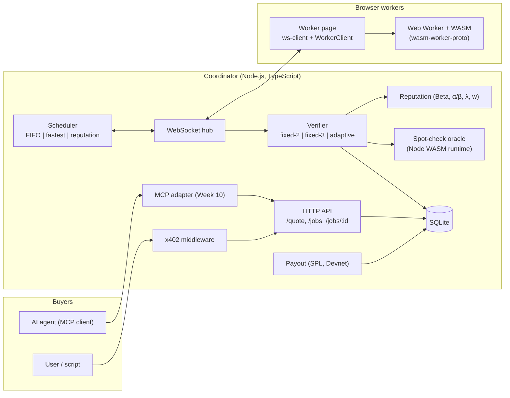
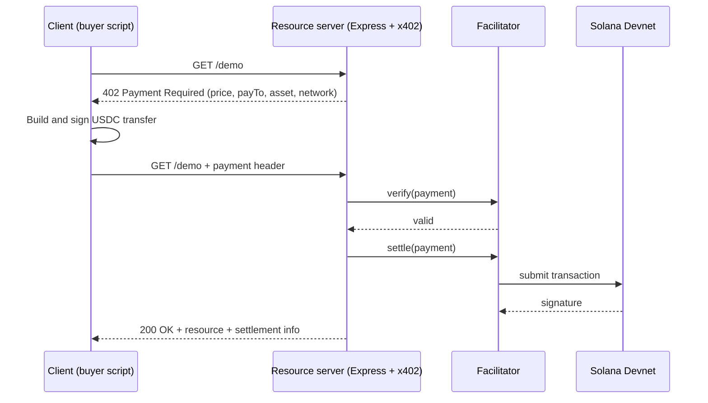

# Weeks 6–7: Progress Report and Implementation Plan

**Project:** x402 stablecoin micro-payment, browser-based volunteer computing platform: scheduling of WebAssembly workflows (DAG), verification via reputation-based adaptive replication, AI agent and MCP interface
**Student:** Hayrunnisa Büşra ERDEM (02230201006)
**Period covered:** Week 6 (Literature II, architecture, x402 prototype) and Week 7 (simulator skeleton and coordinator core, in parallel)
**Source documents:** Weekly Project Plan, Scope Document (*Kapsam Dokümanı*), Literature Notes I, `wasm-worker-proto` README

> Status columns are marked **Planned**. Update them to *Done / Partial / Moved* at the end of each week so this file also serves as the progress log for the advisor.

---

## 0. Baseline at the End of Week 5

### 0.1 What already exists

| Artifact | State | Relevance to Weeks 6–7 |
|---|---|---|
| `wasm-worker-proto` | Rust → WASM tasks (`sha_chain`, `matmul`) in a module Web Worker; stable protocol `{taskId, module, input, impl}` → `{taskId, status, output, durationMs, impl, loadMs?, fatal?}`; 8 test vectors cross-checked against JS and Python `hashlib`; bit-identical on Chrome 155 (macOS, Android) and Firefox 158 (macOS); Node and Playwright tests. | Becomes the **task crate** and the **worker page** of the platform. `test:vectors` already proves WASM runs in Node, which is the path the coordinator needs for spot-check oracles. |
| Scope document | RQ1–RQ3, 3 scheduling × 3 verification strategies, Beta reputation model, spot-check and retroactive cancellation rules, experiment matrix (63 configs × 30 seeds + 270 ablation runs + 60 real-browser runs), MoSCoW. | Fixes the interfaces the simulator and coordinator must expose. |
| Literature Notes I | 18 sources across BOINC, sabotage tolerance, collusion, browser computing, WASM, payment/reputation; first comparison table and gap statement. | Week 6 extends it rather than starting over; a list of open reading items carries over. |

### 0.2 Issues found in the current documents (fix during Week 6)

These were found while cross-reading the documents. They are small, but some of them will cause bugs or reviewer questions if left in place.

1. **Notation collision.** `f` denotes both the *faulty-worker fraction* and the *failure counter* of the reputation model; `s` denotes both the *wrong-result probability* and the *success counter*. The formula `R = (s + 1)/(s + f + 2)` is therefore ambiguous next to "f = 20 %, s = 1".
   **Fix:** keep `f`, `s` for the fault model (matches Sarmenta [4]) and rename the reputation counters to `α` (verified correct) and `β` (verified wrong): `R = (α + 1)/(α + β + 2)`, threshold `α ≥ α_min`. Use the same names in code (`alpha`, `beta`).
2. **Demo week mismatch.** The milestones paragraph says the interim demo is in Week 8; the weekly table puts it in Week 9. Pick one (the table, Week 9, is more realistic given the parallel tracks).
3. **Worker payment model** is listed as a Week 6 decision in the plan but is already decided in the scope document (fixed unit price, paid per matching copy and passed spot-check, batch payout at job completion). Week 6 only needs to formalize it as a cost model (§1.4.5).
4. **Undefined tie rule.** Fixed-2 escalates to a third copy on disagreement and fixed-3 needs "at least two matching", but neither says what happens when all three results differ (possible in the random fault model at f = 30 %). Define a maximum replica count (e.g. `max_replicas = 5`, analogous to BOINC's `max_error_instances` [2]) after which the task is marked failed and re-issued, and count these events as a metric.
5. **Open points carried from the scope document:** (2) priority of agent/MCP (Could) vs. its central place in the project title and in Weeks 10–11; (3) how much the buyer pays via x402 when cost is only known at job completion. Both go to the Week 6 advisor meeting with a proposal (§1.4.5, §1.7).

---

## 1. Week 6 — Literature II, Architecture, x402 Prototype

### 1.1 Objectives and deliverables

| # | Deliverable | Acceptance | Status |
|---|---|---|---|
| D6.1 | **Literature Notes II** (same structure as Notes I: citation, problem and method, contribution, limitation and difference) | Covers x402 and agent payments, MCP, DAG scheduling, reputation systems, plus the carried-over items in §1.2.5 | Planned |
| D6.2 | **Extended comparison table** of related systems and verification methods | Every cell traceable to a source; "not stated" used as in Notes I | Planned |
| D6.3 | **Literature presentation** for the advisor | 10–12 slides, includes the gap statement and the two open decisions | Planned |
| D6.4 | **Architecture document** | Components, protocols, DAG JSON schema, data model, cost model, buyer payment proposal | Planned |
| D6.5 | **Repository set-up** | Monorepo builds and runs the existing `wasm-worker-proto` tests in CI | Planned |
| D6.6 | **x402 prototype** | One 402 → pay → 200 cycle on Solana Devnet with test USDC, transaction signature logged and visible in the Devnet explorer | Planned |
| D6.7 | Corrected scope document | Issues in §0.2 resolved | Planned |

### 1.2 Literature Review II

Each topic has a guiding question so the reading produces decisions, not just summaries.

#### 1.2.1 x402 and agent payments
- **Read:** x402 protocol documentation [18] in full (payment requirements object, schemes, facilitator `verify`/`settle` roles, Solana support), and at least one SDK example for a Solana resource server and client.
- **Questions to answer:**
  - Which payment scheme fits a price known only after execution? (Notes I: the flow assumes a price fixed at request time.)
  - Is there a facilitator that settles on **Solana Devnet**, or must the prototype run its own verify/settle step?
  - What does the client receive as proof of settlement, and what should the coordinator store (transaction signature, payer address, amount, mint)?
- **Feeds:** D6.6, buyer payment decision (§1.4.5), Week 9 escrow tracking.
- **Note:** x402 SDK package names, network identifiers and facilitator support change quickly; record the documentation access date in the citation, as already done for [18].

#### 1.2.2 Model Context Protocol (MCP)
- **Read:** the MCP specification (tools, resources, transports) and the official TypeScript SDK documentation.
- **Questions:** How should `get_quote`, `submit_workflow`, `get_status`, `get_result` be modeled as tools (input schemas, long-running jobs, polling vs. notifications)? How does an MCP tool call carry or trigger an x402 payment?
- **Feeds:** the architecture document reserves an MCP adapter on top of the same HTTP API, so Week 10 adds no new core logic.

#### 1.2.3 DAG scheduling
- **Read:** Topcuoglu, Hariri, Wu (2002), HEFT [L2-1]; Kwok and Ahmad (1999), survey of static DAG scheduling [L2-2]; the DAG/batch-completion works cited in [2] §9 (Heien et al.; Lee et al.), traced through [2]'s reference list.
- **Questions:** Why are static list schedulers (HEFT) not directly applicable here? (Expected answer: task costs are known but worker speeds are unknown and workers churn, so assignment must be online/pull-based.) Is a ready-task *priority* such as HEFT's upward rank worth using to order the ready queue?
- **Decision to record:** the experiment matrix keeps FIFO / fastest-first / reputation-weighted as *worker-selection* rules. Ready-task ordering stays FIFO in all configurations so RQ3 compares only worker selection; upward-rank ordering is noted as future work, not added to the matrix.

#### 1.2.4 Reputation systems
- **Read:** Jøsang, Ismail, Boyd (2007), survey of trust and reputation systems [L2-3]; Kamvar, Schlosser, Garcia-Molina (2003), EigenTrust [L2-4]; Silaghi et al. (2008), already identified in Notes I via [7].
- **Questions:** Is a centralized Beta model [16] justified over a transitive model like EigenTrust given a single trusted coordinator? (Expected: yes; the coordinator observes every verified event directly, so there is no need for transitive trust.) How do on-off attacks interact with the forgetting factor λ? This supports the limitation already stated in scope §4.

#### 1.2.5 Items carried over from Literature Notes I

| Item | Action |
|---|---|
| Fabisiak and Danilecki (2017), browser-based voluntary computing survey | Read; use it to add JSDC, CrowdProcess and BOINC's web approaches to the table |
| BOINC adaptive replication parameters | Confirm names and default thresholds from BOINC documentation; [2] does not give them |
| Silaghi et al. (IPDPS 2008) | Read; add to the collusion section |
| Golle and Mironov (CT-RSA 2001) | Read as the cryptographic predecessor of known-answer spot-checks |
| iExec PoCo [17] | Find a peer-reviewed source; until then keep the "blog only" caveat |
| Golem, Truebit, Gridcoin | Add to the gap analysis; Truebit via Teutsch and Reitwießner [L2-5] |
| [13], [14], [15] | Read full text and confirm the fields quoted in Notes I |
| Canon et al. (IPDPS 2010) characterization paper | Optional; read only if RQ2 results need it |

### 1.3 Extended comparison tables (D6.2)

Notes I has one system-level table. Week 6 splits it in two, because the algorithmic works ([4]–[7]) are not systems and do not fit the "platform / install" columns.

**Table A — Systems** (existing rows from Notes I, new rows to fill during Week 6)

| System | Platform | Verification | Incentive / payment | DAG | Install | Collusion handled |
|---|---|---|---|---|---|---|
| BOINC [1, 2] | Native client | Replication, validator, adaptive replication | Credit (non-monetary) | No | Client | Not stated |
| QMachine [8] | Browser (JS) | None (trusted volunteers) | Not stated | Partial | None | No |
| Pando [9] | Browser (JS, WebRTC) | None (crash-stop) | None | Stream | None | No |
| VFuse [10] | Browser (WASM) | Participating nodes evaluate | NFT reward | Yes | None | Not stated |
| Wasimoff [11] | Browser (WASM) | Not stated | Not stated | No | None | Not stated |
| iExec PoCo [17] | Not stated | Sarmenta voting + reputation + stake | Payment + forfeited stakes | Not stated | Not stated | Partially (stake) |
| Golem | *to fill* | *to fill* | *to fill* | *to fill* | *to fill* | *to fill* |
| Truebit [L2-5] | *to fill* | *to fill* | *to fill* | *to fill* | *to fill* | *to fill* |
| Gridcoin | *to fill* | *to fill* | *to fill* | *to fill* | *to fill* | *to fill* |
| **Proposed** | Browser (Web Worker + WASM) | Reputation-based adaptive replication + known-answer spot-check + retroactive cancellation | x402 purchase; SPL test USDC to verified copies only | Yes | None | Evaluated (RQ2) |

**Table B — Verification methods**

| Method | Expected overhead | Collusion | Needs known answers | Guarantee type | Source |
|---|---|---|---|---|---|
| m-first voting | m/(1−f) | Weak | No | Error falls exponentially in m | [4] |
| Spot-check + backtracking | ≈ 1/(1−q) | Partial | Yes | Error bound ∝ 1/(q·n) | [4] |
| Credibility threshold | Adaptive | Weak (assumes independence) | Yes | Accept at ≥ 1 − ε | [4] |
| Quiz | Per-package | Good | Yes | Analysis + simulation | [5] |
| Reputation-sized groups (LOC) | Adaptive | Not handled | No | Target LOC | [6] |
| CAA certification | ≥ 2 | Good | No | p − √v > 1 − ε | [7] |
| BOINC adaptive replication | → 1 | Not stated | No | "Low bound", not derived | [2] |
| **Proposed** | Measured (RQ1) | Measured (RQ2) | Yes (q = 0.10) | Empirical | — |

### 1.4 Architecture document (D6.4)

#### 1.4.1 Component view



Design rules recorded in the document:
- **One core, several front doors.** The HTTP API is the single entry point; x402 protects it and MCP wraps it. The scheduler and verifier never know how a job was paid for.
- **Strategies are plug-ins** behind two interfaces, `Scheduler.pick(readyReplica, idleWorkers)` and `Verifier.onResult(task, replicas) → {accept | needMore(k) | fail}`, mirrored one-to-one in the simulator (§2.2.4). This is what makes RQ3 (simulator vs. real) meaningful.
- **Reputation is updated only on verified events** (replication outcome or spot-check), as already decided in the scope document.

#### 1.4.2 Stack decisions

| Concern | Choice | Reason |
|---|---|---|
| Coordinator runtime | Node.js 22 + TypeScript | Already used for README tests; same WASM runtime for spot-check oracles |
| WebSocket | `ws` | Minimal, well-known, sufficient for hundreds of workers |
| Database | SQLite via `better-sqlite3` | Synchronous API fits a single-process coordinator; one file per experiment run is easy to archive |
| Message validation | JSON Schema (shared) + a TS validator | Same schemas are reused by the Python simulator |
| Simulator | Python 3.11+, SimPy, NumPy, pandas, pytest | As planned |
| Browser experiments | Playwright | Already used in `test:e2e` |

#### 1.4.3 DAG JSON format (v0)

Tasks in `wasm-worker-proto` take a fixed JSON input. In a DAG a child's input depends on its parents' accepted outputs, so the format needs a reference mechanism. Proposed v0:

```json
{
  "version": 0,
  "jobId": "optional-client-id",
  "tasks": [
    {
      "id": "t1",
      "module": "sha_chain",
      "moduleHash": "sha256:<hash of the .wasm>",
      "input": { "seed": "hello", "iterations": 200000 },
      "cost": 200000,
      "deps": []
    },
    {
      "id": "t2",
      "module": "sha_chain",
      "input": { "seed": { "$ref": "t1.output.hash" }, "iterations": 100000 },
      "cost": 100000,
      "deps": ["t1"]
    },
    {
      "id": "t3",
      "module": "matmul",
      "input": { "seed": 42, "n": 128 },
      "cost": 2097152,
      "deps": []
    }
  ]
}
```

Rules:
- `deps` must form a DAG (validated by topological sort on submission); every `$ref` must point to a task listed in `deps`.
- `$ref` is resolved **only after the parent is accepted** (no speculative execution, per scope §5).
- `cost` is the operation count used to normalize speeds in the fastest-first strategy: `iterations` for `sha_chain`, `n³` for `matmul`. If omitted, the coordinator computes it from a per-module cost function.
- `moduleHash` implements the README roadmap item "coordinator serves `.wasm` modules with hashes, worker verifies before loading". Optional in Week 7, required from Week 8.
- Outputs stay canonical JSON (README), so replica comparison is string equality.

The **same file format** is consumed by the simulator's workload loader, so a DAG used in a real-browser experiment can be replayed in simulation unchanged.

#### 1.4.4 Data model (SQLite, initial)

| Table | Key columns |
|---|---|
| `workers` | `id`, `user_agent`, `device_class`, `first_seen`, `last_seen`, `alpha`, `beta`, `speed_ema`, `wallet` |
| `jobs` | `id`, `dag_json`, `strategy_sched`, `strategy_verif`, `status`, `submitted_at`, `completed_at`, `quote_cap`, `payment_tx`, `refund_tx` |
| `tasks` | `id`, `job_id`, `module`, `input_resolved`, `cost`, `state`, `accepted_output`, `accepted_at` |
| `replicas` | `id`, `task_id`, `worker_id`, `is_spotcheck`, `expected_output`, `state`, `assigned_at`, `deadline_at`, `returned_at`, `output`, `duration_ms`, `load_ms`, `fatal`, `paid` |
| `rep_events` | `worker_id`, `replica_id`, `kind` (match, mismatch, spot_pass, spot_fail), `alpha_after`, `beta_after`, `t` |
| `payouts` | `job_id`, `worker_id`, `amount`, `tx_signature`, `t` |

`replicas` is the central event table; the simulator writes the **same columns** to Parquet/CSV so a single analysis script computes metrics for both (§2.4).

#### 1.4.5 Cost model and buyer payment proposal

Worker side (already decided): unit price `p` per **paid unit**, where a paid unit is a replica matching the accepted result or a passed spot-check. Job cost:

`C_job = p × (matching replicas + passed spot-checks charged to the job)`

Buyer side (open point 3). The x402 flow expects a price at request time, but `C_job` is known only at completion. Two options for the advisor:

| Option | Mechanism | Pros | Cons |
|---|---|---|---|
| **A. Cap + refund** (recommended) | `/quote` returns an upper bound; buyer pays the cap via x402; at completion the coordinator refunds `cap − C_job` with an SPL transfer | Buyer pays the measured cost; matches the planned "budget and escrow" work in Week 9; the agent in Week 11 can reason about a hard budget | One extra on-chain transfer per job; refund logic to test |
| B. Fixed price per strategy | Price = expected cost for the selected strategy; platform absorbs variance | Simplest x402 integration | Buyer price no longer reflects RQ1 cost; platform can lose money under high f |

Cap formula for option A, with `N` tasks, at most `max_replicas` copies per task and spot-check rate `q` (spot-checks are `q/(1−q)` of real replicas):

`cap = p × N × max_replicas / (1 − q)` for the adaptive strategy; `p × N × max_replicas` for fixed strategies.

With `max_replicas = 3` and `q = 0.10` this is about `3.33·p·N`. If issue 4 in §0.2 is resolved with `max_replicas = 5`, the cap grows accordingly, which is a reason to keep that limit small.

### 1.5 Repository set-up (D6.5)

Proposed monorepo; `wasm-worker-proto` is imported with history (`git subtree add` or `git filter-repo` into `tasks/` and `worker-web/`) so the existing commits and test vectors stay traceable.

```
vc-platform/
├── tasks/                 # Rust crate (from wasm-worker-proto/src): sha_chain, matmul, later image filter
│   └── vectors/           # vectors.js + scripts/ref_vectors.py, shared by all packages
├── worker-web/            # index.html, main.js, worker.js, js-baseline.js (+ ws-client.js in Week 7)
├── coordinator/           # TypeScript: api/, ws/, scheduler/, verifier/, reputation/, oracle/, db/
├── shared/
│   ├── schemas/           # dag.v0.json, messages.v0.json (JSON Schema)
│   └── config/            # strategy parameters (τ, α_min, q, λ, w, T_timeout) used by sim AND coordinator
├── payments/
│   └── x402-proto/        # Week 6 prototype: server + client + Devnet scripts
├── sim/                   # Python package (Week 7)
├── experiments/           # Playwright runners, configs, raw data (git-ignored), analysis notebooks
└── docs/                  # architecture.md, literature-notes-*.md, weekly reports
```

Set-up tasks:
1. Root `package.json` with workspaces (`worker-web`, `coordinator`, `payments/x402-proto`); keep the README scripts (`build`, `test:rust`, `test:vectors`, `test:e2e`) working from the root.
2. Build the task crate for two targets: `--target web` (worker page, as now) and a target loadable in Node for the spot-check oracle. The README's `test:vectors` already runs the WASM in Node; reuse that loading code rather than adding a second build if possible.
3. CI (GitHub Actions): Rust tests, vector tests, Playwright Chromium e2e, Python tests (from Week 7).
4. Add a licence (the README says none is specified yet); ask the advisor whether the university has a preference.
5. `.env.example` for Devnet keys; real keypairs are never committed.

### 1.6 x402 prototype on Solana Devnet (D6.6)

**Goal:** prove the buyer-side payment path end to end, independently of the coordinator.



Steps:
1. Create two Devnet keypairs (buyer, platform); airdrop Devnet SOL for fees.
2. Obtain Devnet test USDC from a faucet and create the associated token accounts. Confirm the Devnet USDC mint address from the issuer's documentation and record it in `shared/config`.
3. Check in the x402 documentation which facilitator supports Solana Devnet. If none is available, implement a minimal local verify/settle step in `payments/x402-proto` and note this as a deviation in the architecture document.
4. Implement `server.ts` (one protected route, fixed price, e.g. 0.01 test USDC) and `client.ts` (handles 402, signs, retries).
5. Log the transaction signature, amount and payer; confirm in the Devnet explorer.
6. Test failure paths: insufficient balance, wrong network, replayed payment header. Each must leave the resource unserved.
7. **Stretch (useful for Week 10):** a script that sends an SPL transfer from the platform wallet to a "worker" wallet. This is the worker payout path and is separate from x402.

**Acceptance:** one successful paid request with a verifiable Devnet signature, and three failure cases that correctly return 402 or an error. A 1–2 minute screen recording goes into the advisor presentation.

### 1.7 Advisor presentation outline (D6.3)

1. Problem and motivation (scope §1)
2. Research questions RQ1–RQ3
3. Volunteer computing and BOINC [1–3]
4. Sabotage tolerance: voting, spot-checking, credibility [4]
5. Collusion: Quiz [5], reputation-sized groups [6], CAA [7]
6. Browser-based systems [8–11] and WASM determinism [12–15]
7. Payment and reputation: Beta [16], iExec PoCo [17], x402 [18]
8. Comparison tables A and B
9. Literature gap and the novelty claim (narrowed after [17])
10. Architecture overview and x402 prototype demo
11. **Decisions needed:** buyer payment option A/B; priority of agent/MCP; report format; tie/`max_replicas` rule

### 1.8 Week 6 definition of done

- [ ] Literature Notes II committed to `docs/`, same structure as Notes I
- [ ] Tables A and B complete; no unsourced cell
- [ ] Presentation delivered; advisor decisions recorded in the scope document's decisions table
- [ ] Architecture document with DAG schema v0, message schema v0, data model and cost model
- [ ] Monorepo builds; existing 8 vectors pass in CI
- [ ] x402 Devnet payment demonstrated; signature recorded
- [ ] Scope document corrected (§0.2 issues 1–4)

---

## 2. Week 7 — Simulator Skeleton and Coordinator Core (parallel)

### 2.1 Objectives and deliverables

The plan runs two tracks in parallel to fit the schedule. The weekly output is a **simulator skeleton** and **one task running end to end through the real coordinator without payment**.

| # | Deliverable | Track | Status |
|---|---|---|---|
| D7.1 | SimPy simulator skeleton: worker model, DAG generator, coordinator model with plug-in strategy interfaces, event log, metrics | A | Planned |
| D7.2 | Coordinator core: worker registration, WebSocket hub, task queue, DAG dependency resolution, disconnect detection, timeout-based reassignment | B | Planned |
| D7.3 | Browser worker page connected to the coordinator (consent button, CPU limit) | B | Planned |
| D7.4 | End-to-end test: single task and a 3-task DAG on 2+ browser workers, including a worker that disconnects | B | Planned |
| D7.5 | Shared event schema and a first analysis script that reads both simulator and coordinator logs | A + B | Planned |

**Scope guard:** Week 7 implements only *placeholder* strategies (FIFO scheduling, "accept first OK result" verification). The real strategies are Week 8 work; Week 7 only makes them pluggable.

### 2.2 Track A — Simulator (Python + SimPy)

#### 2.2.1 Package layout

```
sim/
├── pyproject.toml
├── vcsim/
│   ├── config.py        # loads shared/config + experiment YAML
│   ├── rng.py           # named, independent RNG streams
│   ├── workload.py      # DAG generator + loader for shared DAG JSON
│   ├── worker.py        # Worker process: arrival, session, speed, fault behaviour
│   ├── coordinator.py   # ready queue, dispatch, timeouts, detection delay
│   ├── strategies/
│   │   ├── base.py      # Scheduler / Verifier interfaces (mirror coordinator)
│   │   ├── fifo.py      # Week 7
│   │   └── accept_first.py   # Week 7 placeholder verifier
│   ├── reputation.py    # Beta model (α, β, λ, w); shared semantics with coordinator
│   ├── events.py        # replica event records (same columns as SQLite `replicas`)
│   └── run.py           # CLI: one config × one seed → events.parquet + summary.json
└── tests/
```

#### 2.2.2 Worker model

| Parameter | Initial model | Calibration source |
|---|---|---|
| Speed factor | Log-normal across workers (heterogeneous) | `durationMs` of long benchmark tasks on the real devices (README notes that short tasks are unreliable because of timer coarsening, especially in Firefox) |
| Task duration | `cost / (base_rate[module] × speed) + network_overhead` | `base_rate` per module from the same measurements; WASM first-load cost from `loadMs` |
| Arrival | Poisson process | Pilot browser runs |
| Session length (churn) | Exponential placeholder, later Weibull/log-normal if pilot data supports it | Pilot browser runs (scope §5: calibrated from pilot) |
| Faulty | Bernoulli(f) per worker; wrong result with probability `s` per task | Experiment config |
| Collusion | One group; on a "lie" decision every member returns the same wrong value for that task | Experiment config (scope §5) |

Wrong results in the random model are unique tokens (never equal to each other); in the colluding model they are a per-task shared token. This reproduces exactly the matching semantics of string comparison in the real coordinator.

#### 2.2.3 DAG generator

- Shapes: chain, fork-join, layered random (width × depth), each with about 50 tasks (scope §6).
- Module mix and `cost` drawn from configured distributions (`sha_chain` iterations, `matmul` n).
- Output is the **shared DAG JSON v0**, written to disk, so the same workload can be replayed in a real-browser run.
- Default workload: 20 DAGs × ~50 tasks, 50 simulated workers (scope §6); real-browser workload: 5 DAGs × ~50 tasks.

#### 2.2.4 Coordinator model and strategy interfaces

The simulated coordinator implements the same state machine as the real one (§2.3.3):

- A task becomes READY when all parents are accepted; `$ref` inputs are resolved at that moment.
- `Scheduler.pick()` chooses an idle worker; `Verifier.onResult()` decides accept / need more / fail.
- A replica not returned by its deadline is reassigned. A worker that leaves mid-task is detected only after the **same detection delay as the real coordinator** (heartbeat interval × missed beats). Modeling this delay matters for RQ3, because otherwise the simulator would systematically underestimate makespan under churn.

#### 2.2.5 Randomness and reproducibility

Paired Wilcoxon tests (scope §6) need common random numbers across strategies. Use `numpy.random.SeedSequence(seed).spawn(k)` to create **separate named streams** for worker population, arrivals, sessions, fault decisions and workload. A change of strategy then changes only the streams it actually consumes, and the worker population and workload stay identical across strategies for the same seed.

#### 2.2.6 Metrics (computed from the event log, not inside the simulation)

| Metric | Definition (scope §6) |
|---|---|
| Makespan | Workload start → last job completed; per-job makespan also stored |
| Cost per job | `p × (matching replicas + passed spot-checks)` |
| Task error rate | Accepted-and-wrong / all accepted (after retroactive cancellation) |
| Job error rate | Jobs with ≥ 1 wrong task / completed jobs |
| Extra (diagnostic) | Replicas per task, lost replicas, reassignments, `max_replicas` failures |

#### 2.2.7 Tests and checks

- **Determinism:** same config + seed → byte-identical `summary.json`.
- **Lower bound:** with f = 0 and no churn, makespan ≥ the DAG's critical-path time on the fastest worker.
- **Fault injection:** with f = 0, error rate is exactly 0; with the placeholder verifier and f > 0, error rate ≈ f·s (sanity check that accept-first is unsafe).
- **Reputation equilibrium** (if `reputation.py` is written this week): for λ = 0.99, w = 5, a worker with error probability p converges to α ≈ 100(1−p), β ≈ 500p. At p = 1 % this gives R ≈ 0.943 < τ = 0.95; at p = 0.8 %, R ≈ 0.952. This confirms the scope document's statement that roughly < 1 % error is needed to stay in single-copy mode, and the test catches any mis-implementation of the λ update.
- **Run time budget:** about 2,160 simulator runs are planned (1,890 + 270, plus sensitivity runs). Target ≤ 5 s per run so the full matrix finishes within a few hours with `multiprocessing`.

### 2.3 Track B — Coordinator core and worker page

#### 2.3.1 Coordinator modules (Week 7 subset)

```
coordinator/src/
├── index.ts            # HTTP + WS server bootstrap
├── api/jobs.ts         # POST /jobs (DAG v0), GET /jobs/:id  — no payment yet
├── ws/hub.ts           # connections, heartbeat, message validation
├── ws/protocol.ts      # message types generated from shared/schemas/messages.v0.json
├── queue/dag.ts        # validation, topological order, $ref resolution, readiness
├── queue/dispatcher.ts # assigns READY replicas to idle workers via Scheduler
├── scheduler/fifo.ts
├── verifier/acceptFirst.ts
├── db/schema.sql, db/repo.ts
└── cli/submit.ts       # npm run submit -- path/to/dag.json
```

#### 2.3.2 WebSocket protocol v0

The worker-side task message is the README protocol, wrapped in an envelope. The worker page keeps its local numeric `taskId` for the Web Worker and maps it to the coordinator's `replicaId`.

| Direction | Type | Fields |
|---|---|---|
| W → C | `hello` | `workerId?` (stored in `localStorage` if available), `userAgent`, `deviceClass`, `impls: ["wasm"]`, `consent: true` |
| C → W | `welcome` | `workerId`, `heartbeatMs`, `modules: [{name, hash, url}]` |
| C → W | `assign` | `replicaId`, `module`, `input`, `deadlineMs` |
| W → C | `result` | `replicaId`, `status`, `output`, `durationMs`, `loadMs?`, `fatal?` (README fields, unchanged) |
| both | `ping` / `pong` | `t` |
| W → C | `bye` | `reason` (tab closing, CPU limit, battery) |

All messages are validated against the shared JSON Schema; an invalid message closes the connection and is logged.

#### 2.3.3 State machines

**Task:** `WAITING` (parents not accepted) → `READY` → `RUNNING` (≥ 1 live replica) → `ACCEPTED` | `FAILED` (`max_replicas` reached)

**Replica:** `QUEUED` → `ASSIGNED` → `RETURNED_OK` | `RETURNED_ERROR` | `TIMED_OUT` | `LOST`

- `LOST`: WebSocket closed or 2 consecutive missed heartbeats → replica requeued immediately.
- `TIMED_OUT`: no result by `deadline_at` → requeued; the late result, if it arrives, is logged but ignored.
- `RETURNED_ERROR` with `fatal: true` (README: Rust panic → `WebAssembly.RuntimeError`) → requeued on another worker; later feeds reputation as a failure in Week 9.
- Week 7 uses a fixed `T_timeout` from `shared/config`. From Week 8 the deadline can scale with `cost / speed_ema`.

#### 2.3.4 Worker page changes (`worker-web/`)

1. `ws-client.js`: connect, `hello`, heartbeat, reconnect with backoff, `assign` → `WorkerClient.run()` → `result`.
2. Reuse `worker.js` unchanged; the README protocol already returns everything the coordinator needs (`durationMs`, `loadMs`, `fatal`).
3. Restart the Web Worker after `fatal`, as the README page already does.
4. **Ethics and safety** (scope §8): explicit "I agree" button before connecting; a CPU-use limit (e.g. idle pause between tasks / max tasks per minute, configurable); on mobile run only while charging (Battery Status API where available) or with explicit permission.
5. A small status panel: connected / idle / running, tasks completed, last duration.
6. An **experiment-mode flag** (URL parameter, disabled by default) that will later inject faulty behaviour for f/s experiments. Stub it in Week 7 so the Playwright runners in Week 11 do not need page changes.

#### 2.3.5 End-to-end tests (Playwright, extends `test:e2e`)

| Test | Expected result |
|---|---|
| 1 worker, 1 `sha_chain` task (`{"seed":"hello","iterations":1000}`) | Accepted output equals the README vector `f6eec10c…7ac37159`; row in `replicas` with `duration_ms` |
| 2 workers, 3-task DAG with one `$ref` | Child starts only after its parent is accepted; resolved input stored |
| Worker tab closed mid-task | Replica `LOST`, reassigned, job still completes |
| Worker goes silent (heartbeat blocked) | Detected within 2 × `heartbeatMs`; reassigned |
| `debug_panic` task | `fatal` result, worker restarts, task reassigned |
| Invalid message from client | Connection closed, error logged, coordinator keeps running |

### 2.4 Integration points between the tracks

| Shared artifact | Used by | Why it matters |
|---|---|---|
| `shared/schemas/dag.v0.json` | coordinator API, simulator loader, DAG generator | Same workload in simulation and real runs (RQ3) |
| `shared/config/*.yaml` | coordinator strategies, simulator strategies | Identical τ, α_min, q, λ, w, `T_timeout`, `heartbeatMs`, `max_replicas` |
| Replica event columns | SQLite `replicas` table, simulator `events.parquet` | One analysis script computes all metrics for both; the makespan deviation `|sim − real| / real` comes from the same code path |
| Strategy interfaces | `coordinator/scheduler`, `coordinator/verifier`, `sim/vcsim/strategies` | Week 8 strategies are written once per side against the same contract and tested against the same scenarios |

### 2.5 Week 7 definition of done

- [ ] `python -m vcsim.run --config default --seed 1` produces `events.parquet` and `summary.json`; rerun with the same seed is identical
- [ ] Simulator covers worker heterogeneity, churn, random and colluding faults, DAG dependencies and timeouts with FIFO + accept-first
- [ ] Simulator unit tests in CI (determinism, lower bound, fault sanity)
- [ ] Coordinator accepts a DAG v0 via `POST /jobs`, dispatches over WebSocket and stores replicas in SQLite
- [ ] Browser worker page (consent, CPU limit, reconnect) runs the README tasks for the coordinator
- [ ] All six e2e tests in §2.3.5 pass headless in CI; the single-task test also passes manually on one real phone
- [ ] One analysis script reads both the simulator and the coordinator event logs and prints the same metric table

---

## 3. Risks and Mitigations

| Risk | Impact | Mitigation |
|---|---|---|
| No facilitator settles on Solana Devnet | D6.6 blocked | Local verify/settle step in the prototype; document as a deviation; x402 is "Should" in MoSCoW, so the core experiments are unaffected |
| Two parallel tracks for one person in Week 7 | Either track slips | Track B's e2e single-task path has priority (it is the stated weekly output); simulator extras (reputation module, Weibull churn) can move to Week 8 |
| Simulator and coordinator semantics drift | RQ3 deviation inflated for the wrong reason | Shared schemas, shared config, shared event columns, same detection-delay model (§2.4) |
| Timer coarsening in browsers | Bad speed calibration | Calibrate only from long tasks (README guidance); store `durationMs` and `loadMs` separately |
| Spot-check indistinguishability is assumed | RQ2 results optimistic | Same module and input-size distribution for spot-checks; same message format; keep it as a stated limitation (scope §5) |
| Notation collision (§0.2) carried into code | Reputation bugs | Rename to α/β in Week 6 before any reputation code is written |
| Scope pressure from agent/MCP | Core experiments delayed | Get the advisor's decision on priorities in Week 6 (§1.7) |

---

## 4. Decisions Requested from the Advisor (Week 6 meeting)

1. **Buyer payment:** option A (cap + refund, recommended) or option B (fixed price per strategy).
2. **Priority of AI agent and MCP:** keep as "Could" (scope document) or raise to "Should" (project title, Weeks 10–11).
3. **Tie rule:** confirm `max_replicas` (proposed 5) and how failed tasks count in the metrics.
4. **Report format:** structure, length, and how code and data are submitted.
5. **Licence** for the repository.

---

## Appendix — References Added for Literature II (to verify during reading)

Numbering continues from the scope document's bibliography after confirmation; DOIs must be checked against the publisher pages before final use.

- **[L2-1]** Topcuoglu, H., Hariri, S., Wu, M.-Y. (2002). Performance-Effective and Low-Complexity Task Scheduling for Heterogeneous Computing. *IEEE Transactions on Parallel and Distributed Systems*, 13(3), 260–274.
- **[L2-2]** Kwok, Y.-K., Ahmad, I. (1999). Static Scheduling Algorithms for Allocating Directed Task Graphs to Multiprocessors. *ACM Computing Surveys*, 31(4), 406–471.
- **[L2-3]** Jøsang, A., Ismail, R., Boyd, C. (2007). A Survey of Trust and Reputation Systems for Online Service Provision. *Decision Support Systems*, 43(2), 618–644.
- **[L2-4]** Kamvar, S. D., Schlosser, M. T., Garcia-Molina, H. (2003). The EigenTrust Algorithm for Reputation Management in P2P Networks. *Proc. WWW 2003*, 640–651.
- **[L2-5]** Teutsch, J., Reitwießner, C. (2017/2019). A Scalable Verification Solution for Blockchains (Truebit). arXiv:1908.04756.
- **[L2-6]** Model Context Protocol specification and TypeScript SDK documentation (modelcontextprotocol.io), with access date.
- Carried over from Notes I: Fabisiak and Danilecki (2017); Silaghi et al. (IPDPS 2008); Golle and Mironov (CT-RSA 2001); Canon, Jeannot, Weissman (IPDPS 2010).
