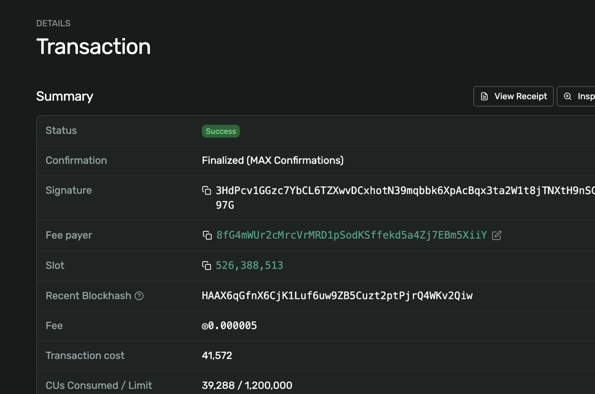

# x402 prototipi (Hafta 6, Ç6.6)

Alıcı tarafındaki ödeme yolunu koordinatörden bağımsız olarak uçtan uca kanıtlar: `GET /demo` → **402** → Devnet USDC ile ödeme → **200**. 8. aşamada aynı ara katman koordinatörün `POST /jobs` yolunun önüne konacak.

- **Protokol:** x402 v2. Başlıklar `PAYMENT-REQUIRED` (sunucu → istemci), `PAYMENT-SIGNATURE` (istemci → sunucu) ve `PAYMENT-RESPONSE` (sunucu → istemci).
- **Paketler:** `@x402/express`, `@x402/fetch`, `@x402/svm` (`exact` şeması), `@x402/core` 2.30.
- **Ağ:** Solana Devnet (`solana:EtWTRABZaYq6iMfeYKouRu166VU2xqa1`), Devnet USDC (`4zMMC9srt5Ri5X14GAgXhaHii3GnPAEERYPJgZJDncDU`).
- **Facilitator:** `https://x402.org/facilitator`. Ödemeyi doğrular, işlemi zincire gönderir ve işlem ücretini (SOL) kendisi öder. Bu yüzden alıcının yalnızca Devnet USDC'ye ihtiyacı var.
- **İstemci güvenlik politikası:** yalnızca Devnet, yalnızca Devnet USDC, ödeme başına en fazla 0,01 USDC (`devnetPolicy`).

## Testler (ağ gerektirmez)

```bash
npm test -w payments/x402-proto
```

Sahte bir facilitator ile şunları doğrular: ödemesiz istek 402 alır; `PAYMENT-REQUIRED` doğru ağı, varlığı, tutarı (10 000 atomik birim = 0,01 USDC) ve alıcıyı taşır; geçersiz `PAYMENT-SIGNATURE` ile kaynak verilmez; istemci politikası mainnet'i, başka token'ları ve üst sınırı aşan tutarları reddeder.

## Devnet'te çalıştırma (elle)

1. **Anahtarlar:** `npm run keys -w payments/x402-proto`. Bu komut `.env` dosyasına bir alıcı ve bir platform anahtar çifti yazar. `.env` git dışındadır; bu anahtarları başka hiçbir yerde kullanmayın.
2. **Test USDC:** <https://faucet.circle.com> adresinde ağ olarak **Solana Devnet**'i seçip `.env` içindeki `BUYER_ADDRESS` adresine USDC isteyin.
3. **Sunucu:** `npm run server -w payments/x402-proto`. Sunucu `http://127.0.0.1:4021/demo` adresinde açılır.
4. **İstemci** (ikinci terminalde): `npm run client -w payments/x402-proto`. Beklenen çıktı `Durum: 200`, kesinleşme bilgisi ve Solana gezgini bağlantısıdır.
5. **Kanıt:** Sunucu her ödemeyi `payments.log` dosyasına yazar (işlem imzası, ödeyen, ağ). Gezgin bağlantısının ekran görüntüsünü ya da kısa bir ekran kaydını Hafta 6 teslimine ekleyin.

> **Önemli:** Ödemeyi alacak platform adresinin Devnet USDC token hesabı (ATA) önceden var olmalıdır; yoksa facilitator ödemeyi `invalid_exact_svm_recipient_ata_missing` ile reddeder. Faucet'ten platform adresine de bir kez USDC istemek hesabı oluşturur.

### Devnet'te yapılan ödeme (8. hafta, 23 Kasım 2026)

Hafta 6'dan açık kalan elle deneme MacBook Air'de yapıldı (ekran kaydıyla).

| | |
|---|---|
| Sonuç | `Durum: 200`, kaynak ödeme sonrasında verildi; `success: true` |
| Ağ | `solana:EtWTRABZaYq6iMfeYKouRu166VU2xqa1` (Devnet) |
| Tutar | 0,01 test USDC (`exact`) |
| Ödeyen (alıcı) | `FKqFgXvXGih6KDYsLSLNAk5WrANM68ZfgkfGUWmEeyrF` |
| Alan (platform) | `8fG4mWUr2cMrcVrMRD1pSodKSffekd5a4Zj7EBm5XiiY` |
| İşlem imzası | `2wXTPCM7FwwcqNmznriMycwbGY6qTaXbVGHbSEz63n1QZri1trdpLkYE3NyZTZ7jmNLc7MknVCcyVQji97ygmq7P` |
| Gezgin | <https://explorer.solana.com/tx/2wXTPCM7FwwcqNmznriMycwbGY6qTaXbVGHbSEz63n1QZri1trdpLkYE3NyZTZ7jmNLc7MknVCcyVQji97ygmq7P?cluster=devnet> |

Aynı oturumda gözlenen hata yolları (ikisinde de kaynak verilmedi):

| Durum | Gözlenen yanıt |
|---|---|
| Platform adresinin USDC hesabı yok | 402 `invalid_exact_svm_recipient_ata_missing` |
| Alıcının USDC'si yok (yetersiz bakiye) | 402 `invalid_exact_svm_transaction_simulation_failed` (facilitator transferi simüle eder; ayrıntılı neden vermez) |

Yanlış ağ ve tutar üst sınırı istemci politikasının ağsız testleriyle denetlenir. Tekrarlanan ödeme başlığı 9. haftada ödemeli koordinatörle denendi (aşağıda).

**Hata yolları (kabul ölçütü):**

| Durum | Nasıl denenir | Beklenen |
|---|---|---|
| Yetersiz bakiye | Faucet'ten USDC almadan istemciyi çalıştırın | Kaynak verilmez (402 ya da hata) |
| Yanlış ağ | `server.ts` içinde ağı mainnet yapın | İstemci politikası reddeder, ödeme yapılmaz |
| Tekrarlanan ödeme | Aynı `PAYMENT-SIGNATURE` başlığını ikinci kez gönderin | Facilitator reddeder |

### Ödemeli koordinatörle iş satın alma (9. hafta, 23 Kasım 2026)

`PAYMENTS=1 npm run coordinator` + `npm run submit -- shared/examples/image-pipeline.json --verifier adaptive --pay --max-usdc 0.1 --wait`; iki tarayıcı (Chrome ve Firefox, MacBook Air).

| Alan | Değer |
|---|---|
| İş | `job_336a3fe8`, 7 görev (`image-pipeline.json`), doğrulayıcı `adaptive` |
| Teklif (üst sınır) | 0,077778 USDC (77778 atomik birim) = 0,001 × 7 × 10 / 0,9 |
| Ödeyen → alıcı | `FKqFgXvXGih6KDYsLSLNAk5WrANM68ZfgkfGUWmEeyrF` → `8fG4mWUr2cMrcVrMRD1pSodKSffekd5a4Zj7EBm5XiiY` |
| İşlem imzası | `5Un1D2TttGVC3seUtoJ9682XE4wqgG6W2emgQQYPdMWWzFrEn1nFXmYsctR2Y8q7P3CxLeQx4ET3oXUnXoLDHCXJ` |
| Gezgin | <https://explorer.solana.com/tx/5Un1D2TttGVC3seUtoJ9682XE4wqgG6W2emgQQYPdMWWzFrEn1nFXmYsctR2Y8q7P3CxLeQx4ET3oXUnXoLDHCXJ?cluster=devnet> |
| Sonuç | COMPLETED; 7 görevin her biri 2 kopya (yeni tarayıcılar henüz güvenilir değil) |
| Emanet defteri | gerçekleşen maliyet 15000 (14 kopya + 1 geçilen sınama işi), iade edilecek 62778 atomik birim; zincir üstü iade 10. haftada |

Gözlem: iş sırasında Mac uykuya geçince iki tarayıcı da koptu; çalışan görevler kuyruğa döndü ve tarayıcılar yeniden bağlanınca iş tamamlandı (gönüllü ayrılması senaryosu).

Tekrar denemesi (`submit -- shared/examples/single-task.json --verifier adaptive --pay --max-usdc 0.1 --replay --wait`): `--replay` aynı imzalı ödeme başlığıyla aynı isteği ikinci kez gönderir.

| Alan | Değer |
|---|---|
| İlk istek | `job_f8600908`, 1 görev, üst sınır 0,011112 USDC (11112), imza `62BcueiSrvZfQ3KvK3b1fGKmHk9hszSXcPUz9EZgNYYRDA7YaLTmdMFtdhB17cMhbchVdyemhnmWhQzWmSshYqik` |
| Aynı başlıkla ikinci istek | **402** `invalid_exact_svm_transaction_simulation_failed`; ikinci iş oluşmadı |
| Defter | gerçekleşen 2000 (2 kopya), iade edilecek 9112 |

Ret nedeni "zaten işlendi" değil "simülasyon başarısız": işlem zincirde zaten yer aldığı için facilitator'ın yeniden simülasyonu başarısız oluyor. Sonuç aynı (para ikinci kez çekilmez, iş oluşmaz); ret kodu facilitator'a bağlı.

### Worker ödemeleri ve iade (10. hafta, 26 Kasım 2026)

`HOST=0.0.0.0 PAYMENTS=1 PAYOUTS=1 npm run coordinator`; iki tarayıcı (Firefox ve Chrome, MacBook Air), her biri `?wallet=` ile bir Devnet ödeme adresiyle. Platform adresine işlem ücretleri için faucet.solana.com'dan 1 Devnet SOL alındı.

**1) CLI ile ödemeli iş:** `npm run submit -- shared/examples/image-pipeline.json --verifier adaptive --pay --max-usdc 0.1 --wait`

| Alan | Değer |
|---|---|
| İş | `job_84adbcea`, 7 görev, `adaptive`; 7/7 görev 2 eşleşen kopyayla kabul, 2 sınama işi |
| Alıcı ödemesi | 0,077778 USDC, imza `5Yme5NaQoZsqf5ttWtspzyn2vnzsNuFv9enBUTommy8FosUm8aRcsgkHFjohkqwQXeL7PCcoMzuXBk88DWAGLfyz` |
| Defter | gerçekleşen 16000, iade 61778 atomik birim |
| Ödeme işlemi (tek işlem, 3 transfer) | `3HdPcv1GGzc7YbCL6TZXwvDCxhotN39mqbbk6XpAcBqx3ta2W1t8jTNXtH9nSCCLpL43WXeVzF8MphzERetJb97G` · <https://explorer.solana.com/tx/3HdPcv1GGzc7YbCL6TZXwvDCxhotN39mqbbk6XpAcBqx3ta2W1t8jTNXtH9nSCCLpL43WXeVzF8MphzERetJb97G?cluster=devnet> |
| Kalemler | Firefox worker'ı (`Ccd4krj2…`) 9 birim = 0,009 USDC; Chrome worker'ı (`5Qh3Jayq…`) 7 birim = 0,007 USDC; alıcıya iade 0,061778 USDC. Toplam = ödenen üst sınır |
| Zincir | Success, Finalized; ücret 0,000005 SOL; iki worker'ın USDC token hesabı aynı işlemde açıldı (kira 2 × 0,00148844 SOL, platformdan) |

**2) MCP üzerinden ödemeli iş:** `npm run mcp-agent -- shared/examples/image-pipeline.json --verifier adaptive --max-usdc 0.1`

| Alan | Değer |
|---|---|
| Akış | MCP (stdio) → `list_modules` → `get_quote` (0,077778, bütçe 0,1) → `submit_workflow` 402 → imza → `_meta["x402/payment"]` ile yeniden çağrı → `get_result` (Tasks) → ödemeler |
| İş | `job_22616c0d`, 7/7 görev; alıcı ödemesi `tDRWDofHMjUTBFy11vmmaCLYrgVnbqjwCarHswtiGy4zkDENRPS2j7fgnWiud1iBwKccdMkdm4mAeBBbXjg8zSM` |
| Defter | gerçekleşen 0,011, iade 0,066778 USDC |
| Ödeme işlemi | `3qLUkWhzj2T3Pg3xg3792sEzeBPV9uioCXYEQ85igc3ydCVsDD6fJTaYnqhift5ZNNsV8XqLTmnHqM4zC4Xs3te8` (worker'lara 0,004 + 0,007, iade 0,066778; üçü `confirmed`) |

Gözlem: aynı iş ikinci kez çalıştırıldığında gerçekleşen maliyet 0,016'dan 0,011 USDC'ye düştü. İlk işten sonra iki tarayıcı da güvenilir eşiği aştığı için bazı görevler tek kopyayla kabul edildi; uyarlanabilir doğrulamanın maliyet etkisi gerçek tarayıcılarda görüldü.



## Alıcı ödemesi kararı

**Karar (Hafta 6, Kapsam Dokümanı v2 §5 ve §8):** alıcı, işi gönderirken `exact` şemasıyla bir üst sınır öder; iş bitince gerçekleşen maliyet hesaplanır ve fark SPL transferiyle iade edilir. Üst sınır formülü, `N` görev, görev başına en fazla `maxReplicas` kopya ve sınama oranı `q` için:

```
üst sınır = p × N × maxReplicas / (1 − q)
```

Sınama işleri gerçek kopyaların `q / (1 − q)` katı olduğu için bölen `1 − q`'dur; sabit stratejilerde sınama işi olmadığından `üst sınır = p × N × maxReplicas`.

**Alternatif:** çekirdek x402 v2 spesifikasyonu `exact` yanında `upto`, `batch-settlement` ve `auth-capture` şemalarını da adlarıyla anar ve kurallarını `specs/schemes/` altındaki ayrı belgelere bırakır. `upto`'da `amount`, doğrulama anında onaylanan üst tutardır; yani aynı sonucu iade transferi olmadan verir. Ancak SVM tarafında varsayılan yöntem emanettir (escrow) ve facilitator tarafında ek imzacı desteği gerekir. Bu yüzden `upto` 10. haftada alternatif olarak denenecek, ana akış `exact` + iade olarak kalacak.
